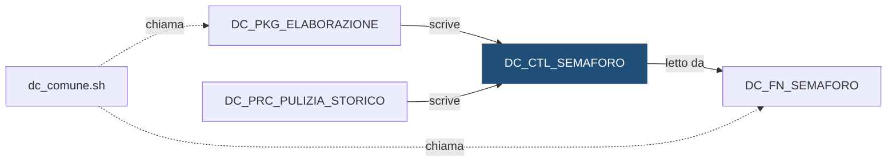

# Tabella: `DEMO_DWH.DC_CTL_SEMAFORO`

> ⚙️ **Scheda generata automaticamente, non modificare a mano.** Commit analizzato `c276f3f` del 2026-09-30. Le spiegazioni scritte a mano vanno nella nota accanto al sorgente.

## Descrizione

**Tipo:** Tabella di controllo

Semaforo dei flussi del motore. Una riga per ogni fonte da cui dipende un flusso, per banca e data di riferimento. Un flusso puo partire solo quando tutte le sue fonti sono pronte (FLG_PRONTO = 'S'). Letta da DC_FN_SEMAFORO, scritta da DC_PKG_ELABORAZIONE.SEGNA_PRONTO.

**Commento sul database:** DEMO_CONTI - Semaforo dei flussi per fonte, banca e data

## Struttura

| Campo | Tipo | Commento |
|---|---|---|
| `COD_FLUSSO` | VARCHAR2(30 CHAR) NOT NULL | Flusso che attende la fonte (DC_CARICO, DC_MOVIMENTI, DC_SALDI, DI_CARICO, DI_POSIZIONI) |
| `COD_FONTE` | VARCHAR2(30 CHAR) NOT NULL | Fonte attesa: sistema esterno (FONTE_A, FONTE_B, FONTE_C) o flusso a monte (es. DC_CARICO) |
| `COD_ISTITUTO` | VARCHAR2(5 CHAR) NOT NULL | Codice dell istituto (valori fittizi 99xxx) |
| `DAT_RIFERIMENTO` | DATE NOT NULL | Data di riferimento (il giorno del file; per i saldi l ultimo giorno del mese) |
| `FLG_PRONTO` | CHAR(1 CHAR) DEFAULT 'N' NOT NULL | S = fonte pronta, N = non ancora disponibile |
| `DAT_AGGIORNAMENTO` | DATE DEFAULT SYSDATE NOT NULL | Data e ora dell ultimo aggiornamento |
| `COD_UTENTE_AGG` | VARCHAR2(30 CHAR) DEFAULT USER NOT NULL | Utente che ha aggiornato la riga |

**Partizionamento e memorizzazione**

```sql
TABLESPACE DEMO_DWH_DATA
```

**Chiavi e vincoli**

| Nome | Tipo | Definizione | File |
|---|---|---|---|
| `DC_CTL_SEMAFORO_PK` | PRIMARY KEY | `(COD_FLUSSO, COD_FONTE, COD_ISTITUTO, DAT_RIFERIMENTO)` | [`sql/DEMO_DWH/CONSTRAINTS/DC_CTL_SEMAFORO.sql`](../../sql/DEMO_DWH/CONSTRAINTS/DC_CTL_SEMAFORO.sql) |
| `DC_CTL_SEMAFORO_CK_PRONTO` | CHECK | `(FLG_PRONTO IN ('S', 'N'))` | [`sql/DEMO_DWH/CONSTRAINTS/DC_CTL_SEMAFORO.sql`](../../sql/DEMO_DWH/CONSTRAINTS/DC_CTL_SEMAFORO.sql) |

## Chi scrive

| Chi scrive | Contesto | Campi | Dove |
|---|---|---|---|
| [`DC_PKG_ELABORAZIONE`](DC_PKG_ELABORAZIONE.md) | STATEMENT | COD_FLUSSO, COD_FONTE, COD_ISTITUTO, COD_UTENTE_AGG, DAT_AGGIORNAMENTO, DAT_RIFERIMENTO, FLG_PRONTO | [`sql/DEMO_DWH/PACKAGES/DC_PKG_ELABORAZIONE.sql:104`](../../sql/DEMO_DWH/PACKAGES/DC_PKG_ELABORAZIONE.sql) |
| [`DC_PRC_PULIZIA_STORICO`](DC_PRC_PULIZIA_STORICO.md) | STATEMENT | DAT_RIFERIMENTO | [`sql/DEMO_DWH/PROCEDURES/DC_PRC_PULIZIA_STORICO.sql:22`](../../sql/DEMO_DWH/PROCEDURES/DC_PRC_PULIZIA_STORICO.sql) |

## Chi legge

| Chi legge | Contesto | Campi | Dove |
|---|---|---|---|
| [`DC_FN_SEMAFORO`](DC_FN_SEMAFORO.md) | STATEMENT | COD_FLUSSO, COD_ISTITUTO, DAT_RIFERIMENTO, FLG_PRONTO | [`sql/DEMO_DWH/FUNCTIONS/DC_FN_SEMAFORO.sql:27`](../../sql/DEMO_DWH/FUNCTIONS/DC_FN_SEMAFORO.sql) |

## Impatti indiretti

Oggetti raggiunti a catena, a valle dei riferimenti diretti:

| Livello | Oggetto | Ruolo | Raggiunto da |
|---|---|---|---|
| 2 | [`dc_comune.sh`](dc_comune.md) | chiama | [`DC_FN_SEMAFORO`](DC_FN_SEMAFORO.md) |
| 3 | [`lancia_dc_carico_movimenti.sh`](lancia_dc_carico_movimenti.md) | chiama | [`dc_comune.sh`](dc_comune.md) |
| 3 | [`lancia_dc_movimenti.sh`](lancia_dc_movimenti.md) | chiama | [`dc_comune.sh`](dc_comune.md) |
| 3 | [`lancia_dc_saldi.sh`](lancia_dc_saldi.md) | chiama | [`dc_comune.sh`](dc_comune.md) |
| 3 | [`lancia_di_carico.sh`](lancia_di_carico.md) | chiama | [`dc_comune.sh`](dc_comune.md) |
| 3 | [`lancia_di_posizioni.sh`](lancia_di_posizioni.md) | chiama | [`dc_comune.sh`](dc_comune.md) |
| 4 | [`DC_FT_MOVIMENTI`](DC_FT_MOVIMENTI.md) | è scritto da | [`lancia_dc_movimenti.sh`](lancia_dc_movimenti.md) |
| 4 | [`DC_FT_SALDI_MENSILI`](DC_FT_SALDI_MENSILI.md) | è scritto da | [`lancia_dc_saldi.sh`](lancia_dc_saldi.md) |
| 4 | [`DC_STG_MOVIMENTI`](DC_STG_MOVIMENTI.md) | è scritto da | [`lancia_dc_carico_movimenti.sh`](lancia_dc_carico_movimenti.md) |
| 4 | [`DI_FT_CONTROVALORI_MENSILI`](DI_FT_CONTROVALORI_MENSILI.md) | è scritto da | [`lancia_di_posizioni.sh`](lancia_di_posizioni.md) |
| 4 | [`DI_FT_POSIZIONI`](DI_FT_POSIZIONI.md) | è scritto da | [`lancia_di_posizioni.sh`](lancia_di_posizioni.md) |
| 4 | [`DI_STG_ORDINI`](DI_STG_ORDINI.md) | è scritto da | [`lancia_di_carico.sh`](lancia_di_carico.md) |
| 4 | [`DI_STG_PREZZI`](DI_STG_PREZZI.md) | è scritto da | [`lancia_di_carico.sh`](lancia_di_carico.md) |
| 5 | [`DC_VC_QUADRATURA`](DC_VC_QUADRATURA.md) | legge | [`DC_FT_MOVIMENTI`](DC_FT_MOVIMENTI.md) |
| 5 | [`DC_VC_VOLUMI_GIORNALIERI`](DC_VC_VOLUMI_GIORNALIERI.md) | legge | [`DC_FT_MOVIMENTI`](DC_FT_MOVIMENTI.md) |
| 5 | [`DI_VC_QUADRATURA`](DI_VC_QUADRATURA.md) | legge | [`DI_FT_POSIZIONI`](DI_FT_POSIZIONI.md) |
| 5 | [`DI_VC_REGOLAMENTO_ORDINI`](DI_VC_REGOLAMENTO_ORDINI.md) | legge | [`DC_FT_MOVIMENTI`](DC_FT_MOVIMENTI.md) |
| 5 | [`wf_DC_MOVIMENTI`](wf_DC_MOVIMENTI.md) | legge | [`DC_STG_MOVIMENTI`](DC_STG_MOVIMENTI.md) |
| 5 | [`wf_DC_SALDI`](wf_DC_SALDI.md) | legge | [`DC_FT_MOVIMENTI`](DC_FT_MOVIMENTI.md) |
| 5 | [`wf_DI_POSIZIONI`](wf_DI_POSIZIONI.md) | legge | [`DI_FT_POSIZIONI`](DI_FT_POSIZIONI.md) |
| 6 | `APP_CONTROLLO_TITOLI` | consuma | [`DI_VC_REGOLAMENTO_ORDINI`](DI_VC_REGOLAMENTO_ORDINI.md) |
| 6 | `APP_REPORTING` | consuma | [`DC_VC_QUADRATURA`](DC_VC_QUADRATURA.md) |
| 6 | `UTENTI_CONTI` | consuma | [`DC_VC_QUADRATURA`](DC_VC_QUADRATURA.md) |
| 6 | `UTENTI_INVESTIMENTI` | consuma | [`DI_VC_QUADRATURA`](DI_VC_QUADRATURA.md) |

Diagramma dei primi due livelli:



## Note

Nota scritta a mano, da modificare nel repository: `sql/DEMO_DWH/TABLES/DC_CTL_SEMAFORO.md`

### Perché

Il semaforo esiste per non far partire un flusso su dati incompleti. Ogni flusso
aspetta una o più fonti, per istituto e data di riferimento, e parte solo quando
sono tutte pronte.

| Flusso (`COD_FLUSSO`) | Aspetta la fonte (`COD_FONTE`) | Chi la segna pronta |
|---|---|---|
| `DC_CARICO` | `FONTE_A` | Processo di ricezione file, fuori da questo repository |
| `DC_MOVIMENTI` | `DC_CARICO` | `lancia_dc_carico_movimenti.sh` a fine carico |
| `DC_SALDI` | `DC_MOVIMENTI` | `lancia_dc_movimenti.sh` a fine elaborazione |
| `DI_CARICO` | `FONTE_B` e `FONTE_C` | Processo di ricezione file, fuori da questo repository |
| `DI_POSIZIONI` | `DI_CARICO` | `lancia_di_carico.sh` a fine carico |

La tabella è **condivisa** con `DEMO_INVESTIMENTI`, che ha aggiunto i suoi due
flussi (`DI_CARICO` e `DI_POSIZIONI`) senza una copia propria. `DI_CARICO` ha
due fonti: per partire devono essere pronte entrambe.

### Attenzione

- La riga di `FONTE_A` non la scrive nessun oggetto del repository: arriva dal
  processo di ricezione file. Se manca, il carico resta fermo con semaforo KO.
- Carico e movimenti girano ogni giorno, i saldi una volta al mese: la riga di
  `DC_SALDI` che conta è quella dell'ultimo giorno del mese. I saldi partono
  quindi solo dopo aver caricato i movimenti di quel giorno.
- Chi modifica questa tabella o `DC_FN_SEMAFORO` cambia il comportamento di
  entrambi i motori: la scheda mostra gli impatti di tutti e due.
- Per sbloccare a mano un flusso si chiama `DC_PKG_ELABORAZIONE.SEGNA_PRONTO`,
  oppure si lancia la shell con `-f`, che salta il semaforo.

## Sorgente

[`sql/DEMO_DWH/TABLES/DC_CTL_SEMAFORO.sql`](../../sql/DEMO_DWH/TABLES/DC_CTL_SEMAFORO.sql)

## Limiti

L'analisi legge solo i file del repository. Non vede:

- **sinonimi** e **db link**: un oggetto letto tramite sinonimo o da un altro database non
  risulta collegato;
- **SQL dinamico**: le istruzioni costruite a runtime (`EXECUTE IMMEDIATE`, stringhe concatenate)
  sono segnalate come "da verificare", ma gli oggetti che toccano non sono noti;
- **oggetti non versionati**: tabelle, job o report che non stanno in questo repository
  (per esempio un cruscotto o un job di manutenzione dello schedulatore).

I risultati vanno sempre confermati con chi conosce il flusso.
