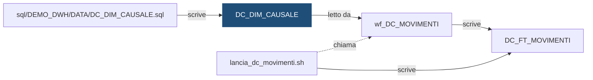

# Tabella: `DEMO_DWH.DC_DIM_CAUSALE`

> ⚙️ **Scheda generata automaticamente, non modificare a mano.** Commit analizzato `c276f3f` del 2026-09-30. Le spiegazioni scritte a mano vanno nella nota accanto al sorgente.

## Descrizione

**Tipo:** Tabella di dimensione (anagrafica)

Causali dei movimenti (bonifico, stipendio, prelievo, ...), con il segno che hanno sul saldo: + entra, - esce. Alimentata a mano (dati di configurazione), letta dal workflow dei movimenti.

**Commento sul database:** DEMO_CONTI - Anagrafica delle causali dei movimenti

## Struttura

| Campo | Tipo | Commento |
|---|---|---|
| `COD_CAUSALE` | VARCHAR2(20 CHAR) NOT NULL | Codice della causale (es. BONIFICO_IN, STIPENDIO, POS) |
| `DES_CAUSALE` | VARCHAR2(100 CHAR) NOT NULL | Descrizione della causale |
| `COD_SEGNO` | CHAR(1 CHAR) NOT NULL | Segno sul saldo: + il movimento fa entrare denaro, - lo fa uscire |
| `DAT_INIZIO_VALIDITA` | DATE NOT NULL | Data di inizio validita della causale |
| `DAT_FINE_VALIDITA` | DATE DEFAULT DATE '9999-12-31' NOT NULL | Data di fine validita (9999-12-31 = attiva) |
| `DAT_INSERIMENTO` | DATE DEFAULT SYSDATE NOT NULL | Data di inserimento del record |
| `COD_UTENTE_INS` | VARCHAR2(30 CHAR) DEFAULT USER NOT NULL | Utente che ha inserito il record |

**Partizionamento e memorizzazione**

```sql
TABLESPACE DEMO_DWH_DATA
```

**Chiavi e vincoli**

| Nome | Tipo | Definizione | File |
|---|---|---|---|
| `DC_DIM_CAUSALE_PK` | PRIMARY KEY | `(COD_CAUSALE, DAT_INIZIO_VALIDITA)` | [`sql/DEMO_DWH/CONSTRAINTS/DC_DIM_CAUSALE.sql`](../../sql/DEMO_DWH/CONSTRAINTS/DC_DIM_CAUSALE.sql) |
| `DC_DIM_CAUSALE_CK_SEGNO` | CHECK | `(COD_SEGNO IN ('+', '-'))` | [`sql/DEMO_DWH/CONSTRAINTS/DC_DIM_CAUSALE.sql`](../../sql/DEMO_DWH/CONSTRAINTS/DC_DIM_CAUSALE.sql) |

## Chi scrive

| Chi scrive | Contesto | Campi | Dove |
|---|---|---|---|
| script [`sql/DEMO_DWH/DATA/DC_DIM_CAUSALE.sql`](../../sql/DEMO_DWH/DATA/DC_DIM_CAUSALE.sql) | STATEMENT | COD_CAUSALE, COD_SEGNO, DAT_INIZIO_VALIDITA, DES_CAUSALE | [`sql/DEMO_DWH/DATA/DC_DIM_CAUSALE.sql:3`](../../sql/DEMO_DWH/DATA/DC_DIM_CAUSALE.sql) |

## Chi legge

| Chi legge | Contesto | Campi | Dove |
|---|---|---|---|
| [`wf_DC_MOVIMENTI`](wf_DC_MOVIMENTI.md) | LOOKUP | COD_CAUSALE, COD_SEGNO, DAT_FINE_VALIDITA, DAT_INIZIO_VALIDITA | [`powercenter/DEMO_CONTI/wf_DC_MOVIMENTI.xml:53`](../../powercenter/DEMO_CONTI/wf_DC_MOVIMENTI.xml) |

## Impatti indiretti

Oggetti raggiunti a catena, a valle dei riferimenti diretti:

| Livello | Oggetto | Ruolo | Raggiunto da |
|---|---|---|---|
| 2 | [`DC_FT_MOVIMENTI`](DC_FT_MOVIMENTI.md) | è scritto da | [`wf_DC_MOVIMENTI`](wf_DC_MOVIMENTI.md) |
| 2 | [`lancia_dc_movimenti.sh`](lancia_dc_movimenti.md) | chiama | [`wf_DC_MOVIMENTI`](wf_DC_MOVIMENTI.md) |
| 3 | [`DC_VC_QUADRATURA`](DC_VC_QUADRATURA.md) | legge | [`DC_FT_MOVIMENTI`](DC_FT_MOVIMENTI.md) |
| 3 | [`DC_VC_VOLUMI_GIORNALIERI`](DC_VC_VOLUMI_GIORNALIERI.md) | legge | [`DC_FT_MOVIMENTI`](DC_FT_MOVIMENTI.md) |
| 3 | [`DI_VC_REGOLAMENTO_ORDINI`](DI_VC_REGOLAMENTO_ORDINI.md) | legge | [`DC_FT_MOVIMENTI`](DC_FT_MOVIMENTI.md) |
| 3 | [`wf_DC_SALDI`](wf_DC_SALDI.md) | legge | [`DC_FT_MOVIMENTI`](DC_FT_MOVIMENTI.md) |
| 4 | `APP_CONTROLLO_TITOLI` | consuma | [`DI_VC_REGOLAMENTO_ORDINI`](DI_VC_REGOLAMENTO_ORDINI.md) |
| 4 | `APP_REPORTING` | consuma | [`DC_VC_QUADRATURA`](DC_VC_QUADRATURA.md) |
| 4 | [`DC_FT_SALDI_MENSILI`](DC_FT_SALDI_MENSILI.md) | è scritto da | [`wf_DC_SALDI`](wf_DC_SALDI.md) |
| 4 | `UTENTI_CONTI` | consuma | [`DC_VC_QUADRATURA`](DC_VC_QUADRATURA.md) |
| 4 | [`lancia_dc_saldi.sh`](lancia_dc_saldi.md) | chiama | [`wf_DC_SALDI`](wf_DC_SALDI.md) |

Diagramma dei primi due livelli:



## Note

Nota scritta a mano, da modificare nel repository: `sql/DEMO_DWH/TABLES/DC_DIM_CAUSALE.md`

### Perché

Il segno della causale decide se un movimento fa entrare o uscire denaro. Nel
file della fonte l'importo arriva sempre positivo: è la causale a dire se va
sommato o sottratto. Così il segno sta in un solo posto e non può essere
scritto diversamente da un flusso all'altro.

Causali previste nella configurazione iniziale:

| Codice | Descrizione | Segno |
|---|---|---|
| `BONIFICO_IN` | Bonifico in entrata | + |
| `BONIFICO_OUT` | Bonifico in uscita | − |
| `STIPENDIO` | Accredito dello stipendio | + |
| `POS` | Pagamento con carta | − |
| `PRELIEVO` | Prelievo di contanti | − |
| `ACQUISTO_TITOLI` | Acquisto di titoli | − |
| `VENDITA_TITOLI` | Vendita di titoli | + |
| `STORNO` | Storno di un movimento precedente | − |

### Attenzione

- La tabella si aggiorna a mano, come una dimensione storicizzata: una modifica
  chiude la riga attiva valorizzando `DAT_FINE_VALIDITA` e ne inserisce una
  nuova. Non si fanno `UPDATE` sul segno di una riga attiva, altrimenti i
  ricaricamenti dei giorni passati cambierebbero risultato.
- Una causale che qui non esiste non viene caricata dal flusso dei movimenti:
  il movimento resta fuori e la quadratura tra staging e movimenti va in `KO`.
  Prima di rilanciare si aggiunge la causale.
- Nella demo lo storno ha sempre segno −, cioè riduce il saldo.
- I valori iniziali sono nel file `sql/DEMO_DWH/DATA/DC_DIM_CAUSALE.sql`.

## Sorgente

[`sql/DEMO_DWH/TABLES/DC_DIM_CAUSALE.sql`](../../sql/DEMO_DWH/TABLES/DC_DIM_CAUSALE.sql)

## Limiti

L'analisi legge solo i file del repository. Non vede:

- **sinonimi** e **db link**: un oggetto letto tramite sinonimo o da un altro database non
  risulta collegato;
- **SQL dinamico**: le istruzioni costruite a runtime (`EXECUTE IMMEDIATE`, stringhe concatenate)
  sono segnalate come "da verificare", ma gli oggetti che toccano non sono noti;
- **oggetti non versionati**: tabelle, job o report che non stanno in questo repository
  (per esempio un cruscotto o un job di manutenzione dello schedulatore).

I risultati vanno sempre confermati con chi conosce il flusso.
