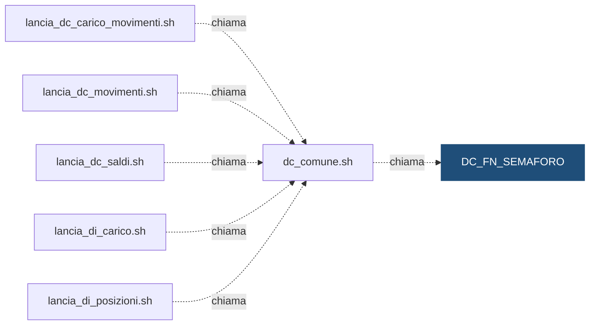

# Funzione: `DEMO_DWH.DC_FN_SEMAFORO`

> ⚙️ **Scheda generata automaticamente, non modificare a mano.** Commit analizzato `c276f3f` del 2026-09-30. Le spiegazioni scritte a mano vanno nella nota accanto al sorgente.

## Descrizione

**Tipo:** Funzione

Dice se un flusso puo partire per una banca e una data di riferimento. Restituisce 'OK' se in DC_CTL_SEMAFORO esiste almeno una fonte per (flusso, istituto, data) e sono tutte pronte; altrimenti 'KO'.

## Struttura

| Nome | Tipo | Parametri | Restituisce | Descrizione |
|---|---|---|---|---|
| `DC_FN_SEMAFORO` | function | `p_cod_flusso` IN VARCHAR2; `p_cod_istituto` IN VARCHAR2; `p_dat_riferimento` IN DATE | VARCHAR2 | — |

## Chi lo chiama

| Chiamante | Contesto | Campi | Dove |
|---|---|---|---|
| [`dc_comune.sh`](dc_comune.md) | STATEMENT | — | [`script/demo_conti/dc_comune.sh:84`](../../script/demo_conti/dc_comune.sh) |

## Cosa legge

| Oggetto letto | Contesto | Campi | Dove |
|---|---|---|---|
| [`DC_CTL_SEMAFORO`](DC_CTL_SEMAFORO.md) | STATEMENT | COD_FLUSSO, COD_ISTITUTO, DAT_RIFERIMENTO, FLG_PRONTO | [`sql/DEMO_DWH/FUNCTIONS/DC_FN_SEMAFORO.sql:27`](../../sql/DEMO_DWH/FUNCTIONS/DC_FN_SEMAFORO.sql) |

## Impatti indiretti

Oggetti raggiunti a catena, a valle dei riferimenti diretti:

| Livello | Oggetto | Ruolo | Raggiunto da |
|---|---|---|---|
| 2 | [`lancia_dc_carico_movimenti.sh`](lancia_dc_carico_movimenti.md) | chiama | [`dc_comune.sh`](dc_comune.md) |
| 2 | [`lancia_dc_movimenti.sh`](lancia_dc_movimenti.md) | chiama | [`dc_comune.sh`](dc_comune.md) |
| 2 | [`lancia_dc_saldi.sh`](lancia_dc_saldi.md) | chiama | [`dc_comune.sh`](dc_comune.md) |
| 2 | [`lancia_di_carico.sh`](lancia_di_carico.md) | chiama | [`dc_comune.sh`](dc_comune.md) |
| 2 | [`lancia_di_posizioni.sh`](lancia_di_posizioni.md) | chiama | [`dc_comune.sh`](dc_comune.md) |
| 3 | [`DC_FT_MOVIMENTI`](DC_FT_MOVIMENTI.md) | è scritto da | [`lancia_dc_movimenti.sh`](lancia_dc_movimenti.md) |
| 3 | [`DC_FT_SALDI_MENSILI`](DC_FT_SALDI_MENSILI.md) | è scritto da | [`lancia_dc_saldi.sh`](lancia_dc_saldi.md) |
| 3 | [`DC_STG_MOVIMENTI`](DC_STG_MOVIMENTI.md) | è scritto da | [`lancia_dc_carico_movimenti.sh`](lancia_dc_carico_movimenti.md) |
| 3 | [`DI_FT_CONTROVALORI_MENSILI`](DI_FT_CONTROVALORI_MENSILI.md) | è scritto da | [`lancia_di_posizioni.sh`](lancia_di_posizioni.md) |
| 3 | [`DI_FT_POSIZIONI`](DI_FT_POSIZIONI.md) | è scritto da | [`lancia_di_posizioni.sh`](lancia_di_posizioni.md) |
| 3 | [`DI_STG_ORDINI`](DI_STG_ORDINI.md) | è scritto da | [`lancia_di_carico.sh`](lancia_di_carico.md) |
| 3 | [`DI_STG_PREZZI`](DI_STG_PREZZI.md) | è scritto da | [`lancia_di_carico.sh`](lancia_di_carico.md) |
| 4 | [`DC_VC_QUADRATURA`](DC_VC_QUADRATURA.md) | legge | [`DC_FT_MOVIMENTI`](DC_FT_MOVIMENTI.md) |
| 4 | [`DC_VC_VOLUMI_GIORNALIERI`](DC_VC_VOLUMI_GIORNALIERI.md) | legge | [`DC_FT_MOVIMENTI`](DC_FT_MOVIMENTI.md) |
| 4 | [`DI_VC_QUADRATURA`](DI_VC_QUADRATURA.md) | legge | [`DI_FT_POSIZIONI`](DI_FT_POSIZIONI.md) |
| 4 | [`DI_VC_REGOLAMENTO_ORDINI`](DI_VC_REGOLAMENTO_ORDINI.md) | legge | [`DC_FT_MOVIMENTI`](DC_FT_MOVIMENTI.md) |
| 4 | [`wf_DC_MOVIMENTI`](wf_DC_MOVIMENTI.md) | legge | [`DC_STG_MOVIMENTI`](DC_STG_MOVIMENTI.md) |
| 4 | [`wf_DC_SALDI`](wf_DC_SALDI.md) | legge | [`DC_FT_MOVIMENTI`](DC_FT_MOVIMENTI.md) |
| 4 | [`wf_DI_POSIZIONI`](wf_DI_POSIZIONI.md) | legge | [`DI_FT_POSIZIONI`](DI_FT_POSIZIONI.md) |
| 5 | `APP_CONTROLLO_TITOLI` | consuma | [`DI_VC_REGOLAMENTO_ORDINI`](DI_VC_REGOLAMENTO_ORDINI.md) |
| 5 | `APP_REPORTING` | consuma | [`DC_VC_QUADRATURA`](DC_VC_QUADRATURA.md) |
| 5 | `UTENTI_CONTI` | consuma | [`DC_VC_QUADRATURA`](DC_VC_QUADRATURA.md) |
| 5 | `UTENTI_INVESTIMENTI` | consuma | [`DI_VC_QUADRATURA`](DI_VC_QUADRATURA.md) |

Diagramma dei primi due livelli:



## Note

Nota scritta a mano, da modificare nel repository: `sql/DEMO_DWH/FUNCTIONS/DC_FN_SEMAFORO.md`

### Attenzione

Con esito `KO` la shell di lancio esce con return code `2`: lo schedulatore mette
il job in attesa e lo ritenta più tardi.

### Query utili

```sql
SELECT DEMO_DWH.DC_FN_SEMAFORO('DC_MOVIMENTI', '99001', DATE '2026-09-29') FROM DUAL;
```

## Sorgente

[`sql/DEMO_DWH/FUNCTIONS/DC_FN_SEMAFORO.sql`](../../sql/DEMO_DWH/FUNCTIONS/DC_FN_SEMAFORO.sql)

## Limiti

L'analisi legge solo i file del repository. Non vede:

- **sinonimi** e **db link**: un oggetto letto tramite sinonimo o da un altro database non
  risulta collegato;
- **SQL dinamico**: le istruzioni costruite a runtime (`EXECUTE IMMEDIATE`, stringhe concatenate)
  sono segnalate come "da verificare", ma gli oggetti che toccano non sono noti;
- **oggetti non versionati**: tabelle, job o report che non stanno in questo repository
  (per esempio un cruscotto o un job di manutenzione dello schedulatore).

I risultati vanno sempre confermati con chi conosce il flusso.
