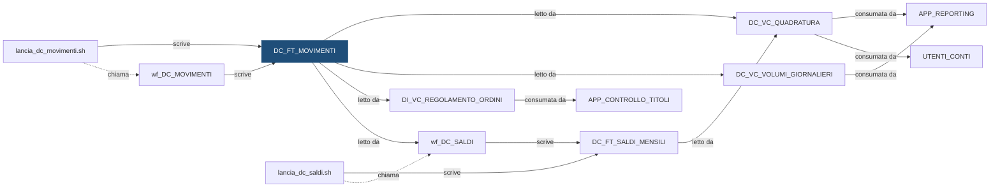

# Tabella: `DEMO_DWH.DC_FT_MOVIMENTI`

> ⚙️ **Scheda generata automaticamente, non modificare a mano.** Commit analizzato `c276f3f` del 2026-09-30. Le spiegazioni scritte a mano vanno nella nota accanto al sorgente.

## Descrizione

**Tipo:** Tabella target (fatti) - movimenti

Movimenti dei conti, senza doppioni, con la causale e il segno (+ entra, - esce). Conserva lo storico mensile per ogni banca. Partizioni mensili create in automatico (INTERVAL) e sottopartizioni per istituto: si puo svuotare solo la coppia (mese, banca) da rifare.

**Commento sul database:** DEMO_CONTI - Movimenti dei conti con causale e segno

## Struttura

| Campo | Tipo | Commento |
|---|---|---|
| `COD_ISTITUTO` | VARCHAR2(5 CHAR) NOT NULL | Codice dell istituto (valori fittizi 99xxx) - chiave di sottopartizione |
| `DAT_CONTABILE` | DATE NOT NULL | Data contabile del movimento - chiave di partizione (un mese per partizione) |
| `ID_MOVIMENTO` | VARCHAR2(30 CHAR) NOT NULL | Identificativo del movimento nel sistema fonte (unico per istituto) |
| `COD_CONTO` | VARCHAR2(20 CHAR) NOT NULL | Codice del conto |
| `COD_CAUSALE` | VARCHAR2(20 CHAR) NOT NULL | Causale del movimento (DC_DIM_CAUSALE) |
| `COD_SEGNO` | CHAR(1 CHAR) NOT NULL | Segno della causale: + entra, - esce |
| `IMP_MOVIMENTO` | NUMBER(18,2) NOT NULL | Importo del movimento, sempre positivo |
| `IMP_CON_SEGNO` | NUMBER(18,2) NOT NULL | Importo con il segno: IMP_MOVIMENTO se entra, -IMP_MOVIMENTO se esce |
| `DAT_VALUTA` | DATE NOT NULL | Data valuta: il giorno da cui decorrono gli interessi |
| `ID_ELABORAZIONE` | NUMBER(12) NOT NULL | Identificativo dell elaborazione che ha caricato il record |
| `DAT_CARICAMENTO` | DATE DEFAULT SYSDATE NOT NULL | Data e ora di caricamento del record |

**Partizionamento e memorizzazione**

```sql
TABLESPACE DEMO_DWH_DATA
PARTITION BY RANGE (DAT_CONTABILE)
INTERVAL (NUMTOYMINTERVAL(1, 'MONTH'))
SUBPARTITION BY LIST (COD_ISTITUTO)
SUBPARTITION TEMPLATE
(
    SUBPARTITION SP_99001   VALUES ('99001'),
    SUBPARTITION SP_99002   VALUES ('99002'),
    SUBPARTITION SP_99003   VALUES ('99003'),
    SUBPARTITION SP_DEFAULT VALUES (DEFAULT)
)
(
    PARTITION P_INIZIALE VALUES LESS THAN (DATE '2026-01-01')
)
```

## Chi scrive

| Chi scrive | Contesto | Campi | Dove |
|---|---|---|---|
| [`lancia_dc_movimenti.sh`](lancia_dc_movimenti.md) | STATEMENT | COD_ISTITUTO, DAT_CONTABILE | [`script/demo_conti/lancia_dc_movimenti.sh:22`](../../script/demo_conti/lancia_dc_movimenti.sh) |
| [`wf_DC_MOVIMENTI`](wf_DC_MOVIMENTI.md) | TARGET | COD_CAUSALE, COD_CONTO, COD_ISTITUTO, COD_SEGNO, DAT_CONTABILE, DAT_VALUTA, ID_ELABORAZIONE, ID_MOVIMENTO, IMP_CON_SEGNO, IMP_MOVIMENTO | [`powercenter/DEMO_CONTI/wf_DC_MOVIMENTI.xml:27`](../../powercenter/DEMO_CONTI/wf_DC_MOVIMENTI.xml) |

## Chi legge

| Chi legge | Contesto | Campi | Dove |
|---|---|---|---|
| [`DC_VC_QUADRATURA`](DC_VC_QUADRATURA.md) | STATEMENT | COD_ISTITUTO, DAT_CONTABILE, ID_MOVIMENTO | [`sql/DEMO_DWH/VIEWS/DC_VC_QUADRATURA.sql:27`](../../sql/DEMO_DWH/VIEWS/DC_VC_QUADRATURA.sql) |
| [`DC_VC_VOLUMI_GIORNALIERI`](DC_VC_VOLUMI_GIORNALIERI.md) | STATEMENT | COD_ISTITUTO, DAT_CONTABILE | [`sql/DEMO_DWH/VIEWS/DC_VC_VOLUMI_GIORNALIERI.sql:31`](../../sql/DEMO_DWH/VIEWS/DC_VC_VOLUMI_GIORNALIERI.sql) |
| [`DI_VC_REGOLAMENTO_ORDINI`](DI_VC_REGOLAMENTO_ORDINI.md) | STATEMENT | COD_CAUSALE, COD_CONTO, COD_ISTITUTO, DAT_CONTABILE, IMP_MOVIMENTO | [`sql/DEMO_DWH/VIEWS/DI_VC_REGOLAMENTO_ORDINI.sql:27`](../../sql/DEMO_DWH/VIEWS/DI_VC_REGOLAMENTO_ORDINI.sql) |
| [`wf_DC_SALDI`](wf_DC_SALDI.md) | SOURCE | COD_CONTO, COD_ISTITUTO, COD_SEGNO, DAT_CONTABILE, IMP_CON_SEGNO, IMP_MOVIMENTO | [`powercenter/DEMO_CONTI/wf_DC_SALDI.xml:15`](../../powercenter/DEMO_CONTI/wf_DC_SALDI.xml) |
| [`wf_DC_SALDI`](wf_DC_SALDI.md) | SQL_OVERRIDE | COD_CONTO, COD_ISTITUTO, COD_SEGNO, DAT_CONTABILE, IMP_CON_SEGNO, IMP_MOVIMENTO | [`powercenter/DEMO_CONTI/wf_DC_SALDI.xml:41`](../../powercenter/DEMO_CONTI/wf_DC_SALDI.xml) |

## Impatti indiretti

Oggetti raggiunti a catena, a valle dei riferimenti diretti:

| Livello | Oggetto | Ruolo | Raggiunto da |
|---|---|---|---|
| 2 | `APP_CONTROLLO_TITOLI` | consuma | [`DI_VC_REGOLAMENTO_ORDINI`](DI_VC_REGOLAMENTO_ORDINI.md) |
| 2 | `APP_REPORTING` | consuma | [`DC_VC_QUADRATURA`](DC_VC_QUADRATURA.md) |
| 2 | [`DC_FT_SALDI_MENSILI`](DC_FT_SALDI_MENSILI.md) | è scritto da | [`wf_DC_SALDI`](wf_DC_SALDI.md) |
| 2 | `UTENTI_CONTI` | consuma | [`DC_VC_QUADRATURA`](DC_VC_QUADRATURA.md) |
| 2 | [`lancia_dc_saldi.sh`](lancia_dc_saldi.md) | chiama | [`wf_DC_SALDI`](wf_DC_SALDI.md) |

Diagramma dei primi due livelli:



## Note

Nota scritta a mano, da modificare nel repository: `sql/DEMO_DWH/TABLES/DC_FT_MOVIMENTI.md`

### Perché

**Partizioni create da sole.** La tabella è partizionata per mese con `INTERVAL`:
il primo movimento di un nuovo mese fa creare a Oracle la partizione del mese,
con tutte le sottopartizioni per istituto del `SUBPARTITION TEMPLATE`. A inizio
mese non serve nessun intervento manuale.

**Gli storni non si cancellano.** Se un movimento va annullato, non si cancella
la riga: si aggiunge un nuovo movimento con causale `STORNO`, cioè di segno
opposto. Così lo storico resta vero: chi ha guardato il saldo ieri può
ritrovare gli stessi numeri e vedere che oggi è arrivato lo storno.

**Data contabile e data valuta.** La data contabile (`DAT_CONTABILE`) dice in
quale giorno il movimento conta per il saldo, ed è la data che partiziona la
tabella e che usano i saldi mensili. La data valuta (`DAT_VALUTA`) dice da
quando decorrono gli interessi: serve al loro calcolo, non ai saldi.

**Niente doppioni.** Il file della fonte può contenere lo stesso movimento più
volte: il flusso `wf_DC_MOVIMENTI` ne tiene uno solo, riconoscendolo
dall'identificativo (`ID_MOVIMENTO`).

**Ricaricare un mese intero.** Il rilancio di un singolo giorno cancella solo le
righe di quel giorno, e la shell `lancia_dc_movimenti.sh` lo fa da sola. Per
rifare un mese intero di una banca si svuota la sola coppia (mese, istituto):

```sql
ALTER TABLE DEMO_DWH.DC_FT_MOVIMENTI
  TRUNCATE SUBPARTITION FOR (DATE '2026-09-15', '99001');
```

Poi si rilanciano i giorni del mese. Il `FOR (data, istituto)` è una scelta
obbligata: le partizioni create da `INTERVAL` hanno nomi generati dal sistema
(`SYS_P…`), diversi da un ambiente all'altro. La sintassi `FOR` individua la
sottopartizione dai valori, con una data qualsiasi del mese, senza dover
conoscere il nome.

### Attenzione

- Un istituto che finisce nella sottopartizione `SP_DEFAULT` non si può
  ricaricare da solo (vale la stessa avvertenza di `DC_STG_MOVIMENTI`). Per un
  nuovo istituto va aggiunto il valore al `SUBPARTITION TEMPLATE`, che vale per i
  mesi futuri, e vanno divise le `SP_DEFAULT` dei mesi già esistenti con `SPLIT
  SUBPARTITION`.
- Gli importi restano nella divisa del conto: non c'è conversione.
- La tabella è letta anche da un cruscotto per il servizio clienti, fuori da
  questo repository: l'analisi d'impatto non lo vede.

## Sorgente

[`sql/DEMO_DWH/TABLES/DC_FT_MOVIMENTI.sql`](../../sql/DEMO_DWH/TABLES/DC_FT_MOVIMENTI.sql)

## Limiti

L'analisi legge solo i file del repository. Non vede:

- **sinonimi** e **db link**: un oggetto letto tramite sinonimo o da un altro database non
  risulta collegato;
- **SQL dinamico**: le istruzioni costruite a runtime (`EXECUTE IMMEDIATE`, stringhe concatenate)
  sono segnalate come "da verificare", ma gli oggetti che toccano non sono noti;
- **oggetti non versionati**: tabelle, job o report che non stanno in questo repository
  (per esempio un cruscotto o un job di manutenzione dello schedulatore).

I risultati vanno sempre confermati con chi conosce il flusso.
