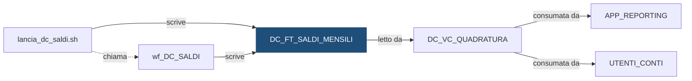

# Tabella: `DEMO_DWH.DC_FT_SALDI_MENSILI`

> ⚙️ **Scheda generata automaticamente, non modificare a mano.** Commit analizzato `c276f3f` del 2026-09-30. Le spiegazioni scritte a mano vanno nella nota accanto al sorgente.

## Descrizione

**Tipo:** Tabella target (fatti) - saldi mensili

Per ogni conto e mese: saldo iniziale, entrate, uscite e saldo finale (l'estratto conto). Conserva lo storico mensile per ogni banca. Partizioni mensili create in automatico (INTERVAL) e sottopartizioni per istituto: il ricaricamento svuota solo la coppia (mese, banca) in lavorazione.

**Commento sul database:** DEMO_CONTI - Saldi mensili per conto (estratto conto)

## Struttura

| Campo | Tipo | Commento |
|---|---|---|
| `COD_ISTITUTO` | VARCHAR2(5 CHAR) NOT NULL | Codice dell istituto (valori fittizi 99xxx) - chiave di sottopartizione |
| `DAT_RIFERIMENTO` | DATE NOT NULL | Data di riferimento (ultimo giorno del mese) - chiave di partizione |
| `COD_CONTO` | VARCHAR2(20 CHAR) NOT NULL | Codice del conto |
| `IMP_SALDO_INIZIALE` | NUMBER(18,2) NOT NULL | Saldo a inizio mese: somma dei movimenti con data contabile precedente al mese |
| `IMP_ENTRATE` | NUMBER(18,2) NOT NULL | Somma dei movimenti che fanno entrare denaro nel mese |
| `IMP_USCITE` | NUMBER(18,2) NOT NULL | Somma dei movimenti che fanno uscire denaro nel mese (importo positivo) |
| `IMP_SALDO_FINALE` | NUMBER(18,2) NOT NULL | Saldo a fine mese: somma di tutti i movimenti fino all ultimo giorno del mese |
| `ID_ELABORAZIONE` | NUMBER(12) NOT NULL | Identificativo dell elaborazione (DC_LOG_ELABORAZIONI) |
| `DAT_CARICAMENTO` | DATE DEFAULT SYSDATE NOT NULL | Data e ora di caricamento del record |

**Partizionamento e memorizzazione**

```sql
TABLESPACE DEMO_DWH_DATA
PARTITION BY RANGE (DAT_RIFERIMENTO)
INTERVAL (NUMTOYMINTERVAL(1, 'MONTH'))
SUBPARTITION BY LIST (COD_ISTITUTO)
SUBPARTITION TEMPLATE
(
    SUBPARTITION SP_99001   VALUES ('99001'),
    SUBPARTITION SP_99002   VALUES ('99002'),
    SUBPARTITION SP_99003   VALUES ('99003'),
    SUBPARTITION SP_DEFAULT VALUES (DEFAULT)
)
(
    PARTITION P_INIZIALE VALUES LESS THAN (DATE '2026-01-01')
)
```

## Chi scrive

| Chi scrive | Contesto | Campi | Dove |
|---|---|---|---|
| [`lancia_dc_saldi.sh`](lancia_dc_saldi.md) | STATEMENT | — | [`script/demo_conti/lancia_dc_saldi.sh:35`](../../script/demo_conti/lancia_dc_saldi.sh) |
| [`wf_DC_SALDI`](wf_DC_SALDI.md) | TARGET | COD_CONTO, COD_ISTITUTO, DAT_RIFERIMENTO, ID_ELABORAZIONE, IMP_ENTRATE, IMP_SALDO_FINALE, IMP_SALDO_INIZIALE, IMP_USCITE | [`powercenter/DEMO_CONTI/wf_DC_SALDI.xml:25`](../../powercenter/DEMO_CONTI/wf_DC_SALDI.xml) |

## Chi legge

| Chi legge | Contesto | Campi | Dove |
|---|---|---|---|
| [`DC_VC_QUADRATURA`](DC_VC_QUADRATURA.md) | STATEMENT | COD_ISTITUTO, DAT_RIFERIMENTO, IMP_ENTRATE, IMP_SALDO_FINALE, IMP_SALDO_INIZIALE, IMP_USCITE | [`sql/DEMO_DWH/VIEWS/DC_VC_QUADRATURA.sql:36`](../../sql/DEMO_DWH/VIEWS/DC_VC_QUADRATURA.sql) |

## Impatti indiretti

Oggetti raggiunti a catena, a valle dei riferimenti diretti:

| Livello | Oggetto | Ruolo | Raggiunto da |
|---|---|---|---|
| 2 | `APP_REPORTING` | consuma | [`DC_VC_QUADRATURA`](DC_VC_QUADRATURA.md) |
| 2 | `UTENTI_CONTI` | consuma | [`DC_VC_QUADRATURA`](DC_VC_QUADRATURA.md) |

Diagramma dei primi due livelli:



## Note

Nota scritta a mano, da modificare nel repository: `sql/DEMO_DWH/TABLES/DC_FT_SALDI_MENSILI.md`

### Perché

**Il saldo finale non si ricava dalla formula.** Saldo iniziale e saldo finale
si calcolano entrambi sommando i movimenti, ciascuno fino alla propria data.
Entrate e uscite si sommano a parte. Per questo la vista di controllo
`DC_VC_QUADRATURA` può verificare che `saldo iniziale + entrate − uscite = saldo
finale`: sono tre calcoli indipendenti, non uno scritto in funzione dell'altro.

**Data contabile, non data valuta.** I saldi mensili usano la data contabile
del movimento. La data valuta serve al calcolo degli interessi e qui non
compare: un movimento contabilizzato il 30 con valuta 2 del mese dopo conta nel
saldo del mese in cui è stato contabilizzato.

**Ricaricamento mirato.** La shell `lancia_dc_saldi.sh` riceve `-i <ISTITUTO|ALL>`
e, prima di lanciare il workflow, svuota solo la coppia (mese, istituto) in
lavorazione, lasciando intatti gli altri mesi e gli altri istituti:

```sql
ALTER TABLE DEMO_DWH.DC_FT_SALDI_MENSILI
  TRUNCATE SUBPARTITION FOR (DATE '2026-08-31', '99001');
```

Il `FOR (data, istituto)` serve perché le partizioni create da `INTERVAL`
hanno nomi generati dal sistema (`SYS_P…`), diversi da un ambiente all'altro:
con i valori non serve conoscere il nome.

### Attenzione

- I saldi si ricalcolano sempre sull'intera storia dei movimenti. Se un mese
  passato riceve un movimento in ritardo o uno storno, vanno rilanciati i saldi
  di quel mese e dei mesi successivi, in ordine.
- Un istituto che finisce nella sottopartizione `SP_DEFAULT` non si può
  ricaricare da solo (vale la stessa avvertenza di `DC_FT_MOVIMENTI`).
- La storia parte dal 2026: per la demo non ci sono saldi di apertura, il primo
  saldo iniziale è zero.
- La tabella alimenta gli estratti conto, fuori da questo repository:
  l'analisi d'impatto non li vede.

## Sorgente

[`sql/DEMO_DWH/TABLES/DC_FT_SALDI_MENSILI.sql`](../../sql/DEMO_DWH/TABLES/DC_FT_SALDI_MENSILI.sql)

## Limiti

L'analisi legge solo i file del repository. Non vede:

- **sinonimi** e **db link**: un oggetto letto tramite sinonimo o da un altro database non
  risulta collegato;
- **SQL dinamico**: le istruzioni costruite a runtime (`EXECUTE IMMEDIATE`, stringhe concatenate)
  sono segnalate come "da verificare", ma gli oggetti che toccano non sono noti;
- **oggetti non versionati**: tabelle, job o report che non stanno in questo repository
  (per esempio un cruscotto o un job di manutenzione dello schedulatore).

I risultati vanno sempre confermati con chi conosce il flusso.
