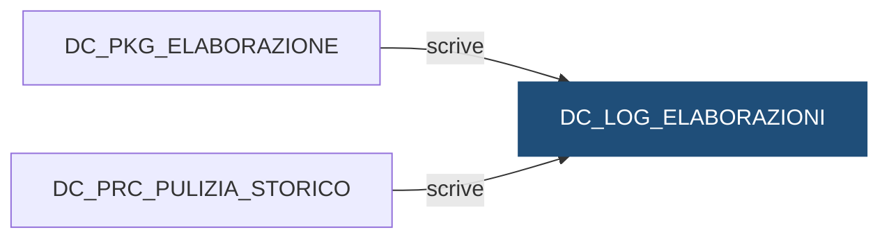

# Tabella: `DEMO_DWH.DC_LOG_ELABORAZIONI`

> ⚙️ **Scheda generata automaticamente, non modificare a mano.** Commit analizzato `c276f3f` del 2026-09-30. Le spiegazioni scritte a mano vanno nella nota accanto al sorgente.

## Descrizione

**Tipo:** Tabella di log

Una riga per ogni esecuzione di un flusso del motore su una banca e una data di riferimento. Lo stato passa da 'running' a 'succeeded' o 'failed'. L'identificativo finisce in ID_ELABORAZIONE delle tabelle alimentate.

**Commento sul database:** DEMO_CONTI - Log delle esecuzioni dei flussi

## Struttura

| Campo | Tipo | Commento |
|---|---|---|
| `ID_ELABORAZIONE` | NUMBER(12) NOT NULL | Identificativo dell elaborazione (sequence DC_SEQ_ELABORAZIONE) |
| `COD_FLUSSO` | VARCHAR2(30 CHAR) NOT NULL | Flusso eseguito (DC_CARICO, DC_MOVIMENTI, DC_SALDI, DI_CARICO, DI_POSIZIONI) |
| `COD_ISTITUTO` | VARCHAR2(5 CHAR) NOT NULL | Codice dell istituto elaborato |
| `DAT_RIFERIMENTO` | DATE NOT NULL | Data di riferimento elaborata |
| `COD_STATO` | VARCHAR2(10 CHAR) NOT NULL | running / succeeded / failed |
| `FLG_FORZA` | CHAR(1 CHAR) DEFAULT 'N' NOT NULL | S = lanciata con FORZA (semaforo saltato) |
| `DAT_INIZIO` | DATE DEFAULT SYSDATE NOT NULL | Inizio dell elaborazione |
| `DAT_FINE` | DATE | Fine dell elaborazione (vuota se ancora running) |
| `DES_ERRORE` | VARCHAR2(4000 CHAR) | Messaggio di errore se failed |
| `COD_UTENTE_OS` | VARCHAR2(30 CHAR) | Utente di sistema operativo che ha lanciato la shell |

**Partizionamento e memorizzazione**

```sql
TABLESPACE DEMO_DWH_DATA
```

**Chiavi e vincoli**

| Nome | Tipo | Definizione | File |
|---|---|---|---|
| `DC_LOG_ELABORAZIONI_PK` | PRIMARY KEY | `(ID_ELABORAZIONE)` | [`sql/DEMO_DWH/CONSTRAINTS/DC_LOG_ELABORAZIONI.sql`](../../sql/DEMO_DWH/CONSTRAINTS/DC_LOG_ELABORAZIONI.sql) |
| `DC_LOG_ELABORAZIONI_CK_STATO` | CHECK | `(COD_STATO IN ('running', 'succeeded', 'failed'))` | [`sql/DEMO_DWH/CONSTRAINTS/DC_LOG_ELABORAZIONI.sql`](../../sql/DEMO_DWH/CONSTRAINTS/DC_LOG_ELABORAZIONI.sql) |

## Chi scrive

| Chi scrive | Contesto | Campi | Dove |
|---|---|---|---|
| [`DC_PKG_ELABORAZIONE`](DC_PKG_ELABORAZIONE.md) | STATEMENT | COD_FLUSSO, COD_ISTITUTO, COD_STATO, COD_UTENTE_OS, DAT_FINE, DAT_INIZIO, DAT_RIFERIMENTO, DES_ERRORE, FLG_FORZA, ID_ELABORAZIONE | [`sql/DEMO_DWH/PACKAGES/DC_PKG_ELABORAZIONE.sql:59`](../../sql/DEMO_DWH/PACKAGES/DC_PKG_ELABORAZIONE.sql) |
| [`DC_PRC_PULIZIA_STORICO`](DC_PRC_PULIZIA_STORICO.md) | STATEMENT | DAT_INIZIO | [`sql/DEMO_DWH/PROCEDURES/DC_PRC_PULIZIA_STORICO.sql:18`](../../sql/DEMO_DWH/PROCEDURES/DC_PRC_PULIZIA_STORICO.sql) |

## Chi legge

Nessun riferimento trovato nel repository.

## Impatti indiretti

Nessun impatto indiretto trovato nel repository.

Diagramma dei primi due livelli:



## Note

Nota scritta a mano, da modificare nel repository: `sql/DEMO_DWH/TABLES/DC_LOG_ELABORAZIONI.md`

### Perché

È il primo posto da guardare quando qualcosa non torna. L'`ID_ELABORAZIONE` si
ritrova in ogni riga di `DC_STG_MOVIMENTI`, `DC_FT_MOVIMENTI` e
`DC_FT_SALDI_MENSILI`, e in `DI_STG_ORDINI`, `DI_STG_PREZZI`, `DI_FT_POSIZIONI`
e `DI_FT_CONTROVALORI_MENSILI`: da un dato si risale a chi l'ha caricato e quando.

La tabella è **condivisa** con `DEMO_INVESTIMENTI`: le sue elaborazioni hanno
`COD_FLUSSO` `DI_CARICO` e `DI_POSIZIONI`, negli stessi campi.

### Attenzione

- Una riga rimasta `running` senza `DAT_FINE` indica una shell interrotta
  bruscamente (es. job terminato a forza). Il rilancio apre comunque una nuova
  elaborazione; per tenere pulito il log, la riga orfana si chiude a mano con
  `DC_PKG_ELABORAZIONE.CHIUDI(<id>, 'failed', '<motivo>')`.

### Query utili

Ultima esecuzione di ogni flusso e istituto:

```sql
SELECT *
  FROM DEMO_DWH.DC_LOG_ELABORAZIONI
 WHERE (COD_FLUSSO, COD_ISTITUTO, DAT_INIZIO) IN
       (SELECT COD_FLUSSO, COD_ISTITUTO, MAX(DAT_INIZIO)
          FROM DEMO_DWH.DC_LOG_ELABORAZIONI
         GROUP BY COD_FLUSSO, COD_ISTITUTO);
```

## Sorgente

[`sql/DEMO_DWH/TABLES/DC_LOG_ELABORAZIONI.sql`](../../sql/DEMO_DWH/TABLES/DC_LOG_ELABORAZIONI.sql)

## Limiti

L'analisi legge solo i file del repository. Non vede:

- **sinonimi** e **db link**: un oggetto letto tramite sinonimo o da un altro database non
  risulta collegato;
- **SQL dinamico**: le istruzioni costruite a runtime (`EXECUTE IMMEDIATE`, stringhe concatenate)
  sono segnalate come "da verificare", ma gli oggetti che toccano non sono noti;
- **oggetti non versionati**: tabelle, job o report che non stanno in questo repository
  (per esempio un cruscotto o un job di manutenzione dello schedulatore).

I risultati vanno sempre confermati con chi conosce il flusso.
