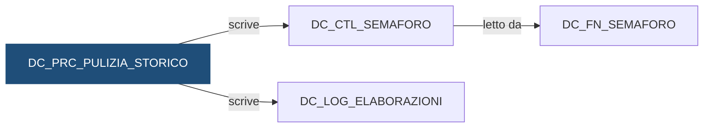

# Procedura: `DEMO_DWH.DC_PRC_PULIZIA_STORICO`

> ⚙️ **Scheda generata automaticamente, non modificare a mano.** Commit analizzato `c276f3f` del 2026-09-30. Le spiegazioni scritte a mano vanno nella nota accanto al sorgente.

## Descrizione

**Tipo:** Procedura

Manutenzione mensile delle tabelle di controllo: cancella le elaborazioni del log e le righe del semaforo piu vecchie di p_mesi mesi, poi recupera lo spazio delle due tabelle.

## Struttura

| Nome | Tipo | Parametri | Restituisce | Descrizione |
|---|---|---|---|---|
| `DC_PRC_PULIZIA_STORICO` | procedure | `p_mesi` IN NUMBER DEFAULT 24 | — | — |

## Cosa scrive

| Oggetto scritto | Contesto | Campi | Dove |
|---|---|---|---|
| [`DC_CTL_SEMAFORO`](DC_CTL_SEMAFORO.md) | STATEMENT | DAT_RIFERIMENTO | [`sql/DEMO_DWH/PROCEDURES/DC_PRC_PULIZIA_STORICO.sql:22`](../../sql/DEMO_DWH/PROCEDURES/DC_PRC_PULIZIA_STORICO.sql) |
| [`DC_LOG_ELABORAZIONI`](DC_LOG_ELABORAZIONI.md) | STATEMENT | DAT_INIZIO | [`sql/DEMO_DWH/PROCEDURES/DC_PRC_PULIZIA_STORICO.sql:18`](../../sql/DEMO_DWH/PROCEDURES/DC_PRC_PULIZIA_STORICO.sql) |

## Impatti indiretti

Oggetti raggiunti a catena, a valle dei riferimenti diretti:

| Livello | Oggetto | Ruolo | Raggiunto da |
|---|---|---|---|
| 2 | [`DC_FN_SEMAFORO`](DC_FN_SEMAFORO.md) | legge | [`DC_CTL_SEMAFORO`](DC_CTL_SEMAFORO.md) |
| 3 | [`dc_comune.sh`](dc_comune.md) | chiama | [`DC_FN_SEMAFORO`](DC_FN_SEMAFORO.md) |
| 4 | [`lancia_dc_carico_movimenti.sh`](lancia_dc_carico_movimenti.md) | chiama | [`dc_comune.sh`](dc_comune.md) |
| 4 | [`lancia_dc_movimenti.sh`](lancia_dc_movimenti.md) | chiama | [`dc_comune.sh`](dc_comune.md) |
| 4 | [`lancia_dc_saldi.sh`](lancia_dc_saldi.md) | chiama | [`dc_comune.sh`](dc_comune.md) |
| 4 | [`lancia_di_carico.sh`](lancia_di_carico.md) | chiama | [`dc_comune.sh`](dc_comune.md) |
| 4 | [`lancia_di_posizioni.sh`](lancia_di_posizioni.md) | chiama | [`dc_comune.sh`](dc_comune.md) |
| 5 | [`DC_FT_MOVIMENTI`](DC_FT_MOVIMENTI.md) | è scritto da | [`lancia_dc_movimenti.sh`](lancia_dc_movimenti.md) |
| 5 | [`DC_FT_SALDI_MENSILI`](DC_FT_SALDI_MENSILI.md) | è scritto da | [`lancia_dc_saldi.sh`](lancia_dc_saldi.md) |
| 5 | [`DC_STG_MOVIMENTI`](DC_STG_MOVIMENTI.md) | è scritto da | [`lancia_dc_carico_movimenti.sh`](lancia_dc_carico_movimenti.md) |
| 5 | [`DI_FT_CONTROVALORI_MENSILI`](DI_FT_CONTROVALORI_MENSILI.md) | è scritto da | [`lancia_di_posizioni.sh`](lancia_di_posizioni.md) |
| 5 | [`DI_FT_POSIZIONI`](DI_FT_POSIZIONI.md) | è scritto da | [`lancia_di_posizioni.sh`](lancia_di_posizioni.md) |
| 5 | [`DI_STG_ORDINI`](DI_STG_ORDINI.md) | è scritto da | [`lancia_di_carico.sh`](lancia_di_carico.md) |
| 5 | [`DI_STG_PREZZI`](DI_STG_PREZZI.md) | è scritto da | [`lancia_di_carico.sh`](lancia_di_carico.md) |
| 6 | [`DC_VC_QUADRATURA`](DC_VC_QUADRATURA.md) | legge | [`DC_FT_MOVIMENTI`](DC_FT_MOVIMENTI.md) |
| 6 | [`DC_VC_VOLUMI_GIORNALIERI`](DC_VC_VOLUMI_GIORNALIERI.md) | legge | [`DC_FT_MOVIMENTI`](DC_FT_MOVIMENTI.md) |
| 6 | [`DI_VC_QUADRATURA`](DI_VC_QUADRATURA.md) | legge | [`DI_FT_POSIZIONI`](DI_FT_POSIZIONI.md) |
| 6 | [`DI_VC_REGOLAMENTO_ORDINI`](DI_VC_REGOLAMENTO_ORDINI.md) | legge | [`DC_FT_MOVIMENTI`](DC_FT_MOVIMENTI.md) |
| 6 | [`wf_DC_MOVIMENTI`](wf_DC_MOVIMENTI.md) | legge | [`DC_STG_MOVIMENTI`](DC_STG_MOVIMENTI.md) |
| 6 | [`wf_DC_SALDI`](wf_DC_SALDI.md) | legge | [`DC_FT_MOVIMENTI`](DC_FT_MOVIMENTI.md) |
| 6 | [`wf_DI_POSIZIONI`](wf_DI_POSIZIONI.md) | legge | [`DI_FT_POSIZIONI`](DI_FT_POSIZIONI.md) |
| 7 | `APP_CONTROLLO_TITOLI` | consuma | [`DI_VC_REGOLAMENTO_ORDINI`](DI_VC_REGOLAMENTO_ORDINI.md) |
| 7 | `APP_REPORTING` | consuma | [`DC_VC_QUADRATURA`](DC_VC_QUADRATURA.md) |
| 7 | `UTENTI_CONTI` | consuma | [`DC_VC_QUADRATURA`](DC_VC_QUADRATURA.md) |
| 7 | `UTENTI_INVESTIMENTI` | consuma | [`DI_VC_QUADRATURA`](DI_VC_QUADRATURA.md) |

Diagramma dei primi due livelli:

## Da verificare

Il sorgente contiene SQL dinamico: gli oggetti toccati da queste istruzioni non si possono ricavare dal codice.

- [`sql/DEMO_DWH/PROCEDURES/DC_PRC_PULIZIA_STORICO.sql:32`](../../sql/DEMO_DWH/PROCEDURES/DC_PRC_PULIZIA_STORICO.sql)

## Note

Nota scritta a mano, da modificare nel repository: `sql/DEMO_DWH/PROCEDURES/DC_PRC_PULIZIA_STORICO.md`

### Perché

Log e semaforo crescono di qualche riga per ogni istituto e ogni giorno: senza
pulizia, dopo qualche anno rallentano le query di assistenza. Due anni di storia
bastano per rispondere a qualsiasi domanda sui rilanci.

Le due tabelle si puliscono con criteri diversi, anche se entrambe hanno
`DAT_RIFERIMENTO`: il log per data di **esecuzione** (`DAT_INIZIO`), il semaforo
per data di **riferimento** dei dati.

### Attenzione

- La lancia un job di manutenzione mensile dello schedulatore, fuori da questo
  repository: nella scheda non compare nessun chiamante.
- Il recupero dello spazio usa SQL dinamico (`EXECUTE IMMEDIATE` con il nome
  della tabella costruito a runtime): l'analisi d'impatto non può sapere quali
  tabelle tocca e lo segnala come "da verificare". Le tabelle sono le stesse
  delle due `DELETE`.

## Sorgente

[`sql/DEMO_DWH/PROCEDURES/DC_PRC_PULIZIA_STORICO.sql`](../../sql/DEMO_DWH/PROCEDURES/DC_PRC_PULIZIA_STORICO.sql)

## Limiti

L'analisi legge solo i file del repository. Non vede:

- **sinonimi** e **db link**: un oggetto letto tramite sinonimo o da un altro database non
  risulta collegato;
- **SQL dinamico**: le istruzioni costruite a runtime (`EXECUTE IMMEDIATE`, stringhe concatenate)
  sono segnalate come "da verificare", ma gli oggetti che toccano non sono noti;
- **oggetti non versionati**: tabelle, job o report che non stanno in questo repository
  (per esempio un cruscotto o un job di manutenzione dello schedulatore).

I risultati vanno sempre confermati con chi conosce il flusso.
