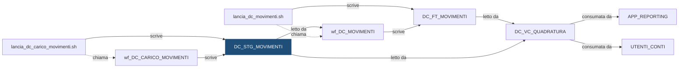

# Tabella: `DEMO_DWH.DC_STG_MOVIMENTI`

> ⚙️ **Scheda generata automaticamente, non modificare a mano.** Commit analizzato `c276f3f` del 2026-09-30. Le spiegazioni scritte a mano vanno nella nota accanto al sorgente.

## Descrizione

**Tipo:** Tabella work (staging)

Movimenti dei conti caricati dal sistema fonte, cosi come arrivano, per l'ultimo giorno caricato di ogni banca. Partizionata per istituto: a ogni elaborazione si svuota (TRUNCATE PARTITION) solo la banca in lavorazione.

**Commento sul database:** DEMO_CONTI - Staging dei movimenti dal sistema fonte

## Struttura

| Campo | Tipo | Commento |
|---|---|---|
| `COD_ISTITUTO` | VARCHAR2(5 CHAR) NOT NULL | Codice dell istituto (valori fittizi 99xxx) |
| `DAT_RIFERIMENTO` | DATE NOT NULL | Data di riferimento (il giorno a cui si riferisce il file) |
| `ID_MOVIMENTO` | VARCHAR2(30 CHAR) NOT NULL | Identificativo del movimento nel sistema fonte (puo comparire due volte nello stesso file: si deduplica in wf_DC_MOVIMENTI) |
| `COD_CONTO` | VARCHAR2(20 CHAR) NOT NULL | Codice del conto |
| `COD_CAUSALE` | VARCHAR2(20 CHAR) NOT NULL | Causale del movimento, normalizzata (UPPER/TRIM) dalla Post SQL del carico |
| `DAT_CONTABILE` | DATE NOT NULL | Data contabile: il giorno in cui il movimento conta per il saldo |
| `DAT_VALUTA` | DATE NOT NULL | Data valuta: il giorno da cui decorrono gli interessi (non conta per i saldi mensili) |
| `IMP_MOVIMENTO` | NUMBER(18,2) NOT NULL | Importo del movimento, sempre positivo: il segno lo dice la causale |
| `COD_SISTEMA_FONTE` | VARCHAR2(10 CHAR) NOT NULL | Sistema fonte che ha inviato il record (es. FONTE_A) |
| `ID_ELABORAZIONE` | NUMBER(12) NOT NULL | Identificativo dell elaborazione che ha caricato il record |
| `DAT_CARICAMENTO` | DATE DEFAULT SYSDATE NOT NULL | Data e ora di caricamento del record |

**Partizionamento e memorizzazione**

```sql
TABLESPACE DEMO_DWH_DATA
NOLOGGING
PARTITION BY LIST (COD_ISTITUTO)
(
    PARTITION P_99001   VALUES ('99001'),
    PARTITION P_99002   VALUES ('99002'),
    PARTITION P_99003   VALUES ('99003'),
    PARTITION P_DEFAULT VALUES (DEFAULT)
)
```

## Chi scrive

| Chi scrive | Contesto | Campi | Dove |
|---|---|---|---|
| [`lancia_dc_carico_movimenti.sh`](lancia_dc_carico_movimenti.md) | STATEMENT | — | [`script/demo_conti/lancia_dc_carico_movimenti.sh:20`](../../script/demo_conti/lancia_dc_carico_movimenti.sh) |
| [`wf_DC_CARICO_MOVIMENTI`](wf_DC_CARICO_MOVIMENTI.md) | POST_SQL | COD_CAUSALE, COD_ISTITUTO | [`powercenter/DEMO_CONTI/wf_DC_CARICO_MOVIMENTI.xml:106`](../../powercenter/DEMO_CONTI/wf_DC_CARICO_MOVIMENTI.xml) |
| [`wf_DC_CARICO_MOVIMENTI`](wf_DC_CARICO_MOVIMENTI.md) | TARGET | COD_CAUSALE, COD_CONTO, COD_ISTITUTO, COD_SISTEMA_FONTE, DAT_CONTABILE, DAT_RIFERIMENTO, DAT_VALUTA, ID_ELABORAZIONE, ID_MOVIMENTO, IMP_MOVIMENTO | [`powercenter/DEMO_CONTI/wf_DC_CARICO_MOVIMENTI.xml:28`](../../powercenter/DEMO_CONTI/wf_DC_CARICO_MOVIMENTI.xml) |

## Chi legge

| Chi legge | Contesto | Campi | Dove |
|---|---|---|---|
| [`DC_VC_QUADRATURA`](DC_VC_QUADRATURA.md) | STATEMENT | COD_ISTITUTO, DAT_CONTABILE, DAT_RIFERIMENTO, ID_MOVIMENTO | [`sql/DEMO_DWH/VIEWS/DC_VC_QUADRATURA.sql:20`](../../sql/DEMO_DWH/VIEWS/DC_VC_QUADRATURA.sql) |
| [`wf_DC_MOVIMENTI`](wf_DC_MOVIMENTI.md) | SOURCE | COD_CAUSALE, COD_CONTO, COD_ISTITUTO, DAT_CONTABILE, DAT_RIFERIMENTO, DAT_VALUTA, ID_MOVIMENTO, IMP_MOVIMENTO | [`powercenter/DEMO_CONTI/wf_DC_MOVIMENTI.xml:15`](../../powercenter/DEMO_CONTI/wf_DC_MOVIMENTI.xml) |
| [`wf_DC_MOVIMENTI`](wf_DC_MOVIMENTI.md) | SQL_OVERRIDE | COD_CAUSALE, COD_CONTO, COD_ISTITUTO, DAT_CARICAMENTO, DAT_CONTABILE, DAT_RIFERIMENTO, DAT_VALUTA, ID_MOVIMENTO, IMP_MOVIMENTO | [`powercenter/DEMO_CONTI/wf_DC_MOVIMENTI.xml:45`](../../powercenter/DEMO_CONTI/wf_DC_MOVIMENTI.xml) |

## Impatti indiretti

Oggetti raggiunti a catena, a valle dei riferimenti diretti:

| Livello | Oggetto | Ruolo | Raggiunto da |
|---|---|---|---|
| 2 | `APP_REPORTING` | consuma | [`DC_VC_QUADRATURA`](DC_VC_QUADRATURA.md) |
| 2 | [`DC_FT_MOVIMENTI`](DC_FT_MOVIMENTI.md) | è scritto da | [`wf_DC_MOVIMENTI`](wf_DC_MOVIMENTI.md) |
| 2 | `UTENTI_CONTI` | consuma | [`DC_VC_QUADRATURA`](DC_VC_QUADRATURA.md) |
| 2 | [`lancia_dc_movimenti.sh`](lancia_dc_movimenti.md) | chiama | [`wf_DC_MOVIMENTI`](wf_DC_MOVIMENTI.md) |
| 3 | [`DC_VC_VOLUMI_GIORNALIERI`](DC_VC_VOLUMI_GIORNALIERI.md) | legge | [`DC_FT_MOVIMENTI`](DC_FT_MOVIMENTI.md) |
| 3 | [`DI_VC_REGOLAMENTO_ORDINI`](DI_VC_REGOLAMENTO_ORDINI.md) | legge | [`DC_FT_MOVIMENTI`](DC_FT_MOVIMENTI.md) |
| 3 | [`wf_DC_SALDI`](wf_DC_SALDI.md) | legge | [`DC_FT_MOVIMENTI`](DC_FT_MOVIMENTI.md) |
| 4 | `APP_CONTROLLO_TITOLI` | consuma | [`DI_VC_REGOLAMENTO_ORDINI`](DI_VC_REGOLAMENTO_ORDINI.md) |
| 4 | [`DC_FT_SALDI_MENSILI`](DC_FT_SALDI_MENSILI.md) | è scritto da | [`wf_DC_SALDI`](wf_DC_SALDI.md) |
| 4 | [`lancia_dc_saldi.sh`](lancia_dc_saldi.md) | chiama | [`wf_DC_SALDI`](wf_DC_SALDI.md) |

Diagramma dei primi due livelli:



## Note

> ⚠️ **Codice modificato dopo l'ultima nota: verificare.** Il sorgente è stato modificato il 2026-09-30 14:24 UTC, la nota l'ultima volta il 2026-09-30 13:58 UTC.

Nota scritta a mano, da modificare nel repository: `sql/DEMO_DWH/TABLES/DC_STG_MOVIMENTI.md`

### Perché

La tabella non conserva lo storico: contiene solo l'ultimo giorno caricato per
ciascun istituto. È partizionata per istituto proprio per poter ricaricare un
istituto senza toccare gli altri: con `-i 99001` la shell
`lancia_dc_carico_movimenti.sh` svuota solo quella partizione.

```sql
ALTER TABLE DEMO_DWH.DC_STG_MOVIMENTI TRUNCATE PARTITION FOR ('99001');
```

Con `-i ALL` vengono svuotati e ricaricati tutti gli istituti.

Il file può contenere lo stesso movimento due volte: lo staging lo tiene così
com'è, senza scartare nulla. I doppioni si tolgono più avanti, quando i
movimenti passano a `DC_FT_MOVIMENTI`, riconoscendoli dall'identificativo del
movimento (`ID_MOVIMENTO`).

### Attenzione

- Un istituto che finisce in `P_DEFAULT` non si può ricaricare da solo, perché il
  TRUNCATE svuoterebbe anche gli altri codici non censiti. Per ogni nuovo
  istituto va creata una partizione dedicata. Siccome esiste già `P_DEFAULT`,
  Oracle non accetta `ADD PARTITION`: bisogna dividere la partizione DEFAULT.

```sql
ALTER TABLE DEMO_DWH.DC_STG_MOVIMENTI
  SPLIT PARTITION P_DEFAULT VALUES ('99004')
  INTO (PARTITION P_99004, PARTITION P_DEFAULT);
```

- Il file sorgente arriva come `movimenti_FONTE_A_<ISTITUTO>_<YYYYMMDD>.csv`
  nella cartella indicata da `DEMO_INPUT_DIR`.

## Sorgente

[`sql/DEMO_DWH/TABLES/DC_STG_MOVIMENTI.sql`](../../sql/DEMO_DWH/TABLES/DC_STG_MOVIMENTI.sql)

## Limiti

L'analisi legge solo i file del repository. Non vede:

- **sinonimi** e **db link**: un oggetto letto tramite sinonimo o da un altro database non
  risulta collegato;
- **SQL dinamico**: le istruzioni costruite a runtime (`EXECUTE IMMEDIATE`, stringhe concatenate)
  sono segnalate come "da verificare", ma gli oggetti che toccano non sono noti;
- **oggetti non versionati**: tabelle, job o report che non stanno in questo repository
  (per esempio un cruscotto o un job di manutenzione dello schedulatore).

I risultati vanno sempre confermati con chi conosce il flusso.
