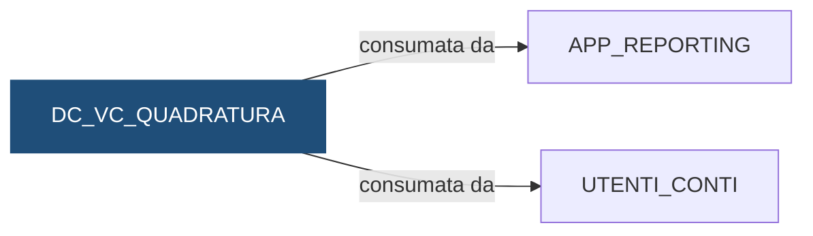

# Vista: `DEMO_DWH.DC_VC_QUADRATURA`

> ⚙️ **Scheda generata automaticamente, non modificare a mano.** Commit analizzato `c276f3f` del 2026-09-30. Le spiegazioni scritte a mano vanno nella nota accanto al sorgente.

## Descrizione

**Tipo:** Vista di controllo

Due controlli di quadratura, una riga per banca e data: - STAGING_MOVIMENTI: i movimenti nello staging (senza doppioni) devono essere gli stessi trovati nei movimenti; - SALDI: per ogni conto, saldo iniziale + entrate - uscite deve dare il saldo finale. ESITO: OK / KO / N/D (dato di confronto non disponibile).

**Commento sul database:** DEMO_CONTI - Quadratura staging / movimenti e saldi mensili, per istituto e data

## Struttura

| Colonna |
|---|
| `COD_CONTROLLO` |
| `COD_ISTITUTO` |
| `DAT_RIFERIMENTO` |
| `NUM_ATTESO` |
| `NUM_TROVATO` |
| `ESITO` |

## Chi scrive

Nessun riferimento trovato nel repository.

## Chi legge

Nessun riferimento trovato nel repository.

## Cosa legge

| Oggetto letto | Contesto | Campi | Dove |
|---|---|---|---|
| [`DC_FT_MOVIMENTI`](DC_FT_MOVIMENTI.md) | STATEMENT | COD_ISTITUTO, DAT_CONTABILE, ID_MOVIMENTO | [`sql/DEMO_DWH/VIEWS/DC_VC_QUADRATURA.sql:27`](../../sql/DEMO_DWH/VIEWS/DC_VC_QUADRATURA.sql) |
| [`DC_FT_SALDI_MENSILI`](DC_FT_SALDI_MENSILI.md) | STATEMENT | COD_ISTITUTO, DAT_RIFERIMENTO, IMP_ENTRATE, IMP_SALDO_FINALE, IMP_SALDO_INIZIALE, IMP_USCITE | [`sql/DEMO_DWH/VIEWS/DC_VC_QUADRATURA.sql:36`](../../sql/DEMO_DWH/VIEWS/DC_VC_QUADRATURA.sql) |
| [`DC_STG_MOVIMENTI`](DC_STG_MOVIMENTI.md) | STATEMENT | COD_ISTITUTO, DAT_CONTABILE, DAT_RIFERIMENTO, ID_MOVIMENTO | [`sql/DEMO_DWH/VIEWS/DC_VC_QUADRATURA.sql:20`](../../sql/DEMO_DWH/VIEWS/DC_VC_QUADRATURA.sql) |

## Chi consuma

Schemi a cui la vista è concessa con `GRANT`:

| Schema | Dove |
|---|---|
| `APP_REPORTING` | [`sql/DEMO_DWH/VIEWS/DC_VC_QUADRATURA.sql:68`](../../sql/DEMO_DWH/VIEWS/DC_VC_QUADRATURA.sql) |
| `UTENTI_CONTI` | [`sql/DEMO_DWH/VIEWS/DC_VC_QUADRATURA.sql:68`](../../sql/DEMO_DWH/VIEWS/DC_VC_QUADRATURA.sql) |

## Impatti indiretti

Nessun impatto indiretto trovato nel repository.

Diagramma dei primi due livelli:



## Note

Nota scritta a mano, da modificare nel repository: `sql/DEMO_DWH/VIEWS/DC_VC_QUADRATURA.md`

### Come leggere gli esiti

La vista ha una riga per controllo, istituto e data: la colonna `COD_CONTROLLO`
dice di quale controllo si tratta. `NUM_ATTESO` e `NUM_TROVATO` devono essere uguali.

- `STAGING_MOVIMENTI`: `NUM_ATTESO` sono i movimenti nello staging **contati una
  sola volta** (i doppioni del file non contano), `NUM_TROVATO` sono i movimenti
  caricati per quel giorno.
  - `KO` se un istituto è nello staging ma non nei movimenti: il flusso dei
    movimenti non è girato o è fallito (vedere `DC_LOG_ELABORAZIONI`).
  - `KO` anche se i numeri sono diversi: di solito è una causale che non esiste
    in `DC_DIM_CAUSALE`, e il movimento è rimasto fuori.
  - `N/D` per i giorni passati: lo staging contiene solo l'ultimo giorno caricato
    per ogni istituto.
- `SALDI`: `NUM_ATTESO` sono i conti con un saldo nel mese, `NUM_TROVATO` quelli in
  cui saldo iniziale + entrate − uscite dà il saldo finale. `KO` se anche un solo
  conto non quadra.

### Query utili

```sql
SELECT *
  FROM DEMO_DWH.DC_VC_QUADRATURA
 WHERE ESITO = 'KO';
```

### Attenzione

La vista è letta da altri schemi (vedi "Chi consuma" nella scheda): la
reportistica di controllo e gli utenti del motore la interrogano ogni giorno.
Rinominare o togliere una colonna rompe i loro report: va concordato prima.

## Sorgente

[`sql/DEMO_DWH/VIEWS/DC_VC_QUADRATURA.sql`](../../sql/DEMO_DWH/VIEWS/DC_VC_QUADRATURA.sql)

## Limiti

L'analisi legge solo i file del repository. Non vede:

- **sinonimi** e **db link**: un oggetto letto tramite sinonimo o da un altro database non
  risulta collegato;
- **SQL dinamico**: le istruzioni costruite a runtime (`EXECUTE IMMEDIATE`, stringhe concatenate)
  sono segnalate come "da verificare", ma gli oggetti che toccano non sono noti;
- **oggetti non versionati**: tabelle, job o report che non stanno in questo repository
  (per esempio un cruscotto o un job di manutenzione dello schedulatore).

I risultati vanno sempre confermati con chi conosce il flusso.
