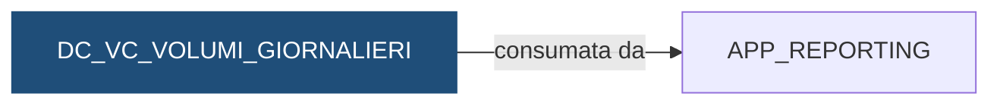

# Vista: `DEMO_DWH.DC_VC_VOLUMI_GIORNALIERI`

> ⚙️ **Scheda generata automaticamente, non modificare a mano.** Commit analizzato `c276f3f` del 2026-09-30. Le spiegazioni scritte a mano vanno nella nota accanto al sorgente.

## Descrizione

**Tipo:** Vista di controllo

Numero di movimenti per banca e giorno, confrontato con la media dei 20 giorni precedenti presenti in tabella. ESITO = KO se i movimenti del giorno sono meno del 50% della media (il file potrebbe essere arrivato a meta).

**Commento sul database:** DEMO_CONTI - Movimenti del giorno rispetto alla media degli ultimi 20 giorni

## Struttura

| Colonna |
|---|
| `COD_ISTITUTO` |
| `DAT_CONTABILE` |
| `NUM_MOVIMENTI` |
| `NUM_MEDIO_20GG` |
| `PCT_SULLA_MEDIA` |
| `ESITO` |

## Chi scrive

Nessun riferimento trovato nel repository.

## Chi legge

Nessun riferimento trovato nel repository.

## Cosa legge

| Oggetto letto | Contesto | Campi | Dove |
|---|---|---|---|
| [`DC_FT_MOVIMENTI`](DC_FT_MOVIMENTI.md) | STATEMENT | COD_ISTITUTO, DAT_CONTABILE | [`sql/DEMO_DWH/VIEWS/DC_VC_VOLUMI_GIORNALIERI.sql:31`](../../sql/DEMO_DWH/VIEWS/DC_VC_VOLUMI_GIORNALIERI.sql) |

## Chi consuma

Schemi a cui la vista è concessa con `GRANT`:

| Schema | Dove |
|---|---|
| `APP_REPORTING` | [`sql/DEMO_DWH/VIEWS/DC_VC_VOLUMI_GIORNALIERI.sql:38`](../../sql/DEMO_DWH/VIEWS/DC_VC_VOLUMI_GIORNALIERI.sql) |

## Impatti indiretti

Nessun impatto indiretto trovato nel repository.

Diagramma dei primi due livelli:



## Note

Nota scritta a mano, da modificare nel repository: `sql/DEMO_DWH/VIEWS/DC_VC_VOLUMI_GIORNALIERI.md`

### Perché

Serve a intercettare un file arrivato a metà (o un giorno caricato due volte)
prima che i saldi lo ereditino. Un giorno con meno della metà dei movimenti
abituali è quasi sempre un file incompleto, non una giornata tranquilla.

### Attenzione

- La media è sugli ultimi 20 giorni **presenti in tabella**, non sui 20 giorni
  di calendario: sabati, domeniche e festività senza file non contano.
- I movimenti contati sono quelli già senza doppioni, cioè quelli di
  `DC_FT_MOVIMENTI`: un file con molti doppioni non risulta gonfiato.
- Nei primi giorni di vita di un istituto la media non esiste e l'esito è `N/D`.
- Un `KO` non è per forza un errore (es. giornata di chiusura parziale), ma va
  sempre verificato con chi gestisce il sistema fonte.
- La vista è letta dalla reportistica di controllo (vedi "Chi consuma" nella
  scheda): la soglia del 50% è concordata con loro e non va cambiata da sola.

### Query utili

```sql
SELECT *
  FROM DEMO_DWH.DC_VC_VOLUMI_GIORNALIERI
 WHERE ESITO = 'KO'
 ORDER BY DAT_CONTABILE DESC;
```

## Sorgente

[`sql/DEMO_DWH/VIEWS/DC_VC_VOLUMI_GIORNALIERI.sql`](../../sql/DEMO_DWH/VIEWS/DC_VC_VOLUMI_GIORNALIERI.sql)

## Limiti

L'analisi legge solo i file del repository. Non vede:

- **sinonimi** e **db link**: un oggetto letto tramite sinonimo o da un altro database non
  risulta collegato;
- **SQL dinamico**: le istruzioni costruite a runtime (`EXECUTE IMMEDIATE`, stringhe concatenate)
  sono segnalate come "da verificare", ma gli oggetti che toccano non sono noti;
- **oggetti non versionati**: tabelle, job o report che non stanno in questo repository
  (per esempio un cruscotto o un job di manutenzione dello schedulatore).

I risultati vanno sempre confermati con chi conosce il flusso.
