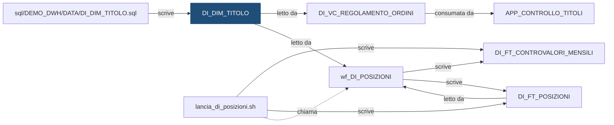

# Tabella: `DEMO_DWH.DI_DIM_TITOLO`

> ⚙️ **Scheda generata automaticamente, non modificare a mano.** Commit analizzato `c276f3f` del 2026-09-30. Le spiegazioni scritte a mano vanno nella nota accanto al sorgente.

## Descrizione

**Tipo:** Tabella di dimensione (anagrafica)

Anagrafica dei titoli: codice ISIN (inventato), descrizione e tipo (AZIONE, OBBLIGAZIONE, FONDO). Alimentata a mano (dati di configurazione), letta dal workflow delle posizioni per calcolare il controvalore.

**Commento sul database:** DEMO_INVESTIMENTI - Anagrafica dei titoli

## Struttura

| Campo | Tipo | Commento |
|---|---|---|
| `COD_TITOLO` | VARCHAR2(12 CHAR) NOT NULL | Codice ISIN del titolo (valori inventati) |
| `DES_TITOLO` | VARCHAR2(100 CHAR) NOT NULL | Descrizione del titolo |
| `COD_TIPO` | VARCHAR2(15 CHAR) NOT NULL | Tipo di titolo: AZIONE, OBBLIGAZIONE o FONDO |
| `DAT_INSERIMENTO` | DATE DEFAULT SYSDATE NOT NULL | Data di inserimento del record |
| `COD_UTENTE_INS` | VARCHAR2(30 CHAR) DEFAULT USER NOT NULL | Utente che ha inserito il record |

**Partizionamento e memorizzazione**

```sql
TABLESPACE DEMO_DWH_DATA
```

**Chiavi e vincoli**

| Nome | Tipo | Definizione | File |
|---|---|---|---|
| `DI_DIM_TITOLO_PK` | PRIMARY KEY | `(COD_TITOLO)` | [`sql/DEMO_DWH/CONSTRAINTS/DI_DIM_TITOLO.sql`](../../sql/DEMO_DWH/CONSTRAINTS/DI_DIM_TITOLO.sql) |
| `DI_DIM_TITOLO_CK_TIPO` | CHECK | `(COD_TIPO IN ('AZIONE', 'OBBLIGAZIONE', 'FONDO'))` | [`sql/DEMO_DWH/CONSTRAINTS/DI_DIM_TITOLO.sql`](../../sql/DEMO_DWH/CONSTRAINTS/DI_DIM_TITOLO.sql) |

## Chi scrive

| Chi scrive | Contesto | Campi | Dove |
|---|---|---|---|
| script [`sql/DEMO_DWH/DATA/DI_DIM_TITOLO.sql`](../../sql/DEMO_DWH/DATA/DI_DIM_TITOLO.sql) | STATEMENT | COD_TIPO, COD_TITOLO, DES_TITOLO | [`sql/DEMO_DWH/DATA/DI_DIM_TITOLO.sql:3`](../../sql/DEMO_DWH/DATA/DI_DIM_TITOLO.sql) |

## Chi legge

| Chi legge | Contesto | Campi | Dove |
|---|---|---|---|
| [`DI_VC_REGOLAMENTO_ORDINI`](DI_VC_REGOLAMENTO_ORDINI.md) | STATEMENT | COD_TIPO, COD_TITOLO | [`sql/DEMO_DWH/VIEWS/DI_VC_REGOLAMENTO_ORDINI.sql:51`](../../sql/DEMO_DWH/VIEWS/DI_VC_REGOLAMENTO_ORDINI.sql) |
| [`wf_DI_POSIZIONI`](wf_DI_POSIZIONI.md) | LOOKUP | COD_TIPO, COD_TITOLO | [`powercenter/DEMO_INVESTIMENTI/wf_DI_POSIZIONI.xml:121`](../../powercenter/DEMO_INVESTIMENTI/wf_DI_POSIZIONI.xml) |

## Impatti indiretti

Oggetti raggiunti a catena, a valle dei riferimenti diretti:

| Livello | Oggetto | Ruolo | Raggiunto da |
|---|---|---|---|
| 2 | `APP_CONTROLLO_TITOLI` | consuma | [`DI_VC_REGOLAMENTO_ORDINI`](DI_VC_REGOLAMENTO_ORDINI.md) |
| 2 | [`DI_FT_CONTROVALORI_MENSILI`](DI_FT_CONTROVALORI_MENSILI.md) | è scritto da | [`wf_DI_POSIZIONI`](wf_DI_POSIZIONI.md) |
| 2 | [`DI_FT_POSIZIONI`](DI_FT_POSIZIONI.md) | è scritto da | [`wf_DI_POSIZIONI`](wf_DI_POSIZIONI.md) |
| 2 | [`lancia_di_posizioni.sh`](lancia_di_posizioni.md) | chiama | [`wf_DI_POSIZIONI`](wf_DI_POSIZIONI.md) |
| 3 | [`DI_VC_QUADRATURA`](DI_VC_QUADRATURA.md) | legge | [`DI_FT_POSIZIONI`](DI_FT_POSIZIONI.md) |
| 4 | `APP_REPORTING` | consuma | [`DI_VC_QUADRATURA`](DI_VC_QUADRATURA.md) |
| 4 | `UTENTI_INVESTIMENTI` | consuma | [`DI_VC_QUADRATURA`](DI_VC_QUADRATURA.md) |

Diagramma dei primi due livelli:



## Note

Nota scritta a mano, da modificare nel repository: `sql/DEMO_DWH/TABLES/DI_DIM_TITOLO.md`

### Perché

Il tipo del titolo serve a una cosa sola: sapere come si calcola il controvalore.
Azioni e fondi hanno il prezzo in euro per unità; le obbligazioni hanno il
prezzo in percentuale del loro valore nominale (il valore che verrà rimborsato),
per esempio 98 vuol dire 98%. Per questo il controvalore delle obbligazioni si
divide per 100.

Titoli previsti nella configurazione iniziale (codici inventati):

| Codice | Descrizione | Tipo |
|---|---|---|
| `ZZ0000000011` | Azione Demo Alfa | `AZIONE` |
| `ZZ0000000029` | Azione Demo Beta | `AZIONE` |
| `ZZ0000000037` | Obbligazione Demo 2030 | `OBBLIGAZIONE` |
| `ZZ0000000045` | Obbligazione Demo 2035 | `OBBLIGAZIONE` |
| `ZZ0000000052` | Fondo Demo Azionario | `FONDO` |
| `ZZ0000000060` | Fondo Demo Bilanciato | `FONDO` |

### Attenzione

- Un titolo che negli ordini o nei prezzi non è in questa tabella non viene
  riconosciuto dal calcolo del controvalore: se ne accorge chi legge le righe con
  tipo vuoto. Prima di caricare un titolo nuovo va inserito qui.
- Per un'obbligazione inserita per errore come `FONDO` il controvalore risulta cento
  volte più grande: il tipo va controllato a mano al momento dell'inserimento.
- I valori iniziali sono nel file `sql/DEMO_DWH/DATA/DI_DIM_TITOLO.sql`.

## Sorgente

[`sql/DEMO_DWH/TABLES/DI_DIM_TITOLO.sql`](../../sql/DEMO_DWH/TABLES/DI_DIM_TITOLO.sql)

## Limiti

L'analisi legge solo i file del repository. Non vede:

- **sinonimi** e **db link**: un oggetto letto tramite sinonimo o da un altro database non
  risulta collegato;
- **SQL dinamico**: le istruzioni costruite a runtime (`EXECUTE IMMEDIATE`, stringhe concatenate)
  sono segnalate come "da verificare", ma gli oggetti che toccano non sono noti;
- **oggetti non versionati**: tabelle, job o report che non stanno in questo repository
  (per esempio un cruscotto o un job di manutenzione dello schedulatore).

I risultati vanno sempre confermati con chi conosce il flusso.
