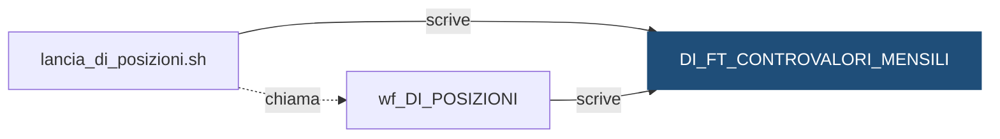

# Tabella: `DEMO_DWH.DI_FT_CONTROVALORI_MENSILI`

> ⚙️ **Scheda generata automaticamente, non modificare a mano.** Commit analizzato `c276f3f` del 2026-09-30. Le spiegazioni scritte a mano vanno nella nota accanto al sorgente.

## Descrizione

**Tipo:** Tabella target (fatti) - controvalori mensili

Per ogni dossier e mese, il controvalore dei titoli posseduti a fine mese: quantita per prezzo di fine mese. Conserva lo storico mensile per ogni banca. Partizioni mensili create in automatico (INTERVAL) e sottopartizioni per istituto: il ricaricamento svuota solo la coppia (mese, banca) in lavorazione.

**Commento sul database:** DEMO_INVESTIMENTI - Controvalore dei titoli per dossier e mese

## Struttura

| Campo | Tipo | Commento |
|---|---|---|
| `COD_ISTITUTO` | VARCHAR2(5 CHAR) NOT NULL | Codice dell istituto (valori fittizi 99xxx) - chiave di sottopartizione |
| `DAT_RIFERIMENTO` | DATE NOT NULL | Data di riferimento (ultimo giorno del mese) - chiave di partizione |
| `COD_DOSSIER` | VARCHAR2(20 CHAR) NOT NULL | Codice del dossier titoli |
| `NUM_TITOLI` | NUMBER(9) NOT NULL | Numero di titoli diversi posseduti a fine mese |
| `NUM_TITOLI_PREZZO_RIPORTATO` | NUMBER(9) NOT NULL | Quanti di questi titoli sono valorizzati con un prezzo riportato da un giorno precedente |
| `IMP_CONTROVALORE` | NUMBER(18,2) NOT NULL | Somma di quantita per prezzo dei titoli del dossier (obbligazioni: diviso 100) |
| `ID_ELABORAZIONE` | NUMBER(12) NOT NULL | Identificativo dell elaborazione (DC_LOG_ELABORAZIONI) |
| `DAT_CARICAMENTO` | DATE DEFAULT SYSDATE NOT NULL | Data e ora di caricamento del record |

**Partizionamento e memorizzazione**

```sql
TABLESPACE DEMO_DWH_DATA
PARTITION BY RANGE (DAT_RIFERIMENTO)
INTERVAL (NUMTOYMINTERVAL(1, 'MONTH'))
SUBPARTITION BY LIST (COD_ISTITUTO)
SUBPARTITION TEMPLATE
(
    SUBPARTITION SP_99001   VALUES ('99001'),
    SUBPARTITION SP_99002   VALUES ('99002'),
    SUBPARTITION SP_99003   VALUES ('99003'),
    SUBPARTITION SP_DEFAULT VALUES (DEFAULT)
)
(
    PARTITION P_INIZIALE VALUES LESS THAN (DATE '2026-01-01')
)
```

## Chi scrive

| Chi scrive | Contesto | Campi | Dove |
|---|---|---|---|
| [`lancia_di_posizioni.sh`](lancia_di_posizioni.md) | STATEMENT | — | [`script/demo_investimenti/lancia_di_posizioni.sh:33`](../../script/demo_investimenti/lancia_di_posizioni.sh) |
| [`wf_DI_POSIZIONI`](wf_DI_POSIZIONI.md) | TARGET | COD_DOSSIER, COD_ISTITUTO, DAT_RIFERIMENTO, ID_ELABORAZIONE, IMP_CONTROVALORE, NUM_TITOLI, NUM_TITOLI_PREZZO_RIPORTATO | [`powercenter/DEMO_INVESTIMENTI/wf_DI_POSIZIONI.xml:47`](../../powercenter/DEMO_INVESTIMENTI/wf_DI_POSIZIONI.xml) |

## Chi legge

Nessun riferimento trovato nel repository.

## Impatti indiretti

Nessun impatto indiretto trovato nel repository.

Diagramma dei primi due livelli:



## Note

Nota scritta a mano, da modificare nel repository: `sql/DEMO_DWH/TABLES/DI_FT_CONTROVALORI_MENSILI.md`

### Perché

**Obbligazioni: si divide per 100.** Azioni e fondi hanno il prezzo in euro per
unità, e il controvalore è quantità per prezzo. Le obbligazioni hanno il prezzo
in percentuale del valore nominale: con prezzo 98, ogni 100 euro di nominale
costano 98 euro. Se la quantità è espressa in euro di nominale, 1.000 di
nominale con prezzo 98 valgono 1.000 × 98 / 100 = 980 euro, non 98.000. Il tipo
del titolo si legge in `DI_DIM_TITOLO`.

**Prezzo di fine mese.** Il controvalore usa la posizione e il prezzo dell'ultimo
giorno del mese. Se quel giorno il prezzo di un titolo mancava, `DI_FT_POSIZIONI`
riporta l'ultimo prezzo disponibile: il controvalore è calcolato lo stesso, e
`NUM_TITOLI_PREZZO_RIPORTATO` dice su quanti titoli del dossier è successo.
Un valore diverso da zero invita a leggere il numero con cautela.

**Ricaricamento mirato.** La shell `lancia_di_posizioni.sh`, nel giorno di fine
mese, svuota solo la coppia (mese, istituto) prima di lanciare il calcolo:

```sql
ALTER TABLE DEMO_DWH.DI_FT_CONTROVALORI_MENSILI
  TRUNCATE SUBPARTITION FOR (DATE '2026-08-31', '99001');
```

Il `FOR (data, istituto)` serve perché le partizioni create da `INTERVAL`
hanno nomi generati dal sistema, diversi da un ambiente all'altro.

### Attenzione

- Il controvalore è in euro solo se il prezzo è in euro: non c'è conversione di
  divisa.
- Un istituto che finisce nella sottopartizione `SP_DEFAULT` non si può ricaricare
  da solo (stessa avvertenza di `DC_FT_MOVIMENTI`).
- La tabella alimenta la reportistica dei dossier, fuori da questo repository:
  l'analisi d'impatto non la vede.

## Sorgente

[`sql/DEMO_DWH/TABLES/DI_FT_CONTROVALORI_MENSILI.sql`](../../sql/DEMO_DWH/TABLES/DI_FT_CONTROVALORI_MENSILI.sql)

## Limiti

L'analisi legge solo i file del repository. Non vede:

- **sinonimi** e **db link**: un oggetto letto tramite sinonimo o da un altro database non
  risulta collegato;
- **SQL dinamico**: le istruzioni costruite a runtime (`EXECUTE IMMEDIATE`, stringhe concatenate)
  sono segnalate come "da verificare", ma gli oggetti che toccano non sono noti;
- **oggetti non versionati**: tabelle, job o report che non stanno in questo repository
  (per esempio un cruscotto o un job di manutenzione dello schedulatore).

I risultati vanno sempre confermati con chi conosce il flusso.
