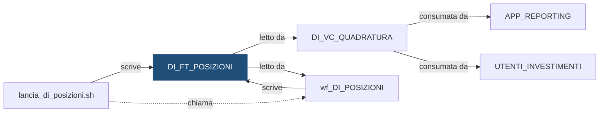

# Tabella: `DEMO_DWH.DI_FT_POSIZIONI`

> ⚙️ **Scheda generata automaticamente, non modificare a mano.** Commit analizzato `c276f3f` del 2026-09-30. Le spiegazioni scritte a mano vanno nella nota accanto al sorgente.

## Descrizione

**Tipo:** Tabella target (fatti) - posizioni

Quantita di ogni titolo in ogni dossier a fine giornata: posizione iniziale, acquisti, vendite e posizione finale, con il prezzo di chiusura del giorno. Conserva lo storico mensile per ogni banca. Partizioni mensili create in automatico (INTERVAL) e sottopartizioni per istituto.

**Commento sul database:** DEMO_INVESTIMENTI - Posizioni per dossier e titolo a fine giornata

## Struttura

| Campo | Tipo | Commento |
|---|---|---|
| `COD_ISTITUTO` | VARCHAR2(5 CHAR) NOT NULL | Codice dell istituto (valori fittizi 99xxx) - chiave di sottopartizione |
| `DAT_RIFERIMENTO` | DATE NOT NULL | Giorno della posizione - chiave di partizione (un mese per partizione) |
| `COD_DOSSIER` | VARCHAR2(20 CHAR) NOT NULL | Codice del dossier titoli |
| `COD_TITOLO` | VARCHAR2(12 CHAR) NOT NULL | Codice ISIN del titolo (DI_DIM_TITOLO) |
| `QTA_INIZIALE` | NUMBER(18,4) NOT NULL | Quantita a inizio giornata: la posizione finale dell ultimo giorno precedente |
| `QTA_ACQUISTI` | NUMBER(18,4) NOT NULL | Quantita acquistata nella giornata |
| `QTA_VENDITE` | NUMBER(18,4) NOT NULL | Quantita venduta nella giornata |
| `QTA_FINALE` | NUMBER(18,4) NOT NULL | Quantita a fine giornata: QTA_INIZIALE + QTA_ACQUISTI - QTA_VENDITE |
| `IMP_PREZZO` | NUMBER(18,6) | Prezzo di chiusura usato per la riga (vuoto se il titolo non e mai stato quotato) |
| `FLG_PREZZO_RIPORTATO` | CHAR(1 CHAR) NOT NULL | S = il prezzo del giorno mancava e si e usato l ultimo disponibile, N = prezzo del giorno |
| `ID_ELABORAZIONE` | NUMBER(12) NOT NULL | Identificativo dell elaborazione che ha caricato il record |
| `DAT_CARICAMENTO` | DATE DEFAULT SYSDATE NOT NULL | Data e ora di caricamento del record |

**Partizionamento e memorizzazione**

```sql
TABLESPACE DEMO_DWH_DATA
PARTITION BY RANGE (DAT_RIFERIMENTO)
INTERVAL (NUMTOYMINTERVAL(1, 'MONTH'))
SUBPARTITION BY LIST (COD_ISTITUTO)
SUBPARTITION TEMPLATE
(
    SUBPARTITION SP_99001   VALUES ('99001'),
    SUBPARTITION SP_99002   VALUES ('99002'),
    SUBPARTITION SP_99003   VALUES ('99003'),
    SUBPARTITION SP_DEFAULT VALUES (DEFAULT)
)
(
    PARTITION P_INIZIALE VALUES LESS THAN (DATE '2026-01-01')
)
```

## Chi scrive

| Chi scrive | Contesto | Campi | Dove |
|---|---|---|---|
| [`lancia_di_posizioni.sh`](lancia_di_posizioni.md) | STATEMENT | COD_ISTITUTO, DAT_RIFERIMENTO | [`script/demo_investimenti/lancia_di_posizioni.sh:30`](../../script/demo_investimenti/lancia_di_posizioni.sh) |
| [`wf_DI_POSIZIONI`](wf_DI_POSIZIONI.md) | TARGET | COD_DOSSIER, COD_ISTITUTO, COD_TITOLO, DAT_RIFERIMENTO, FLG_PREZZO_RIPORTATO, ID_ELABORAZIONE, IMP_PREZZO, QTA_ACQUISTI, QTA_FINALE, QTA_INIZIALE, QTA_VENDITE | [`powercenter/DEMO_INVESTIMENTI/wf_DI_POSIZIONI.xml:34`](../../powercenter/DEMO_INVESTIMENTI/wf_DI_POSIZIONI.xml) |

## Chi legge

| Chi legge | Contesto | Campi | Dove |
|---|---|---|---|
| [`DI_VC_QUADRATURA`](DI_VC_QUADRATURA.md) | STATEMENT | COD_ISTITUTO, DAT_RIFERIMENTO, QTA_ACQUISTI, QTA_FINALE, QTA_INIZIALE, QTA_VENDITE | [`sql/DEMO_DWH/VIEWS/DI_VC_QUADRATURA.sql:25`](../../sql/DEMO_DWH/VIEWS/DI_VC_QUADRATURA.sql) |
| [`wf_DI_POSIZIONI`](wf_DI_POSIZIONI.md) | SOURCE | COD_DOSSIER, COD_ISTITUTO, COD_TITOLO, DAT_RIFERIMENTO, FLG_PREZZO_RIPORTATO, IMP_PREZZO, QTA_FINALE | [`powercenter/DEMO_INVESTIMENTI/wf_DI_POSIZIONI.xml:23`](../../powercenter/DEMO_INVESTIMENTI/wf_DI_POSIZIONI.xml) |
| [`wf_DI_POSIZIONI`](wf_DI_POSIZIONI.md) | SQL_OVERRIDE | COD_DOSSIER, COD_ISTITUTO, COD_TITOLO, DAT_RIFERIMENTO, FLG_PREZZO_RIPORTATO, IMP_PREZZO, QTA_ACQUISTI, QTA_FINALE, QTA_INIZIALE, QTA_VENDITE | [`powercenter/DEMO_INVESTIMENTI/wf_DI_POSIZIONI.xml:64`](../../powercenter/DEMO_INVESTIMENTI/wf_DI_POSIZIONI.xml) |

## Impatti indiretti

Oggetti raggiunti a catena, a valle dei riferimenti diretti:

| Livello | Oggetto | Ruolo | Raggiunto da |
|---|---|---|---|
| 2 | `APP_REPORTING` | consuma | [`DI_VC_QUADRATURA`](DI_VC_QUADRATURA.md) |
| 2 | `UTENTI_INVESTIMENTI` | consuma | [`DI_VC_QUADRATURA`](DI_VC_QUADRATURA.md) |

Diagramma dei primi due livelli:



## Note

Nota scritta a mano, da modificare nel repository: `sql/DEMO_DWH/TABLES/DI_FT_POSIZIONI.md`

### Perché

**Prezzo mancante.** Se nel file dei prezzi del giorno manca un titolo, la riga
non resta senza prezzo: si usa l'ultimo prezzo disponibile, cioè quello scritto
nella riga del giorno precedente, e la riga viene marcata con
`FLG_PREZZO_RIPORTATO = 'S'`. Il marchio serve a chi legge il controvalore:
un numero calcolato su un prezzo vecchio va letto con cautela. Se il prezzo
manca più giorni di seguito, il marchio resta e il prezzo è sempre quello
dell'ultima quotazione vera. Un titolo mai quotato ha prezzo vuoto.

**Posizione iniziale.** Non viene letta dagli ordini, che nello staging sono
solo quelli di un giorno: è la posizione finale dell'ultimo giorno già presente
in tabella per lo stesso dossier e titolo. Le posizioni a zero non si riportano
avanti.

**Ricaricare un giorno.** La shell `lancia_di_posizioni.sh` cancella con una
`DELETE` solo le righe del giorno e dell'istituto in lavorazione, e non con un
`TRUNCATE`: la sottopartizione contiene tutto il mese della banca. Per rifare
un mese intero si svuota la coppia (mese, istituto) e si rilanciano i giorni:

```sql
ALTER TABLE DEMO_DWH.DI_FT_POSIZIONI
  TRUNCATE SUBPARTITION FOR (DATE '2026-09-15', '99001');
```

La sintassi `FOR (data, istituto)` è obbligata: le partizioni create da
`INTERVAL` hanno nomi generati dal sistema, diversi da un ambiente all'altro.

### Attenzione

- Le posizioni si calcolano una dopo l'altra: se si rilancia un giorno passato
  vanno rilanciati, in ordine, anche tutti i giorni successivi, perché ognuno
  parte dalla posizione del giorno prima.
- Un istituto che finisce nella sottopartizione `SP_DEFAULT` non si può ricaricare
  da solo (stessa avvertenza di `DC_FT_MOVIMENTI`).

## Sorgente

[`sql/DEMO_DWH/TABLES/DI_FT_POSIZIONI.sql`](../../sql/DEMO_DWH/TABLES/DI_FT_POSIZIONI.sql)

## Limiti

L'analisi legge solo i file del repository. Non vede:

- **sinonimi** e **db link**: un oggetto letto tramite sinonimo o da un altro database non
  risulta collegato;
- **SQL dinamico**: le istruzioni costruite a runtime (`EXECUTE IMMEDIATE`, stringhe concatenate)
  sono segnalate come "da verificare", ma gli oggetti che toccano non sono noti;
- **oggetti non versionati**: tabelle, job o report che non stanno in questo repository
  (per esempio un cruscotto o un job di manutenzione dello schedulatore).

I risultati vanno sempre confermati con chi conosce il flusso.
