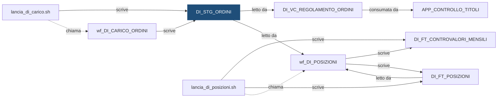

# Tabella: `DEMO_DWH.DI_STG_ORDINI`

> ⚙️ **Scheda generata automaticamente, non modificare a mano.** Commit analizzato `c276f3f` del 2026-09-30. Le spiegazioni scritte a mano vanno nella nota accanto al sorgente.

## Descrizione

**Tipo:** Tabella work (staging)

Ordini eseguiti nel giorno (acquisti e vendite di titoli), cosi come arrivano dal sistema fonte, per l'ultimo giorno caricato di ogni banca. Partizionata per istituto: a ogni elaborazione si svuota (TRUNCATE PARTITION) solo la banca in lavorazione.

**Commento sul database:** DEMO_INVESTIMENTI - Staging degli ordini eseguiti dal sistema fonte

## Struttura

| Campo | Tipo | Commento |
|---|---|---|
| `COD_ISTITUTO` | VARCHAR2(5 CHAR) NOT NULL | Codice dell istituto (valori fittizi 99xxx) |
| `DAT_RIFERIMENTO` | DATE NOT NULL | Data di riferimento (il giorno a cui si riferisce il file) |
| `ID_ORDINE` | VARCHAR2(30 CHAR) NOT NULL | Identificativo dell ordine nel sistema fonte |
| `COD_DOSSIER` | VARCHAR2(20 CHAR) NOT NULL | Codice del dossier titoli |
| `COD_TITOLO` | VARCHAR2(12 CHAR) NOT NULL | Codice ISIN del titolo (DI_DIM_TITOLO) |
| `COD_OPERAZIONE` | VARCHAR2(10 CHAR) NOT NULL | ACQUISTO oppure VENDITA |
| `QTA_ORDINE` | NUMBER(18,4) NOT NULL | Quantita di titoli comprata o venduta, sempre positiva |
| `IMP_PREZZO` | NUMBER(18,6) NOT NULL | Prezzo di esecuzione (per le obbligazioni in percentuale del valore nominale) |
| `COD_CONTO_ADDEBITO` | VARCHAR2(20 CHAR) | Conto su cui si regola l ordine (codice conto di DEMO_CONTI): DI_VC_REGOLAMENTO_ORDINI cerca su questo conto l addebito o l accredito |
| `COD_SISTEMA_FONTE` | VARCHAR2(10 CHAR) NOT NULL | Sistema fonte che ha inviato il record (es. FONTE_B) |
| `ID_ELABORAZIONE` | NUMBER(12) NOT NULL | Identificativo dell elaborazione che ha caricato il record |
| `DAT_CARICAMENTO` | DATE DEFAULT SYSDATE NOT NULL | Data e ora di caricamento del record |

**Partizionamento e memorizzazione**

```sql
TABLESPACE DEMO_DWH_DATA
NOLOGGING
PARTITION BY LIST (COD_ISTITUTO)
(
    PARTITION P_99001   VALUES ('99001'),
    PARTITION P_99002   VALUES ('99002'),
    PARTITION P_99003   VALUES ('99003'),
    PARTITION P_DEFAULT VALUES (DEFAULT)
)
```

## Chi scrive

| Chi scrive | Contesto | Campi | Dove |
|---|---|---|---|
| [`lancia_di_carico.sh`](lancia_di_carico.md) | STATEMENT | — | [`script/demo_investimenti/lancia_di_carico.sh:25`](../../script/demo_investimenti/lancia_di_carico.sh) |
| [`wf_DI_CARICO_ORDINI`](wf_DI_CARICO_ORDINI.md) | TARGET | COD_CONTO_ADDEBITO, COD_DOSSIER, COD_ISTITUTO, COD_OPERAZIONE, COD_SISTEMA_FONTE, COD_TITOLO, DAT_RIFERIMENTO, ID_ELABORAZIONE, ID_ORDINE, IMP_PREZZO, QTA_ORDINE | [`powercenter/DEMO_INVESTIMENTI/wf_DI_CARICO_ORDINI.xml:29`](../../powercenter/DEMO_INVESTIMENTI/wf_DI_CARICO_ORDINI.xml) |

## Chi legge

| Chi legge | Contesto | Campi | Dove |
|---|---|---|---|
| [`DI_VC_REGOLAMENTO_ORDINI`](DI_VC_REGOLAMENTO_ORDINI.md) | STATEMENT | COD_CONTO_ADDEBITO, COD_DOSSIER, COD_ISTITUTO, COD_OPERAZIONE, COD_TITOLO, DAT_RIFERIMENTO, ID_ORDINE, IMP_PREZZO, QTA_ORDINE | [`sql/DEMO_DWH/VIEWS/DI_VC_REGOLAMENTO_ORDINI.sql:50`](../../sql/DEMO_DWH/VIEWS/DI_VC_REGOLAMENTO_ORDINI.sql) |
| [`wf_DI_POSIZIONI`](wf_DI_POSIZIONI.md) | SOURCE | COD_DOSSIER, COD_ISTITUTO, COD_OPERAZIONE, COD_TITOLO, DAT_RIFERIMENTO, QTA_ORDINE | [`powercenter/DEMO_INVESTIMENTI/wf_DI_POSIZIONI.xml:15`](../../powercenter/DEMO_INVESTIMENTI/wf_DI_POSIZIONI.xml) |
| [`wf_DI_POSIZIONI`](wf_DI_POSIZIONI.md) | SQL_OVERRIDE | COD_DOSSIER, COD_ISTITUTO, COD_OPERAZIONE, COD_TITOLO, DAT_RIFERIMENTO, IMP_PREZZO, QTA_ORDINE | [`powercenter/DEMO_INVESTIMENTI/wf_DI_POSIZIONI.xml:64`](../../powercenter/DEMO_INVESTIMENTI/wf_DI_POSIZIONI.xml) |

## Impatti indiretti

Oggetti raggiunti a catena, a valle dei riferimenti diretti:

| Livello | Oggetto | Ruolo | Raggiunto da |
|---|---|---|---|
| 2 | `APP_CONTROLLO_TITOLI` | consuma | [`DI_VC_REGOLAMENTO_ORDINI`](DI_VC_REGOLAMENTO_ORDINI.md) |
| 2 | [`DI_FT_CONTROVALORI_MENSILI`](DI_FT_CONTROVALORI_MENSILI.md) | è scritto da | [`wf_DI_POSIZIONI`](wf_DI_POSIZIONI.md) |
| 2 | [`DI_FT_POSIZIONI`](DI_FT_POSIZIONI.md) | è scritto da | [`wf_DI_POSIZIONI`](wf_DI_POSIZIONI.md) |
| 2 | [`lancia_di_posizioni.sh`](lancia_di_posizioni.md) | chiama | [`wf_DI_POSIZIONI`](wf_DI_POSIZIONI.md) |
| 3 | [`DI_VC_QUADRATURA`](DI_VC_QUADRATURA.md) | legge | [`DI_FT_POSIZIONI`](DI_FT_POSIZIONI.md) |
| 4 | `APP_REPORTING` | consuma | [`DI_VC_QUADRATURA`](DI_VC_QUADRATURA.md) |
| 4 | `UTENTI_INVESTIMENTI` | consuma | [`DI_VC_QUADRATURA`](DI_VC_QUADRATURA.md) |

Diagramma dei primi due livelli:



## Note

Nota scritta a mano, da modificare nel repository: `sql/DEMO_DWH/TABLES/DI_STG_ORDINI.md`

### Perché

La tabella non conserva lo storico: contiene solo l'ultimo giorno caricato per
ciascun istituto. È partizionata per istituto proprio per poter ricaricare un
istituto senza toccare gli altri: con `-i 99001` la shell `lancia_di_carico.sh`
svuota solo quella partizione.

```sql
ALTER TABLE DEMO_DWH.DI_STG_ORDINI TRUNCATE PARTITION FOR ('99001');
```

Con `-i ALL` vengono svuotati e ricaricati tutti gli istituti.

### Attenzione

- Un istituto che finisce in `P_DEFAULT` non si può ricaricare da solo, perché il
  TRUNCATE svuoterebbe anche gli altri codici non censiti. Per ogni nuovo
  istituto va creata una partizione dedicata, dividendo la partizione DEFAULT
  (Oracle non accetta `ADD PARTITION` se esiste già): vale la stessa procedura
  descritta in `DC_STG_MOVIMENTI`, e vale anche per `DI_STG_PREZZI`.
- Il file arriva come `ordini_FONTE_B_<ISTITUTO>_<YYYYMMDD>.csv` nella cartella
  indicata da `DEMO_INPUT_DIR`.
- Gli ordini non generano movimenti: l'addebito o l'accredito sul conto arriva
  da `DEMO_CONTI` con i suoi flussi. `DI_VC_REGOLAMENTO_ORDINI` usa il conto di
  addebito per controllare che il movimento esista in `DC_FT_MOVIMENTI`: un
  codice conto sbagliato in questo file dà un `KO` in quella vista.

## Sorgente

[`sql/DEMO_DWH/TABLES/DI_STG_ORDINI.sql`](../../sql/DEMO_DWH/TABLES/DI_STG_ORDINI.sql)

## Limiti

L'analisi legge solo i file del repository. Non vede:

- **sinonimi** e **db link**: un oggetto letto tramite sinonimo o da un altro database non
  risulta collegato;
- **SQL dinamico**: le istruzioni costruite a runtime (`EXECUTE IMMEDIATE`, stringhe concatenate)
  sono segnalate come "da verificare", ma gli oggetti che toccano non sono noti;
- **oggetti non versionati**: tabelle, job o report che non stanno in questo repository
  (per esempio un cruscotto o un job di manutenzione dello schedulatore).

I risultati vanno sempre confermati con chi conosce il flusso.
