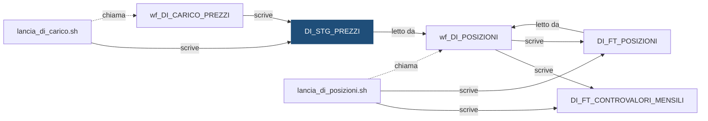

# Tabella: `DEMO_DWH.DI_STG_PREZZI`

> ⚙️ **Scheda generata automaticamente, non modificare a mano.** Commit analizzato `c276f3f` del 2026-09-30. Le spiegazioni scritte a mano vanno nella nota accanto al sorgente.

## Descrizione

**Tipo:** Tabella work (staging)

Prezzi di chiusura del giorno, uno per titolo, cosi come arrivano dal sistema fonte, per l'ultimo giorno caricato di ogni banca. Partizionata per istituto: a ogni elaborazione si svuota (TRUNCATE PARTITION) solo la banca in lavorazione.

**Commento sul database:** DEMO_INVESTIMENTI - Staging dei prezzi di chiusura dal sistema fonte

## Struttura

| Campo | Tipo | Commento |
|---|---|---|
| `COD_ISTITUTO` | VARCHAR2(5 CHAR) NOT NULL | Codice dell istituto (valori fittizi 99xxx) |
| `DAT_RIFERIMENTO` | DATE NOT NULL | Data di riferimento (il giorno del prezzo di chiusura) |
| `COD_TITOLO` | VARCHAR2(12 CHAR) NOT NULL | Codice ISIN del titolo, normalizzato (UPPER/TRIM) dalla Post SQL del carico |
| `IMP_PREZZO` | NUMBER(18,6) NOT NULL | Prezzo di chiusura (per le obbligazioni in percentuale del valore nominale) |
| `COD_SISTEMA_FONTE` | VARCHAR2(10 CHAR) NOT NULL | Sistema fonte che ha inviato il record (es. FONTE_C) |
| `ID_ELABORAZIONE` | NUMBER(12) NOT NULL | Identificativo dell elaborazione che ha caricato il record |
| `DAT_CARICAMENTO` | DATE DEFAULT SYSDATE NOT NULL | Data e ora di caricamento del record |

**Partizionamento e memorizzazione**

```sql
TABLESPACE DEMO_DWH_DATA
NOLOGGING
PARTITION BY LIST (COD_ISTITUTO)
(
    PARTITION P_99001   VALUES ('99001'),
    PARTITION P_99002   VALUES ('99002'),
    PARTITION P_99003   VALUES ('99003'),
    PARTITION P_DEFAULT VALUES (DEFAULT)
)
```

## Chi scrive

| Chi scrive | Contesto | Campi | Dove |
|---|---|---|---|
| [`lancia_di_carico.sh`](lancia_di_carico.md) | STATEMENT | — | [`script/demo_investimenti/lancia_di_carico.sh:26`](../../script/demo_investimenti/lancia_di_carico.sh) |
| [`wf_DI_CARICO_PREZZI`](wf_DI_CARICO_PREZZI.md) | POST_SQL | COD_ISTITUTO, COD_TITOLO | [`powercenter/DEMO_INVESTIMENTI/wf_DI_CARICO_PREZZI.xml:87`](../../powercenter/DEMO_INVESTIMENTI/wf_DI_CARICO_PREZZI.xml) |
| [`wf_DI_CARICO_PREZZI`](wf_DI_CARICO_PREZZI.md) | TARGET | COD_ISTITUTO, COD_SISTEMA_FONTE, COD_TITOLO, DAT_RIFERIMENTO, ID_ELABORAZIONE, IMP_PREZZO | [`powercenter/DEMO_INVESTIMENTI/wf_DI_CARICO_PREZZI.xml:24`](../../powercenter/DEMO_INVESTIMENTI/wf_DI_CARICO_PREZZI.xml) |

## Chi legge

| Chi legge | Contesto | Campi | Dove |
|---|---|---|---|
| [`wf_DI_POSIZIONI`](wf_DI_POSIZIONI.md) | SQL_OVERRIDE | COD_ISTITUTO, COD_TITOLO, DAT_RIFERIMENTO, IMP_PREZZO | [`powercenter/DEMO_INVESTIMENTI/wf_DI_POSIZIONI.xml:64`](../../powercenter/DEMO_INVESTIMENTI/wf_DI_POSIZIONI.xml) |

## Impatti indiretti

Oggetti raggiunti a catena, a valle dei riferimenti diretti:

| Livello | Oggetto | Ruolo | Raggiunto da |
|---|---|---|---|
| 2 | [`DI_FT_CONTROVALORI_MENSILI`](DI_FT_CONTROVALORI_MENSILI.md) | è scritto da | [`wf_DI_POSIZIONI`](wf_DI_POSIZIONI.md) |
| 2 | [`DI_FT_POSIZIONI`](DI_FT_POSIZIONI.md) | è scritto da | [`wf_DI_POSIZIONI`](wf_DI_POSIZIONI.md) |
| 2 | [`lancia_di_posizioni.sh`](lancia_di_posizioni.md) | chiama | [`wf_DI_POSIZIONI`](wf_DI_POSIZIONI.md) |
| 3 | [`DI_VC_QUADRATURA`](DI_VC_QUADRATURA.md) | legge | [`DI_FT_POSIZIONI`](DI_FT_POSIZIONI.md) |
| 4 | `APP_REPORTING` | consuma | [`DI_VC_QUADRATURA`](DI_VC_QUADRATURA.md) |
| 4 | `UTENTI_INVESTIMENTI` | consuma | [`DI_VC_QUADRATURA`](DI_VC_QUADRATURA.md) |

Diagramma dei primi due livelli:



## Note

Nota scritta a mano, da modificare nel repository: `sql/DEMO_DWH/TABLES/DI_STG_PREZZI.md`

### Perché

Come `DI_STG_ORDINI`, contiene solo l'ultimo giorno caricato per ciascun
istituto ed è partizionata per istituto, per ricaricare una banca senza toccare
le altre:

```sql
ALTER TABLE DEMO_DWH.DI_STG_PREZZI TRUNCATE PARTITION FOR ('99001');
```

Ogni banca riceve il proprio file dei prezzi, anche se i prezzi di mercato sono
gli stessi per tutte: si tiene la stessa struttura degli ordini, così una banca
si ricarica per intero (ordini e prezzi) con un solo lancio.

### Attenzione

- Il file può non contenere tutti i titoli: per quelli mancanti il flusso delle
  posizioni riporta l'ultimo prezzo disponibile e marca la riga (vedere
  `DI_FT_POSIZIONI`).
- Il file arriva come `prezzi_FONTE_C_<ISTITUTO>_<YYYYMMDD>.csv` nella cartella
  indicata da `DEMO_INPUT_DIR`.
- Per un nuovo istituto vale la stessa procedura di `DI_STG_ORDINI`: partizione
  dedicata, ottenuta dividendo la partizione DEFAULT.

## Sorgente

[`sql/DEMO_DWH/TABLES/DI_STG_PREZZI.sql`](../../sql/DEMO_DWH/TABLES/DI_STG_PREZZI.sql)

## Limiti

L'analisi legge solo i file del repository. Non vede:

- **sinonimi** e **db link**: un oggetto letto tramite sinonimo o da un altro database non
  risulta collegato;
- **SQL dinamico**: le istruzioni costruite a runtime (`EXECUTE IMMEDIATE`, stringhe concatenate)
  sono segnalate come "da verificare", ma gli oggetti che toccano non sono noti;
- **oggetti non versionati**: tabelle, job o report che non stanno in questo repository
  (per esempio un cruscotto o un job di manutenzione dello schedulatore).

I risultati vanno sempre confermati con chi conosce il flusso.
