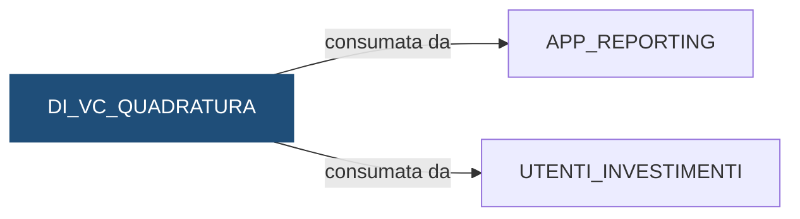

# Vista: `DEMO_DWH.DI_VC_QUADRATURA`

> ⚙️ **Scheda generata automaticamente, non modificare a mano.** Commit analizzato `c276f3f` del 2026-09-30. Le spiegazioni scritte a mano vanno nella nota accanto al sorgente.

## Descrizione

**Tipo:** Vista di controllo

Quadratura delle posizioni, una riga per banca e giorno: per ogni dossier e titolo, posizione iniziale + acquisti - vendite deve dare la posizione finale. ESITO: OK se tutte le righe del giorno quadrano, KO se almeno una non quadra.

**Commento sul database:** DEMO_INVESTIMENTI - Quadratura delle posizioni per istituto e giorno

## Struttura

| Colonna |
|---|
| `COD_ISTITUTO` |
| `DAT_RIFERIMENTO` |
| `NUM_POSIZIONI` |
| `NUM_POSIZIONI_QUADRANTI` |
| `ESITO` |

## Chi scrive

Nessun riferimento trovato nel repository.

## Chi legge

Nessun riferimento trovato nel repository.

## Cosa legge

| Oggetto letto | Contesto | Campi | Dove |
|---|---|---|---|
| [`DI_FT_POSIZIONI`](DI_FT_POSIZIONI.md) | STATEMENT | COD_ISTITUTO, DAT_RIFERIMENTO, QTA_ACQUISTI, QTA_FINALE, QTA_INIZIALE, QTA_VENDITE | [`sql/DEMO_DWH/VIEWS/DI_VC_QUADRATURA.sql:25`](../../sql/DEMO_DWH/VIEWS/DI_VC_QUADRATURA.sql) |

## Chi consuma

Schemi a cui la vista è concessa con `GRANT`:

| Schema | Dove |
|---|---|
| `APP_REPORTING` | [`sql/DEMO_DWH/VIEWS/DI_VC_QUADRATURA.sql:31`](../../sql/DEMO_DWH/VIEWS/DI_VC_QUADRATURA.sql) |
| `UTENTI_INVESTIMENTI` | [`sql/DEMO_DWH/VIEWS/DI_VC_QUADRATURA.sql:31`](../../sql/DEMO_DWH/VIEWS/DI_VC_QUADRATURA.sql) |

## Impatti indiretti

Nessun impatto indiretto trovato nel repository.

Diagramma dei primi due livelli:



## Note

Nota scritta a mano, da modificare nel repository: `sql/DEMO_DWH/VIEWS/DI_VC_QUADRATURA.md`

### Come leggere gli esiti

Una riga per istituto e giorno. `NUM_POSIZIONI` sono le righe del giorno,
`NUM_POSIZIONI_QUADRANTI` quelle in cui posizione iniziale + acquisti −
vendite dà la posizione finale: se i due numeri sono diversi l'esito è `KO`.

La posizione finale la calcola il flusso stesso con quella formula: la vista non
può accorgersi di un errore di calcolo, ma segnala righe modificate a mano o
scritte a metà da un caricamento interrotto.

### Query utili

```sql
SELECT *
  FROM DEMO_DWH.DI_VC_QUADRATURA
 WHERE ESITO = 'KO'
 ORDER BY DAT_RIFERIMENTO DESC;
```

### Attenzione

La vista è letta da altri schemi (vedi "Chi consuma" nella scheda): la
reportistica di controllo e gli utenti del motore la interrogano ogni giorno.
Rinominare o togliere una colonna rompe i loro report: va concordato prima.

## Sorgente

[`sql/DEMO_DWH/VIEWS/DI_VC_QUADRATURA.sql`](../../sql/DEMO_DWH/VIEWS/DI_VC_QUADRATURA.sql)

## Limiti

L'analisi legge solo i file del repository. Non vede:

- **sinonimi** e **db link**: un oggetto letto tramite sinonimo o da un altro database non
  risulta collegato;
- **SQL dinamico**: le istruzioni costruite a runtime (`EXECUTE IMMEDIATE`, stringhe concatenate)
  sono segnalate come "da verificare", ma gli oggetti che toccano non sono noti;
- **oggetti non versionati**: tabelle, job o report che non stanno in questo repository
  (per esempio un cruscotto o un job di manutenzione dello schedulatore).

I risultati vanno sempre confermati con chi conosce il flusso.
