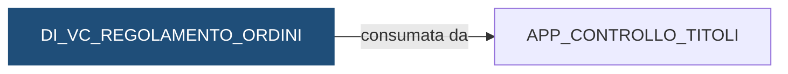

# Vista: `DEMO_DWH.DI_VC_REGOLAMENTO_ORDINI`

> ⚙️ **Scheda generata automaticamente, non modificare a mano.** Commit analizzato `c276f3f` del 2026-09-30. Le spiegazioni scritte a mano vanno nella nota accanto al sorgente.

## Descrizione

**Tipo:** Vista di controllo

Una riga per ogni ordine di DI_STG_ORDINI: verifica che sul conto di addebito esista il movimento corrispondente in DC_FT_MOVIMENTI, cioe stesso istituto, stesso conto, stesso giorno, stesso importo e causale ACQUISTO_TITOLI per un acquisto oppure VENDITA_TITOLI per una vendita. L'importo dell'ordine e quantita per prezzo (per le obbligazioni diviso 100). ESITO = KO se il movimento manca, altrimenti OK.

**Commento sul database:** DEMO_INVESTIMENTI - Ordini eseguiti con o senza il movimento di addebito o accredito sul conto

## Struttura

| Colonna |
|---|
| `COD_ISTITUTO` |
| `DAT_RIFERIMENTO` |
| `ID_ORDINE` |
| `COD_DOSSIER` |
| `COD_CONTO_ADDEBITO` |
| `COD_OPERAZIONE` |
| `IMP_ORDINE` |
| `ESITO` |

## Chi scrive

Nessun riferimento trovato nel repository.

## Chi legge

Nessun riferimento trovato nel repository.

## Cosa legge

| Oggetto letto | Contesto | Campi | Dove |
|---|---|---|---|
| [`DC_FT_MOVIMENTI`](DC_FT_MOVIMENTI.md) | STATEMENT | COD_CAUSALE, COD_CONTO, COD_ISTITUTO, DAT_CONTABILE, IMP_MOVIMENTO | [`sql/DEMO_DWH/VIEWS/DI_VC_REGOLAMENTO_ORDINI.sql:27`](../../sql/DEMO_DWH/VIEWS/DI_VC_REGOLAMENTO_ORDINI.sql) |
| [`DI_DIM_TITOLO`](DI_DIM_TITOLO.md) | STATEMENT | COD_TIPO, COD_TITOLO | [`sql/DEMO_DWH/VIEWS/DI_VC_REGOLAMENTO_ORDINI.sql:51`](../../sql/DEMO_DWH/VIEWS/DI_VC_REGOLAMENTO_ORDINI.sql) |
| [`DI_STG_ORDINI`](DI_STG_ORDINI.md) | STATEMENT | COD_CONTO_ADDEBITO, COD_DOSSIER, COD_ISTITUTO, COD_OPERAZIONE, COD_TITOLO, DAT_RIFERIMENTO, ID_ORDINE, IMP_PREZZO, QTA_ORDINE | [`sql/DEMO_DWH/VIEWS/DI_VC_REGOLAMENTO_ORDINI.sql:50`](../../sql/DEMO_DWH/VIEWS/DI_VC_REGOLAMENTO_ORDINI.sql) |

## Chi consuma

Schemi a cui la vista è concessa con `GRANT`:

| Schema | Dove |
|---|---|
| `APP_CONTROLLO_TITOLI` | [`sql/DEMO_DWH/VIEWS/DI_VC_REGOLAMENTO_ORDINI.sql:58`](../../sql/DEMO_DWH/VIEWS/DI_VC_REGOLAMENTO_ORDINI.sql) |

## Impatti indiretti

Nessun impatto indiretto trovato nel repository.

Diagramma dei primi due livelli:



## Note

Nota scritta a mano, da modificare nel repository: `sql/DEMO_DWH/VIEWS/DI_VC_REGOLAMENTO_ORDINI.md`

### Perché

Un ordine eseguito deve avere il suo addebito (acquisto) o accredito (vendita)
sul conto del cliente. Se l'ordine c'è ma il movimento no, il cliente ha
comprato titoli senza pagarli, o li ha venduti senza incassare: è un problema
per il cliente, che vede un saldo sbagliato, e per la banca, che ha dato i titoli
senza ricevere il denaro (o il contrario). Questa vista è il controllo che lo
scopre il giorno stesso.

È l'unico punto in cui i due motori si toccano: gli ordini sono di
`DEMO_INVESTIMENTI`, i movimenti dei conti di `DEMO_CONTI`.

### Come leggere gli esiti

- `KO`: manca il movimento con lo stesso istituto, conto, giorno, importo e la
  causale giusta (`ACQUISTO_TITOLI` per un acquisto, `VENDITA_TITOLI` per una
  vendita). Un importo diverso di un solo centesimo dà `KO`.
- `OK`: il movimento c'è.
- Un ordine senza conto di addebito dà sempre `KO`: non c'è dove cercare.

### Attenzione

- Lo staging contiene solo l'ultimo giorno caricato: la vista controlla solo
  quel giorno. Per un giorno passato serve rilanciare il carico degli ordini.
- Se i movimenti di un giorno non sono ancora stati caricati da `DEMO_CONTI`,
  tutti gli ordini di quel giorno risultano `KO` anche se l'addebito esiste nel
  sistema fonte. Prima di segnalare un problema controllare che il flusso dei
  movimenti sia girato.
- L'importo dell'ordine è quantità per prezzo; per le obbligazioni si divide per
  100, come nei controvalori mensili. Un titolo assente da `DI_DIM_TITOLO` è
  trattato come non obbligazione.
- Due ordini identici (stesso conto, giorno e importo) si accontentano di un
  solo movimento: il controllo non li conta uno a uno.
- Chi cambia il modo di registrare acquisti e vendite di titoli nei movimenti
  (causali, segno, data contabile) deve avvisare chi legge questa vista.

### Query utili

```sql
SELECT *
  FROM DEMO_DWH.DI_VC_REGOLAMENTO_ORDINI
 WHERE ESITO = 'KO'
 ORDER BY COD_ISTITUTO, COD_CONTO_ADDEBITO;
```

## Sorgente

[`sql/DEMO_DWH/VIEWS/DI_VC_REGOLAMENTO_ORDINI.sql`](../../sql/DEMO_DWH/VIEWS/DI_VC_REGOLAMENTO_ORDINI.sql)

## Limiti

L'analisi legge solo i file del repository. Non vede:

- **sinonimi** e **db link**: un oggetto letto tramite sinonimo o da un altro database non
  risulta collegato;
- **SQL dinamico**: le istruzioni costruite a runtime (`EXECUTE IMMEDIATE`, stringhe concatenate)
  sono segnalate come "da verificare", ma gli oggetti che toccano non sono noti;
- **oggetti non versionati**: tabelle, job o report che non stanno in questo repository
  (per esempio un cruscotto o un job di manutenzione dello schedulatore).

I risultati vanno sempre confermati con chi conosce il flusso.
