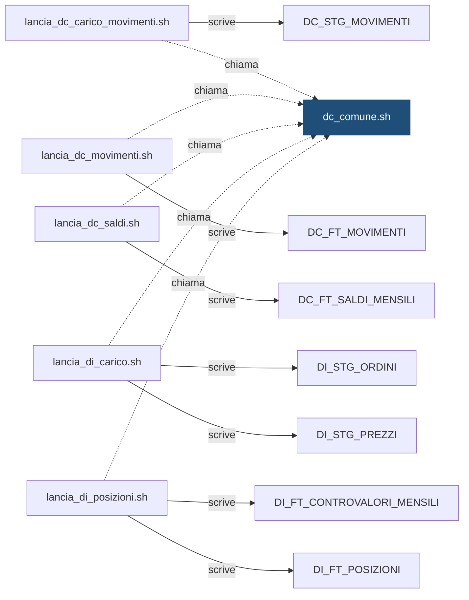

# Shell: `dc_comune.sh`

> ⚙️ **Scheda generata automaticamente, non modificare a mano.** Commit analizzato `c276f3f` del 2026-09-30. Le spiegazioni scritte a mano vanno nella nota accanto al sorgente.

## Descrizione

Funzioni comuni alle shell di lancio del motore. Non si esegue da sola: viene inclusa (source) da lancia_dc_*.sh, che prima definiscono FLUSSO, WORKFLOW, FLUSSO_VALLE e la funzione svuota_target, poi chiamano esegui_flusso "$@". Un flusso che lancia piu workflow di seguito definisce WORKFLOWS (elenco separato da spazi) al posto di WORKFLOW. Il motore che la usa puo definire PMCMD_CARTELLA prima di includerla (default: DEMO_CONTI). Ogni shell puo ridefinire data_predefinita (data usata senza -d) e controlla_data (verifica della data ricevuta).

## Struttura

**Parametri** (letti dal codice che interpreta la riga di comando):

| Opzione | Variabile | Valore | Definita in |
|---|---|---|---|
| `-i` | `ISTITUTO` | argomento successivo | [`script/demo_conti/dc_comune.sh`](../../script/demo_conti/dc_comune.sh) |
| `-d` | `DATA_RIF` | argomento successivo | [`script/demo_conti/dc_comune.sh`](../../script/demo_conti/dc_comune.sh) |
| `-f` | `FORZATO` | `S` | [`script/demo_conti/dc_comune.sh`](../../script/demo_conti/dc_comune.sh) |

**Variabili impostate:**

| Variabile | Valore | Commento |
|---|---|---|
| `RC_OK` | `0` | esecuzione completata |
| `RC_ERRORE` | `1` | errore bloccante |
| `RC_SEMAFORO` | `2` | semaforo KO, dati non disponibili (lo schedulatore ritenta) |
| `RC_WORKFLOW` | `3` | errore nel workflow ETL |
| `ISTITUTI_ATTIVI` | `99001 99002 99003` | — |
| `PMCMD_DOMINIO` | `DOM_DEMO` | — |
| `PMCMD_SERVIZIO` | `IS_DEMO` | — |
| `PMCMD_CARTELLA` | `${PMCMD_CARTELLA:-DEMO_CONTI}` | — |
| `LOG_DIR` | `${DEMO_LOG_DIR:-/tmp}` | — |

**Funzioni definite:** `log`, `esegui_sql`, `data_sql`, `data_predefinita`, `leggi_parametri`, `verifica_semafori`, `apri_elaborazione`, `chiudi_elaborazione`, `fallisci`, `avvia_workflow`, `lancia_workflow`, `esegui_flusso`

## Chi lo chiama

| Chiamante | Contesto | Campi | Dove |
|---|---|---|---|
| [`lancia_dc_carico_movimenti.sh`](lancia_dc_carico_movimenti.md) | STATEMENT | — | [`script/demo_conti/lancia_dc_carico_movimenti.sh:16`](../../script/demo_conti/lancia_dc_carico_movimenti.sh) |
| [`lancia_dc_movimenti.sh`](lancia_dc_movimenti.md) | STATEMENT | — | [`script/demo_conti/lancia_dc_movimenti.sh:17`](../../script/demo_conti/lancia_dc_movimenti.sh) |
| [`lancia_dc_saldi.sh`](lancia_dc_saldi.md) | STATEMENT | — | [`script/demo_conti/lancia_dc_saldi.sh:20`](../../script/demo_conti/lancia_dc_saldi.sh) |
| [`lancia_di_carico.sh`](lancia_di_carico.md) | STATEMENT | — | [`script/demo_investimenti/lancia_di_carico.sh:21`](../../script/demo_investimenti/lancia_di_carico.sh) |
| [`lancia_di_posizioni.sh`](lancia_di_posizioni.md) | STATEMENT | — | [`script/demo_investimenti/lancia_di_posizioni.sh:20`](../../script/demo_investimenti/lancia_di_posizioni.sh) |

## Cosa chiama

| Oggetto chiamato | Contesto | Campi | Dove |
|---|---|---|---|
| [`DC_FN_SEMAFORO`](DC_FN_SEMAFORO.md) | STATEMENT | — | [`script/demo_conti/dc_comune.sh:84`](../../script/demo_conti/dc_comune.sh) |
| [`DC_PKG_ELABORAZIONE`](DC_PKG_ELABORAZIONE.md) | STATEMENT | — | [`script/demo_conti/dc_comune.sh:96`](../../script/demo_conti/dc_comune.sh) |

## Impatti indiretti

Oggetti raggiunti a catena, a valle dei riferimenti diretti:

| Livello | Oggetto | Ruolo | Raggiunto da |
|---|---|---|---|
| 2 | [`DC_FT_MOVIMENTI`](DC_FT_MOVIMENTI.md) | è scritto da | [`lancia_dc_movimenti.sh`](lancia_dc_movimenti.md) |
| 2 | [`DC_FT_SALDI_MENSILI`](DC_FT_SALDI_MENSILI.md) | è scritto da | [`lancia_dc_saldi.sh`](lancia_dc_saldi.md) |
| 2 | [`DC_STG_MOVIMENTI`](DC_STG_MOVIMENTI.md) | è scritto da | [`lancia_dc_carico_movimenti.sh`](lancia_dc_carico_movimenti.md) |
| 2 | [`DI_FT_CONTROVALORI_MENSILI`](DI_FT_CONTROVALORI_MENSILI.md) | è scritto da | [`lancia_di_posizioni.sh`](lancia_di_posizioni.md) |
| 2 | [`DI_FT_POSIZIONI`](DI_FT_POSIZIONI.md) | è scritto da | [`lancia_di_posizioni.sh`](lancia_di_posizioni.md) |
| 2 | [`DI_STG_ORDINI`](DI_STG_ORDINI.md) | è scritto da | [`lancia_di_carico.sh`](lancia_di_carico.md) |
| 2 | [`DI_STG_PREZZI`](DI_STG_PREZZI.md) | è scritto da | [`lancia_di_carico.sh`](lancia_di_carico.md) |
| 3 | [`DC_VC_QUADRATURA`](DC_VC_QUADRATURA.md) | legge | [`DC_FT_MOVIMENTI`](DC_FT_MOVIMENTI.md) |
| 3 | [`DC_VC_VOLUMI_GIORNALIERI`](DC_VC_VOLUMI_GIORNALIERI.md) | legge | [`DC_FT_MOVIMENTI`](DC_FT_MOVIMENTI.md) |
| 3 | [`DI_VC_QUADRATURA`](DI_VC_QUADRATURA.md) | legge | [`DI_FT_POSIZIONI`](DI_FT_POSIZIONI.md) |
| 3 | [`DI_VC_REGOLAMENTO_ORDINI`](DI_VC_REGOLAMENTO_ORDINI.md) | legge | [`DC_FT_MOVIMENTI`](DC_FT_MOVIMENTI.md) |
| 3 | [`wf_DC_MOVIMENTI`](wf_DC_MOVIMENTI.md) | legge | [`DC_STG_MOVIMENTI`](DC_STG_MOVIMENTI.md) |
| 3 | [`wf_DC_SALDI`](wf_DC_SALDI.md) | legge | [`DC_FT_MOVIMENTI`](DC_FT_MOVIMENTI.md) |
| 3 | [`wf_DI_POSIZIONI`](wf_DI_POSIZIONI.md) | legge | [`DI_FT_POSIZIONI`](DI_FT_POSIZIONI.md) |
| 4 | `APP_CONTROLLO_TITOLI` | consuma | [`DI_VC_REGOLAMENTO_ORDINI`](DI_VC_REGOLAMENTO_ORDINI.md) |
| 4 | `APP_REPORTING` | consuma | [`DC_VC_QUADRATURA`](DC_VC_QUADRATURA.md) |
| 4 | `UTENTI_CONTI` | consuma | [`DC_VC_QUADRATURA`](DC_VC_QUADRATURA.md) |
| 4 | `UTENTI_INVESTIMENTI` | consuma | [`DI_VC_QUADRATURA`](DI_VC_QUADRATURA.md) |

Diagramma dei primi due livelli:

## Note

Nota scritta a mano, da modificare nel repository: `script/demo_conti/dc_comune.md`

### Perché

La libreria è **condivisa** con `DEMO_INVESTIMENTI`: le sue shell (`lancia_di_carico.sh`
e `lancia_di_posizioni.sh`) la includono dalla cartella di `DEMO_CONTI` invece di
averne una copia. Così semaforo, log delle elaborazioni e package sono gli stessi
per i due motori. Ogni shell che la usa può scegliere la cartella PowerCenter
(`PMCMD_CARTELLA`) e, se lancia più workflow di seguito, elencarli in `WORKFLOWS`.

### Attenzione

- Una modifica a questa libreria cambia il comportamento delle shell di entrambi
  i motori: prima di committare vanno provate tutte.
- Per aggiungere un istituto bisogna aggiornare `ISTITUTI_ATTIVI` **e** creare le
  partizioni dedicate nelle tabelle di entrambi i motori (vedere la nota di
  `DC_STG_MOVIMENTI` e quella di `DI_STG_ORDINI`). Aggiornare solo la variabile fa
  finire i dati nella partizione `DEFAULT`.
- Senza `-d` le shell usano il giorno prima. `lancia_dc_saldi.sh` cambia la
  regola (ultimo giorno del mese precedente) ridefinendo `data_predefinita`.

## Sorgente

[`script/demo_conti/dc_comune.sh`](../../script/demo_conti/dc_comune.sh)

## Limiti

L'analisi legge solo i file del repository. Non vede:

- **sinonimi** e **db link**: un oggetto letto tramite sinonimo o da un altro database non
  risulta collegato;
- **SQL dinamico**: le istruzioni costruite a runtime (`EXECUTE IMMEDIATE`, stringhe concatenate)
  sono segnalate come "da verificare", ma gli oggetti che toccano non sono noti;
- **oggetti non versionati**: tabelle, job o report che non stanno in questo repository
  (per esempio un cruscotto o un job di manutenzione dello schedulatore).

I risultati vanno sempre confermati con chi conosce il flusso.
