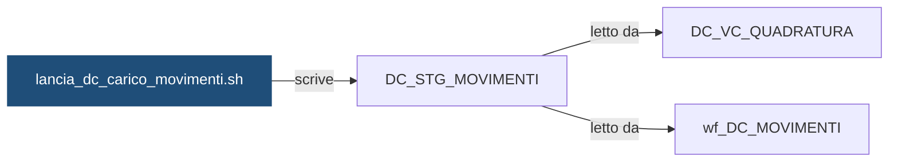

# Shell: `lancia_dc_carico_movimenti.sh`

> ⚙️ **Scheda generata automaticamente, non modificare a mano.** Commit analizzato `c276f3f` del 2026-09-30. Le spiegazioni scritte a mano vanno nella nota accanto al sorgente.

## Descrizione

Carica in DC_STG_MOVIMENTI il file giornaliero dei movimenti del sistema fonte FONTE_A, per banca, con wf_DC_CARICO_MOVIMENTI. A fine carico sblocca il flusso DC_MOVIMENTI.

## Struttura

**Uso:** `lancia_dc_carico_movimenti.sh -i <ISTITUTO|ALL> [-d YYYYMMDD] [-f]`

**Parametri** (letti dal codice che interpreta la riga di comando):

| Opzione | Variabile | Valore | Definita in |
|---|---|---|---|
| `-i` | `ISTITUTO` | argomento successivo | [`script/demo_conti/dc_comune.sh`](../../script/demo_conti/dc_comune.sh) |
| `-d` | `DATA_RIF` | argomento successivo | [`script/demo_conti/dc_comune.sh`](../../script/demo_conti/dc_comune.sh) |
| `-f` | `FORZATO` | `S` | [`script/demo_conti/dc_comune.sh`](../../script/demo_conti/dc_comune.sh) |

**Variabili impostate:**

| Variabile | Valore | Commento |
|---|---|---|
| `FLUSSO` | `DC_CARICO` | — |
| `WORKFLOW` | `wf_DC_CARICO_MOVIMENTI` | — |
| `FLUSSO_VALLE` | `DC_MOVIMENTI` | — |

**Funzioni definite:** `svuota_target`, `parametri_extra`

## Cosa scrive

| Oggetto scritto | Contesto | Campi | Dove |
|---|---|---|---|
| [`DC_STG_MOVIMENTI`](DC_STG_MOVIMENTI.md) | STATEMENT | — | [`script/demo_conti/lancia_dc_carico_movimenti.sh:20`](../../script/demo_conti/lancia_dc_carico_movimenti.sh) |

## Cosa chiama

| Oggetto chiamato | Contesto | Campi | Dove |
|---|---|---|---|
| [`dc_comune.sh`](dc_comune.md) | STATEMENT | — | [`script/demo_conti/lancia_dc_carico_movimenti.sh:16`](../../script/demo_conti/lancia_dc_carico_movimenti.sh) |
| [`wf_DC_CARICO_MOVIMENTI`](wf_DC_CARICO_MOVIMENTI.md) | STATEMENT | — | [`script/demo_conti/lancia_dc_carico_movimenti.sh:16`](../../script/demo_conti/lancia_dc_carico_movimenti.sh) |

## Impatti indiretti

Oggetti raggiunti a catena, a valle dei riferimenti diretti:

| Livello | Oggetto | Ruolo | Raggiunto da |
|---|---|---|---|
| 2 | [`DC_VC_QUADRATURA`](DC_VC_QUADRATURA.md) | legge | [`DC_STG_MOVIMENTI`](DC_STG_MOVIMENTI.md) |
| 2 | [`wf_DC_MOVIMENTI`](wf_DC_MOVIMENTI.md) | legge | [`DC_STG_MOVIMENTI`](DC_STG_MOVIMENTI.md) |
| 3 | `APP_REPORTING` | consuma | [`DC_VC_QUADRATURA`](DC_VC_QUADRATURA.md) |
| 3 | [`DC_FT_MOVIMENTI`](DC_FT_MOVIMENTI.md) | è scritto da | [`wf_DC_MOVIMENTI`](wf_DC_MOVIMENTI.md) |
| 3 | `UTENTI_CONTI` | consuma | [`DC_VC_QUADRATURA`](DC_VC_QUADRATURA.md) |
| 3 | [`lancia_dc_movimenti.sh`](lancia_dc_movimenti.md) | chiama | [`wf_DC_MOVIMENTI`](wf_DC_MOVIMENTI.md) |
| 4 | [`DC_VC_VOLUMI_GIORNALIERI`](DC_VC_VOLUMI_GIORNALIERI.md) | legge | [`DC_FT_MOVIMENTI`](DC_FT_MOVIMENTI.md) |
| 4 | [`DI_VC_REGOLAMENTO_ORDINI`](DI_VC_REGOLAMENTO_ORDINI.md) | legge | [`DC_FT_MOVIMENTI`](DC_FT_MOVIMENTI.md) |
| 4 | [`wf_DC_SALDI`](wf_DC_SALDI.md) | legge | [`DC_FT_MOVIMENTI`](DC_FT_MOVIMENTI.md) |
| 5 | `APP_CONTROLLO_TITOLI` | consuma | [`DI_VC_REGOLAMENTO_ORDINI`](DI_VC_REGOLAMENTO_ORDINI.md) |
| 5 | [`DC_FT_SALDI_MENSILI`](DC_FT_SALDI_MENSILI.md) | è scritto da | [`wf_DC_SALDI`](wf_DC_SALDI.md) |
| 5 | [`lancia_dc_saldi.sh`](lancia_dc_saldi.md) | chiama | [`wf_DC_SALDI`](wf_DC_SALDI.md) |

Diagramma dei primi due livelli:



## Note

Nota scritta a mano, da modificare nel repository: `script/demo_conti/lancia_dc_carico_movimenti.md`

### Perché

Gira nello schedulatore Control-M come job `DC_CARICO_GIORN` (folder `DEMO_CONTI`),
ogni giorno lavorativo, con `-i ALL`. Senza `-d` carica il file del giorno prima.

### Attenzione

- Con `-i ALL` gli istituti vengono elaborati uno alla volta: se uno fallisce,
  lo script si ferma e gli istituti successivi non vengono lanciati. Dopo la
  correzione si rilancia solo l'istituto in errore con `-i <ISTITUTO>`.
- Lo staging tiene un solo giorno per banca: rilanciare il carico di un giorno
  passato cancella quello caricato dopo. Dopo un rilancio di questo tipo va
  rilanciato anche `lancia_dc_movimenti.sh` per lo stesso istituto e giorno.

### Comandi utili

```bash
# Rilancio manuale di un solo istituto, senza semaforo
./lancia_dc_carico_movimenti.sh -i 99001 -d 20260929 -f

# Rilancio di tutti gli istituti per un giorno preciso
./lancia_dc_carico_movimenti.sh -i ALL -d 20260929 -f
```

## Sorgente

[`script/demo_conti/lancia_dc_carico_movimenti.sh`](../../script/demo_conti/lancia_dc_carico_movimenti.sh)

## Limiti

L'analisi legge solo i file del repository. Non vede:

- **sinonimi** e **db link**: un oggetto letto tramite sinonimo o da un altro database non
  risulta collegato;
- **SQL dinamico**: le istruzioni costruite a runtime (`EXECUTE IMMEDIATE`, stringhe concatenate)
  sono segnalate come "da verificare", ma gli oggetti che toccano non sono noti;
- **oggetti non versionati**: tabelle, job o report che non stanno in questo repository
  (per esempio un cruscotto o un job di manutenzione dello schedulatore).

I risultati vanno sempre confermati con chi conosce il flusso.
