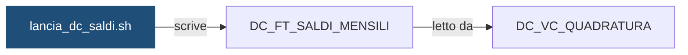

# Shell: `lancia_dc_saldi.sh`

> ⚙️ **Scheda generata automaticamente, non modificare a mano.** Commit analizzato `c276f3f` del 2026-09-30. Le spiegazioni scritte a mano vanno nella nota accanto al sorgente.

## Descrizione

Lancia wf_DC_SALDI per una banca (-i <ISTITUTO>) o per tutte le banche attive (-i ALL): calcola per ogni conto saldo iniziale, entrate, uscite e saldo finale del mese e scrive DC_FT_SALDI_MENSILI. E' l'ultimo flusso della catena: non sblocca altri flussi. La data e' l'ultimo giorno del mese; senza -d si usa il mese precedente.

## Struttura

**Uso:** `lancia_dc_saldi.sh -i <ISTITUTO|ALL> [-d YYYYMMDD] [-f]`

**Parametri** (letti dal codice che interpreta la riga di comando):

| Opzione | Variabile | Valore | Definita in |
|---|---|---|---|
| `-i` | `ISTITUTO` | argomento successivo | [`script/demo_conti/dc_comune.sh`](../../script/demo_conti/dc_comune.sh) |
| `-d` | `DATA_RIF` | argomento successivo | [`script/demo_conti/dc_comune.sh`](../../script/demo_conti/dc_comune.sh) |
| `-f` | `FORZATO` | `S` | [`script/demo_conti/dc_comune.sh`](../../script/demo_conti/dc_comune.sh) |

**Variabili impostate:**

| Variabile | Valore | Commento |
|---|---|---|
| `FLUSSO` | `DC_SALDI` | — |
| `WORKFLOW` | `wf_DC_SALDI` | — |
| `FLUSSO_VALLE` | `` | — |

**Funzioni definite:** `data_predefinita`, `controlla_data`, `svuota_target`

## Cosa scrive

| Oggetto scritto | Contesto | Campi | Dove |
|---|---|---|---|
| [`DC_FT_SALDI_MENSILI`](DC_FT_SALDI_MENSILI.md) | STATEMENT | — | [`script/demo_conti/lancia_dc_saldi.sh:35`](../../script/demo_conti/lancia_dc_saldi.sh) |

## Cosa chiama

| Oggetto chiamato | Contesto | Campi | Dove |
|---|---|---|---|
| [`dc_comune.sh`](dc_comune.md) | STATEMENT | — | [`script/demo_conti/lancia_dc_saldi.sh:20`](../../script/demo_conti/lancia_dc_saldi.sh) |
| [`wf_DC_SALDI`](wf_DC_SALDI.md) | STATEMENT | — | [`script/demo_conti/lancia_dc_saldi.sh:20`](../../script/demo_conti/lancia_dc_saldi.sh) |

## Impatti indiretti

Oggetti raggiunti a catena, a valle dei riferimenti diretti:

| Livello | Oggetto | Ruolo | Raggiunto da |
|---|---|---|---|
| 2 | [`DC_VC_QUADRATURA`](DC_VC_QUADRATURA.md) | legge | [`DC_FT_SALDI_MENSILI`](DC_FT_SALDI_MENSILI.md) |
| 3 | `APP_REPORTING` | consuma | [`DC_VC_QUADRATURA`](DC_VC_QUADRATURA.md) |
| 3 | `UTENTI_CONTI` | consuma | [`DC_VC_QUADRATURA`](DC_VC_QUADRATURA.md) |

Diagramma dei primi due livelli:



## Note

Nota scritta a mano, da modificare nel repository: `script/demo_conti/lancia_dc_saldi.md`

### Perché

Gira nello schedulatore Control-M come job `DC_SALDI_MENS` (folder `DEMO_CONTI`),
mensile, dal 2° giorno lavorativo del mese, con `-i ALL`. Senza `-d` calcola i
saldi del mese precedente.

La data deve essere l'ultimo giorno del mese: la shell esce con errore se ne
riceve un'altra, per non scrivere saldi con una data di riferimento sbagliata.

### Attenzione

- Con `-i ALL` gli istituti vengono elaborati uno alla volta: se uno fallisce,
  lo script si ferma e gli istituti successivi non vengono lanciati. Dopo la
  correzione si rilancia solo l'istituto in errore con `-i <ISTITUTO>`.
- Il semaforo aspetta che siano stati caricati i movimenti dell'ultimo giorno
  del mese, ma non controlla che ci siano tutti i giorni precedenti: prima di
  forzare un lancio guardare `DC_VC_VOLUMI_GIORNALIERI`.
- Se cambiano i movimenti di un mese passato vanno rilanciati i saldi di quel
  mese e dei successivi, in ordine.

### Comandi utili

```bash
# Rilancio manuale di un solo istituto, senza semaforo
./lancia_dc_saldi.sh -i 99001 -d 20260831 -f

# Rilancio di tutti gli istituti per un mese preciso
./lancia_dc_saldi.sh -i ALL -d 20260831 -f
```

## Sorgente

[`script/demo_conti/lancia_dc_saldi.sh`](../../script/demo_conti/lancia_dc_saldi.sh)

## Limiti

L'analisi legge solo i file del repository. Non vede:

- **sinonimi** e **db link**: un oggetto letto tramite sinonimo o da un altro database non
  risulta collegato;
- **SQL dinamico**: le istruzioni costruite a runtime (`EXECUTE IMMEDIATE`, stringhe concatenate)
  sono segnalate come "da verificare", ma gli oggetti che toccano non sono noti;
- **oggetti non versionati**: tabelle, job o report che non stanno in questo repository
  (per esempio un cruscotto o un job di manutenzione dello schedulatore).

I risultati vanno sempre confermati con chi conosce il flusso.
