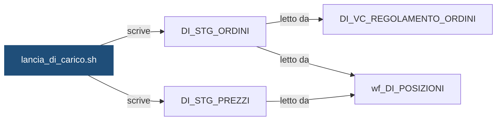

# Shell: `lancia_di_carico.sh`

> ⚙️ **Scheda generata automaticamente, non modificare a mano.** Commit analizzato `c276f3f` del 2026-09-30. Le spiegazioni scritte a mano vanno nella nota accanto al sorgente.

## Descrizione

Carica gli staging del giorno per una banca (-i <ISTITUTO>) o per tutte le banche attive (-i ALL): gli ordini eseguiti (FONTE_B) in DI_STG_ORDINI con wf_DI_CARICO_ORDINI e i prezzi di chiusura (FONTE_C) in DI_STG_PREZZI con wf_DI_CARICO_PREZZI. A fine carico sblocca il flusso DI_POSIZIONI. Usa la libreria di DEMO_CONTI (dc_comune.sh): semaforo, log delle elaborazioni e package sono condivisi tra i due motori.

## Struttura

**Uso:** `lancia_di_carico.sh -i <ISTITUTO|ALL> [-d YYYYMMDD] [-f]`

**Parametri** (letti dal codice che interpreta la riga di comando):

| Opzione | Variabile | Valore | Definita in |
|---|---|---|---|
| `-i` | `ISTITUTO` | argomento successivo | [`script/demo_conti/dc_comune.sh`](../../script/demo_conti/dc_comune.sh) |
| `-d` | `DATA_RIF` | argomento successivo | [`script/demo_conti/dc_comune.sh`](../../script/demo_conti/dc_comune.sh) |
| `-f` | `FORZATO` | `S` | [`script/demo_conti/dc_comune.sh`](../../script/demo_conti/dc_comune.sh) |

**Variabili impostate:**

| Variabile | Valore | Commento |
|---|---|---|
| `FLUSSO` | `DI_CARICO` | — |
| `WORKFLOWS` | `wf_DI_CARICO_ORDINI wf_DI_CARICO_PREZZI` | — |
| `FLUSSO_VALLE` | `DI_POSIZIONI` | — |
| `PMCMD_CARTELLA` | `DEMO_INVESTIMENTI` | — |

**Funzioni definite:** `svuota_target`, `parametri_extra`

## Cosa scrive

| Oggetto scritto | Contesto | Campi | Dove |
|---|---|---|---|
| [`DI_STG_ORDINI`](DI_STG_ORDINI.md) | STATEMENT | — | [`script/demo_investimenti/lancia_di_carico.sh:25`](../../script/demo_investimenti/lancia_di_carico.sh) |
| [`DI_STG_PREZZI`](DI_STG_PREZZI.md) | STATEMENT | — | [`script/demo_investimenti/lancia_di_carico.sh:26`](../../script/demo_investimenti/lancia_di_carico.sh) |

## Cosa chiama

| Oggetto chiamato | Contesto | Campi | Dove |
|---|---|---|---|
| [`dc_comune.sh`](dc_comune.md) | STATEMENT | — | [`script/demo_investimenti/lancia_di_carico.sh:21`](../../script/demo_investimenti/lancia_di_carico.sh) |
| [`wf_DI_CARICO_ORDINI`](wf_DI_CARICO_ORDINI.md) | STATEMENT | — | [`script/demo_investimenti/lancia_di_carico.sh:21`](../../script/demo_investimenti/lancia_di_carico.sh) |
| [`wf_DI_CARICO_PREZZI`](wf_DI_CARICO_PREZZI.md) | STATEMENT | — | [`script/demo_investimenti/lancia_di_carico.sh:21`](../../script/demo_investimenti/lancia_di_carico.sh) |

## Impatti indiretti

Oggetti raggiunti a catena, a valle dei riferimenti diretti:

| Livello | Oggetto | Ruolo | Raggiunto da |
|---|---|---|---|
| 2 | [`DI_VC_REGOLAMENTO_ORDINI`](DI_VC_REGOLAMENTO_ORDINI.md) | legge | [`DI_STG_ORDINI`](DI_STG_ORDINI.md) |
| 2 | [`wf_DI_POSIZIONI`](wf_DI_POSIZIONI.md) | legge | [`DI_STG_ORDINI`](DI_STG_ORDINI.md) |
| 3 | `APP_CONTROLLO_TITOLI` | consuma | [`DI_VC_REGOLAMENTO_ORDINI`](DI_VC_REGOLAMENTO_ORDINI.md) |
| 3 | [`DI_FT_CONTROVALORI_MENSILI`](DI_FT_CONTROVALORI_MENSILI.md) | è scritto da | [`wf_DI_POSIZIONI`](wf_DI_POSIZIONI.md) |
| 3 | [`DI_FT_POSIZIONI`](DI_FT_POSIZIONI.md) | è scritto da | [`wf_DI_POSIZIONI`](wf_DI_POSIZIONI.md) |
| 3 | [`lancia_di_posizioni.sh`](lancia_di_posizioni.md) | chiama | [`wf_DI_POSIZIONI`](wf_DI_POSIZIONI.md) |
| 4 | [`DI_VC_QUADRATURA`](DI_VC_QUADRATURA.md) | legge | [`DI_FT_POSIZIONI`](DI_FT_POSIZIONI.md) |
| 5 | `APP_REPORTING` | consuma | [`DI_VC_QUADRATURA`](DI_VC_QUADRATURA.md) |
| 5 | `UTENTI_INVESTIMENTI` | consuma | [`DI_VC_QUADRATURA`](DI_VC_QUADRATURA.md) |

Diagramma dei primi due livelli:



## Note

Nota scritta a mano, da modificare nel repository: `script/demo_investimenti/lancia_di_carico.md`

### Perché

Gira nello schedulatore Control-M come job `DI_CARICO_GIORN` (folder
`DEMO_INVESTIMENTI`), ogni giorno lavorativo, con `-i ALL`. Senza `-d` carica i
file del giorno prima.

Lancia due workflow di seguito, ordini e prezzi, dentro la stessa elaborazione:
un'elaborazione è "riuscita" solo se lo sono entrambi. Il semaforo `DI_CARICO`
aspetta due fonti, gli ordini (`FONTE_B`) e i prezzi (`FONTE_C`): parte solo quando
sono arrivati tutti e due i file.

Semaforo, log delle elaborazioni e package sono quelli di `DEMO_CONTI`
(`DC_CTL_SEMAFORO`, `DC_LOG_ELABORAZIONI`, `DC_PKG_ELABORAZIONE`), raggiunti
tramite la libreria `dc_comune.sh`: non esistono copie per gli investimenti.

### Attenzione

- Con `-i ALL` gli istituti vengono elaborati uno alla volta: se uno fallisce,
  lo script si ferma e gli istituti successivi non vengono lanciati. Dopo la
  correzione si rilancia solo l'istituto in errore con `-i <ISTITUTO>`.
- Se fallisce il secondo workflow (prezzi), il primo (ordini) è già stato
  caricato, ma il rilancio svuota comunque entrambi gli staging e ricarica tutto.
- Gli staging tengono un solo giorno per banca: rilanciare il carico di un giorno
  passato cancella quello caricato dopo. Dopo un rilancio di questo tipo va
  rilanciato anche `lancia_di_posizioni.sh` per lo stesso istituto e giorno.
- Ogni istituto che si aggiunge a `ISTITUTI_ATTIVI` in `dc_comune.sh` vale per
  entrambi i motori: servono le partizioni dedicate anche in `DI_STG_ORDINI` e
  `DI_STG_PREZZI`.

### Comandi utili

```bash
# Rilancio manuale di un solo istituto, senza semaforo
./lancia_di_carico.sh -i 99001 -d 20260929 -f

# Rilancio di tutti gli istituti per un giorno preciso
./lancia_di_carico.sh -i ALL -d 20260929 -f
```

## Sorgente

[`script/demo_investimenti/lancia_di_carico.sh`](../../script/demo_investimenti/lancia_di_carico.sh)

## Limiti

L'analisi legge solo i file del repository. Non vede:

- **sinonimi** e **db link**: un oggetto letto tramite sinonimo o da un altro database non
  risulta collegato;
- **SQL dinamico**: le istruzioni costruite a runtime (`EXECUTE IMMEDIATE`, stringhe concatenate)
  sono segnalate come "da verificare", ma gli oggetti che toccano non sono noti;
- **oggetti non versionati**: tabelle, job o report che non stanno in questo repository
  (per esempio un cruscotto o un job di manutenzione dello schedulatore).

I risultati vanno sempre confermati con chi conosce il flusso.
