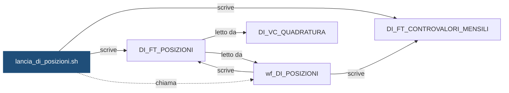

# Shell: `lancia_di_posizioni.sh`

> ⚙️ **Scheda generata automaticamente, non modificare a mano.** Commit analizzato `c276f3f` del 2026-09-30. Le spiegazioni scritte a mano vanno nella nota accanto al sorgente.

## Descrizione

Lancia wf_DI_POSIZIONI per una banca (-i <ISTITUTO>) o per tutte le banche attive (-i ALL): calcola le posizioni di fine giorno in DI_FT_POSIZIONI e, nel giorno di fine mese, il controvalore dei dossier in DI_FT_CONTROVALORI_MENSILI. E' l'ultimo flusso della catena: non sblocca altri flussi. Usa la libreria di DEMO_CONTI (dc_comune.sh).

## Struttura

**Uso:** `lancia_di_posizioni.sh -i <ISTITUTO|ALL> [-d YYYYMMDD] [-f]`

**Parametri** (letti dal codice che interpreta la riga di comando):

| Opzione | Variabile | Valore | Definita in |
|---|---|---|---|
| `-i` | `ISTITUTO` | argomento successivo | [`script/demo_conti/dc_comune.sh`](../../script/demo_conti/dc_comune.sh) |
| `-d` | `DATA_RIF` | argomento successivo | [`script/demo_conti/dc_comune.sh`](../../script/demo_conti/dc_comune.sh) |
| `-f` | `FORZATO` | `S` | [`script/demo_conti/dc_comune.sh`](../../script/demo_conti/dc_comune.sh) |

**Variabili impostate:**

| Variabile | Valore | Commento |
|---|---|---|
| `FLUSSO` | `DI_POSIZIONI` | — |
| `WORKFLOW` | `wf_DI_POSIZIONI` | — |
| `FLUSSO_VALLE` | `` | — |
| `PMCMD_CARTELLA` | `DEMO_INVESTIMENTI` | — |

**Funzioni definite:** `fine_mese`, `svuota_target`, `parametri_extra`

## Cosa scrive

| Oggetto scritto | Contesto | Campi | Dove |
|---|---|---|---|
| [`DI_FT_CONTROVALORI_MENSILI`](DI_FT_CONTROVALORI_MENSILI.md) | STATEMENT | — | [`script/demo_investimenti/lancia_di_posizioni.sh:33`](../../script/demo_investimenti/lancia_di_posizioni.sh) |
| [`DI_FT_POSIZIONI`](DI_FT_POSIZIONI.md) | STATEMENT | COD_ISTITUTO, DAT_RIFERIMENTO | [`script/demo_investimenti/lancia_di_posizioni.sh:30`](../../script/demo_investimenti/lancia_di_posizioni.sh) |

## Cosa chiama

| Oggetto chiamato | Contesto | Campi | Dove |
|---|---|---|---|
| [`dc_comune.sh`](dc_comune.md) | STATEMENT | — | [`script/demo_investimenti/lancia_di_posizioni.sh:20`](../../script/demo_investimenti/lancia_di_posizioni.sh) |
| [`wf_DI_POSIZIONI`](wf_DI_POSIZIONI.md) | STATEMENT | — | [`script/demo_investimenti/lancia_di_posizioni.sh:20`](../../script/demo_investimenti/lancia_di_posizioni.sh) |

## Impatti indiretti

Oggetti raggiunti a catena, a valle dei riferimenti diretti:

| Livello | Oggetto | Ruolo | Raggiunto da |
|---|---|---|---|
| 2 | [`DI_VC_QUADRATURA`](DI_VC_QUADRATURA.md) | legge | [`DI_FT_POSIZIONI`](DI_FT_POSIZIONI.md) |
| 2 | [`wf_DI_POSIZIONI`](wf_DI_POSIZIONI.md) | legge | [`DI_FT_POSIZIONI`](DI_FT_POSIZIONI.md) |
| 3 | `APP_REPORTING` | consuma | [`DI_VC_QUADRATURA`](DI_VC_QUADRATURA.md) |
| 3 | `UTENTI_INVESTIMENTI` | consuma | [`DI_VC_QUADRATURA`](DI_VC_QUADRATURA.md) |

Diagramma dei primi due livelli:



## Note

Nota scritta a mano, da modificare nel repository: `script/demo_investimenti/lancia_di_posizioni.md`

### Perché

Gira nello schedulatore Control-M come job `DI_POS_GIORN` (folder
`DEMO_INVESTIMENTI`), ogni giorno lavorativo, con `-i ALL`.

Le posizioni sono giornaliere e il controvalore è mensile, ma il flusso è uno
solo: il workflow riceve il parametro `FLG_FINE_MESE` e calcola i controvalori
solo quando la data è l'ultimo giorno del mese. Negli altri giorni scrive solo
le posizioni.

La shell cancella con una `DELETE` le posizioni del solo giorno e istituto in
lavorazione, e non con un `TRUNCATE`: la sottopartizione contiene tutto il mese
della banca. Solo per il controvalore, che è uno per mese, si svuota la coppia
(mese, istituto).

### Attenzione

- Con `-i ALL` gli istituti vengono elaborati uno alla volta: se uno fallisce,
  lo script si ferma e gli istituti successivi non vengono lanciati. Dopo la
  correzione si rilancia solo l'istituto in errore con `-i <ISTITUTO>`.
- Legge gli staging, che contengono un solo giorno per banca: il giorno da
  elaborare deve essere quello caricato per ultimo da `lancia_di_carico.sh`.
- Le posizioni partono dal giorno precedente: se si rilancia un giorno passato
  vanno rilanciati in ordine anche tutti i successivi, compreso l'ultimo giorno
  del mese per rifare il controvalore.
- Il semaforo, il log e il package sono quelli di `DEMO_CONTI`
  (`DC_CTL_SEMAFORO`, `DC_LOG_ELABORAZIONI`, `DC_PKG_ELABORAZIONE`).

### Comandi utili

```bash
# Rilancio manuale di un solo istituto, senza semaforo
./lancia_di_posizioni.sh -i 99001 -d 20260929 -f

# Rilancio di tutti gli istituti per un giorno preciso
./lancia_di_posizioni.sh -i ALL -d 20260929 -f
```

## Sorgente

[`script/demo_investimenti/lancia_di_posizioni.sh`](../../script/demo_investimenti/lancia_di_posizioni.sh)

## Limiti

L'analisi legge solo i file del repository. Non vede:

- **sinonimi** e **db link**: un oggetto letto tramite sinonimo o da un altro database non
  risulta collegato;
- **SQL dinamico**: le istruzioni costruite a runtime (`EXECUTE IMMEDIATE`, stringhe concatenate)
  sono segnalate come "da verificare", ma gli oggetti che toccano non sono noti;
- **oggetti non versionati**: tabelle, job o report che non stanno in questo repository
  (per esempio un cruscotto o un job di manutenzione dello schedulatore).

I risultati vanno sempre confermati con chi conosce il flusso.
