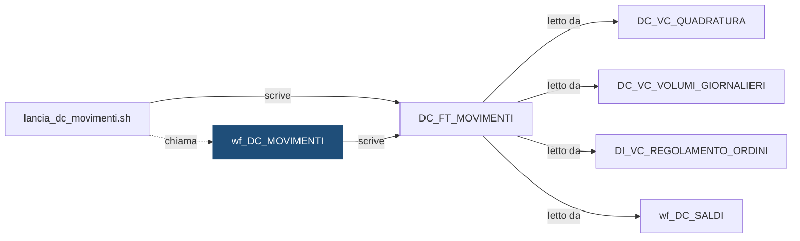

# Workflow: `wf_DC_MOVIMENTI`

> ⚙️ **Scheda generata automaticamente, non modificare a mano.** Commit analizzato `c276f3f` del 2026-09-30. Le spiegazioni scritte a mano vanno nella nota accanto al sorgente.

## Descrizione

DEMO_CONTI - flusso dei movimenti, lanciato da lancia_dc_movimenti.sh. Dall'intestazione dell'export: Export PowerCenter SEMPLIFICATO e INVENTATO a scopo dimostrativo. Contiene solo i campi principali; non e' importabile in un repository reale.

## Struttura

**Sessioni**

| Sessione | Mapping | Descrizione |
|---|---|---|
| `s_m_DC_MOVIMENTI` | `m_DC_MOVIMENTI` | Carico dei movimenti per istituto e giorno |

**Source**

| Nome | Tipo | Campi |
|---|---|---|
| [`DC_STG_MOVIMENTI`](DC_STG_MOVIMENTI.md) | Oracle | 8 |

**Target**

| Nome | Tipo | Campi |
|---|---|---|
| [`DC_FT_MOVIMENTI`](DC_FT_MOVIMENTI.md) | Oracle | 10 |

**Lookup**

| Trasformazione | Tabella |
|---|---|
| `LKP_DC_DIM_CAUSALE` | [`DC_DIM_CAUSALE`](DC_DIM_CAUSALE.md) |

**Parametri:** `$$COD_ISTITUTO`, `$$DAT_RIFERIMENTO`, `$$ID_ELABORAZIONE`

## Chi lo chiama

| Chiamante | Contesto | Campi | Dove |
|---|---|---|---|
| [`lancia_dc_movimenti.sh`](lancia_dc_movimenti.md) | STATEMENT | — | [`script/demo_conti/lancia_dc_movimenti.sh:17`](../../script/demo_conti/lancia_dc_movimenti.sh) |

## Cosa scrive

| Oggetto scritto | Contesto | Campi | Dove |
|---|---|---|---|
| [`DC_FT_MOVIMENTI`](DC_FT_MOVIMENTI.md) | TARGET | COD_CAUSALE, COD_CONTO, COD_ISTITUTO, COD_SEGNO, DAT_CONTABILE, DAT_VALUTA, ID_ELABORAZIONE, ID_MOVIMENTO, IMP_CON_SEGNO, IMP_MOVIMENTO | [`powercenter/DEMO_CONTI/wf_DC_MOVIMENTI.xml:27`](../../powercenter/DEMO_CONTI/wf_DC_MOVIMENTI.xml) |

## Cosa legge

| Oggetto letto | Contesto | Campi | Dove |
|---|---|---|---|
| [`DC_DIM_CAUSALE`](DC_DIM_CAUSALE.md) | LOOKUP | COD_CAUSALE, COD_SEGNO, DAT_FINE_VALIDITA, DAT_INIZIO_VALIDITA | [`powercenter/DEMO_CONTI/wf_DC_MOVIMENTI.xml:53`](../../powercenter/DEMO_CONTI/wf_DC_MOVIMENTI.xml) |
| [`DC_STG_MOVIMENTI`](DC_STG_MOVIMENTI.md) | SOURCE | COD_CAUSALE, COD_CONTO, COD_ISTITUTO, DAT_CONTABILE, DAT_RIFERIMENTO, DAT_VALUTA, ID_MOVIMENTO, IMP_MOVIMENTO | [`powercenter/DEMO_CONTI/wf_DC_MOVIMENTI.xml:15`](../../powercenter/DEMO_CONTI/wf_DC_MOVIMENTI.xml) |
| [`DC_STG_MOVIMENTI`](DC_STG_MOVIMENTI.md) | SQL_OVERRIDE | COD_CAUSALE, COD_CONTO, COD_ISTITUTO, DAT_CARICAMENTO, DAT_CONTABILE, DAT_RIFERIMENTO, DAT_VALUTA, ID_MOVIMENTO, IMP_MOVIMENTO | [`powercenter/DEMO_CONTI/wf_DC_MOVIMENTI.xml:45`](../../powercenter/DEMO_CONTI/wf_DC_MOVIMENTI.xml) |

## Impatti indiretti

Oggetti raggiunti a catena, a valle dei riferimenti diretti:

| Livello | Oggetto | Ruolo | Raggiunto da |
|---|---|---|---|
| 2 | [`DC_VC_QUADRATURA`](DC_VC_QUADRATURA.md) | legge | [`DC_FT_MOVIMENTI`](DC_FT_MOVIMENTI.md) |
| 2 | [`DC_VC_VOLUMI_GIORNALIERI`](DC_VC_VOLUMI_GIORNALIERI.md) | legge | [`DC_FT_MOVIMENTI`](DC_FT_MOVIMENTI.md) |
| 2 | [`DI_VC_REGOLAMENTO_ORDINI`](DI_VC_REGOLAMENTO_ORDINI.md) | legge | [`DC_FT_MOVIMENTI`](DC_FT_MOVIMENTI.md) |
| 2 | [`wf_DC_SALDI`](wf_DC_SALDI.md) | legge | [`DC_FT_MOVIMENTI`](DC_FT_MOVIMENTI.md) |
| 3 | `APP_CONTROLLO_TITOLI` | consuma | [`DI_VC_REGOLAMENTO_ORDINI`](DI_VC_REGOLAMENTO_ORDINI.md) |
| 3 | `APP_REPORTING` | consuma | [`DC_VC_QUADRATURA`](DC_VC_QUADRATURA.md) |
| 3 | [`DC_FT_SALDI_MENSILI`](DC_FT_SALDI_MENSILI.md) | è scritto da | [`wf_DC_SALDI`](wf_DC_SALDI.md) |
| 3 | `UTENTI_CONTI` | consuma | [`DC_VC_QUADRATURA`](DC_VC_QUADRATURA.md) |
| 3 | [`lancia_dc_saldi.sh`](lancia_dc_saldi.md) | chiama | [`wf_DC_SALDI`](wf_DC_SALDI.md) |

Diagramma dei primi due livelli:

## Note

Nota scritta a mano, da modificare nel repository: `powercenter/DEMO_CONTI/wf_DC_MOVIMENTI.md`

### Perché

**Doppioni.** Il file della fonte può contenere lo stesso movimento più volte.
Il flusso ne tiene uno solo, riconoscendolo dall'identificativo
(`ID_MOVIMENTO`); la deduplica sta nella query di override della source. Vale
dentro il file del giorno: se lo stesso identificativo arrivasse in un altro
giorno, non verrebbe riconosciuto.

**Causale sconosciuta.** Se la causale non è in `DC_DIM_CAUSALE`, il movimento
non viene caricato. È voluto: meglio un movimento in meno che un movimento con
il segno sbagliato, e la quadratura tra staging e movimenti (`DC_VC_QUADRATURA`)
va in `KO` e lo segnala.

### Attenzione

- Si rilancia sempre tramite la shell `lancia_dc_movimenti.sh`, che cancella
  prima i movimenti del giorno. Lanciato a mano dal client PowerCenter, il
  workflow duplicherebbe i dati, perché la sessione non tronca il target.
- Dopo un rilancio dei movimenti vanno rilanciati anche i saldi del mese.
- L'export XML è **semplificato**: non è importabile in un repository reale.

## Sorgente

[`powercenter/DEMO_CONTI/wf_DC_MOVIMENTI.xml`](../../powercenter/DEMO_CONTI/wf_DC_MOVIMENTI.xml)

## Limiti

L'analisi legge solo i file del repository. Non vede:

- **sinonimi** e **db link**: un oggetto letto tramite sinonimo o da un altro database non
  risulta collegato;
- **SQL dinamico**: le istruzioni costruite a runtime (`EXECUTE IMMEDIATE`, stringhe concatenate)
  sono segnalate come "da verificare", ma gli oggetti che toccano non sono noti;
- **oggetti non versionati**: tabelle, job o report che non stanno in questo repository
  (per esempio un cruscotto o un job di manutenzione dello schedulatore).

I risultati vanno sempre confermati con chi conosce il flusso.
