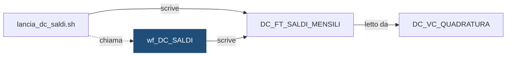

# Workflow: `wf_DC_SALDI`

> ⚙️ **Scheda generata automaticamente, non modificare a mano.** Commit analizzato `c276f3f` del 2026-09-30. Le spiegazioni scritte a mano vanno nella nota accanto al sorgente.

## Descrizione

DEMO_CONTI - saldi mensili, lanciato da lancia_dc_saldi.sh. Dall'intestazione dell'export: Export PowerCenter SEMPLIFICATO e INVENTATO a scopo dimostrativo. Contiene solo i campi principali; non e' importabile in un repository reale.

## Struttura

**Sessioni**

| Sessione | Mapping | Descrizione |
|---|---|---|
| `s_m_DC_SALDI` | `m_DC_SALDI` | Calcolo dei saldi mensili per istituto e mese |

**Source**

| Nome | Tipo | Campi |
|---|---|---|
| [`DC_FT_MOVIMENTI`](DC_FT_MOVIMENTI.md) | Oracle | 6 |

**Target**

| Nome | Tipo | Campi |
|---|---|---|
| [`DC_FT_SALDI_MENSILI`](DC_FT_SALDI_MENSILI.md) | Oracle | 8 |

**Parametri:** `$$COD_ISTITUTO`, `$$DAT_RIFERIMENTO`, `$$ID_ELABORAZIONE`

## Chi lo chiama

| Chiamante | Contesto | Campi | Dove |
|---|---|---|---|
| [`lancia_dc_saldi.sh`](lancia_dc_saldi.md) | STATEMENT | — | [`script/demo_conti/lancia_dc_saldi.sh:20`](../../script/demo_conti/lancia_dc_saldi.sh) |

## Cosa scrive

| Oggetto scritto | Contesto | Campi | Dove |
|---|---|---|---|
| [`DC_FT_SALDI_MENSILI`](DC_FT_SALDI_MENSILI.md) | TARGET | COD_CONTO, COD_ISTITUTO, DAT_RIFERIMENTO, ID_ELABORAZIONE, IMP_ENTRATE, IMP_SALDO_FINALE, IMP_SALDO_INIZIALE, IMP_USCITE | [`powercenter/DEMO_CONTI/wf_DC_SALDI.xml:25`](../../powercenter/DEMO_CONTI/wf_DC_SALDI.xml) |

## Cosa legge

| Oggetto letto | Contesto | Campi | Dove |
|---|---|---|---|
| [`DC_FT_MOVIMENTI`](DC_FT_MOVIMENTI.md) | SOURCE | COD_CONTO, COD_ISTITUTO, COD_SEGNO, DAT_CONTABILE, IMP_CON_SEGNO, IMP_MOVIMENTO | [`powercenter/DEMO_CONTI/wf_DC_SALDI.xml:15`](../../powercenter/DEMO_CONTI/wf_DC_SALDI.xml) |
| [`DC_FT_MOVIMENTI`](DC_FT_MOVIMENTI.md) | SQL_OVERRIDE | COD_CONTO, COD_ISTITUTO, COD_SEGNO, DAT_CONTABILE, IMP_CON_SEGNO, IMP_MOVIMENTO | [`powercenter/DEMO_CONTI/wf_DC_SALDI.xml:41`](../../powercenter/DEMO_CONTI/wf_DC_SALDI.xml) |

## Impatti indiretti

Oggetti raggiunti a catena, a valle dei riferimenti diretti:

| Livello | Oggetto | Ruolo | Raggiunto da |
|---|---|---|---|
| 2 | [`DC_VC_QUADRATURA`](DC_VC_QUADRATURA.md) | legge | [`DC_FT_SALDI_MENSILI`](DC_FT_SALDI_MENSILI.md) |
| 3 | `APP_REPORTING` | consuma | [`DC_VC_QUADRATURA`](DC_VC_QUADRATURA.md) |
| 3 | `UTENTI_CONTI` | consuma | [`DC_VC_QUADRATURA`](DC_VC_QUADRATURA.md) |

Diagramma dei primi due livelli:

## Note

Nota scritta a mano, da modificare nel repository: `powercenter/DEMO_CONTI/wf_DC_SALDI.md`

### Perché

Saldo iniziale e saldo finale si calcolano nella query di override della source,
sommando i movimenti con segno fino alla propria data. Si usa la **data
contabile**: la data valuta serve agli interessi, non ai saldi. Per questo un
movimento contabilizzato a fine mese ma con valuta nel mese dopo conta nel mese
in cui è stato contabilizzato.

Entrate e uscite si sommano a parte, e non si ricavano per differenza: così
`DC_VC_QUADRATURA` può controllare che saldo iniziale + entrate − uscite dia il
saldo finale.

### Attenzione

- Si rilancia sempre tramite la shell `lancia_dc_saldi.sh`, che svuota prima la
  sottopartizione (mese, istituto). Lanciato a mano dal client PowerCenter, il
  workflow duplicherebbe i dati, perché la sessione non tronca il target.
- Legge tutta la storia dei movimenti dell'istituto, non solo il mese: è il
  motivo per cui un movimento in ritardo su un mese passato obbliga a
  rilanciare anche i mesi successivi.
- L'export XML è **semplificato**: non è importabile in un repository reale.

## Sorgente

[`powercenter/DEMO_CONTI/wf_DC_SALDI.xml`](../../powercenter/DEMO_CONTI/wf_DC_SALDI.xml)

## Limiti

L'analisi legge solo i file del repository. Non vede:

- **sinonimi** e **db link**: un oggetto letto tramite sinonimo o da un altro database non
  risulta collegato;
- **SQL dinamico**: le istruzioni costruite a runtime (`EXECUTE IMMEDIATE`, stringhe concatenate)
  sono segnalate come "da verificare", ma gli oggetti che toccano non sono noti;
- **oggetti non versionati**: tabelle, job o report che non stanno in questo repository
  (per esempio un cruscotto o un job di manutenzione dello schedulatore).

I risultati vanno sempre confermati con chi conosce il flusso.
