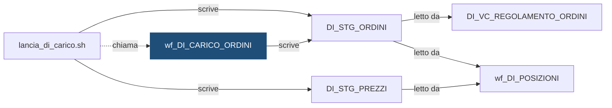

# Workflow: `wf_DI_CARICO_ORDINI`

> ⚙️ **Scheda generata automaticamente, non modificare a mano.** Commit analizzato `c276f3f` del 2026-09-30. Le spiegazioni scritte a mano vanno nella nota accanto al sorgente.

## Descrizione

DEMO_INVESTIMENTI - carico degli ordini, lanciato da lancia_di_carico.sh. Dall'intestazione dell'export: Export PowerCenter SEMPLIFICATO e INVENTATO a scopo dimostrativo. Contiene solo i campi principali; non e' importabile in un repository reale.

## Struttura

**Sessioni**

| Sessione | Mapping | Descrizione |
|---|---|---|
| `s_m_DI_CARICO_ORDINI` | `m_DI_CARICO_ORDINI` | Carico del file degli ordini di una banca nello staging |

**Source**

| Nome | Tipo | Campi |
|---|---|---|
| `FF_ORDINI_FONTE_B` | Flat File | 9 |

**Target**

| Nome | Tipo | Campi |
|---|---|---|
| [`DI_STG_ORDINI`](DI_STG_ORDINI.md) | Oracle | 11 |

**Parametri:** `$$COD_ISTITUTO`, `$$DAT_RIFERIMENTO`, `$$ID_ELABORAZIONE`

## Chi lo chiama

| Chiamante | Contesto | Campi | Dove |
|---|---|---|---|
| [`lancia_di_carico.sh`](lancia_di_carico.md) | STATEMENT | — | [`script/demo_investimenti/lancia_di_carico.sh:21`](../../script/demo_investimenti/lancia_di_carico.sh) |

## Cosa scrive

| Oggetto scritto | Contesto | Campi | Dove |
|---|---|---|---|
| [`DI_STG_ORDINI`](DI_STG_ORDINI.md) | TARGET | COD_CONTO_ADDEBITO, COD_DOSSIER, COD_ISTITUTO, COD_OPERAZIONE, COD_SISTEMA_FONTE, COD_TITOLO, DAT_RIFERIMENTO, ID_ELABORAZIONE, ID_ORDINE, IMP_PREZZO, QTA_ORDINE | [`powercenter/DEMO_INVESTIMENTI/wf_DI_CARICO_ORDINI.xml:29`](../../powercenter/DEMO_INVESTIMENTI/wf_DI_CARICO_ORDINI.xml) |

## Cosa legge

| Oggetto letto | Contesto | Campi | Dove |
|---|---|---|---|
| `FF_ORDINI_FONTE_B` | SOURCE | COD_CONTO_ADDEBITO, COD_DOSSIER, COD_ISTITUTO, COD_OPERAZIONE, COD_TITOLO, DATA_RIFERIMENTO, ID_ORDINE, IMP_PREZZO, QTA_ORDINE | [`powercenter/DEMO_INVESTIMENTI/wf_DI_CARICO_ORDINI.xml:15`](../../powercenter/DEMO_INVESTIMENTI/wf_DI_CARICO_ORDINI.xml) |

## Impatti indiretti

Oggetti raggiunti a catena, a valle dei riferimenti diretti:

| Livello | Oggetto | Ruolo | Raggiunto da |
|---|---|---|---|
| 2 | [`DI_STG_PREZZI`](DI_STG_PREZZI.md) | è scritto da | [`lancia_di_carico.sh`](lancia_di_carico.md) |
| 2 | [`DI_VC_REGOLAMENTO_ORDINI`](DI_VC_REGOLAMENTO_ORDINI.md) | legge | [`DI_STG_ORDINI`](DI_STG_ORDINI.md) |
| 2 | [`wf_DI_POSIZIONI`](wf_DI_POSIZIONI.md) | legge | [`DI_STG_ORDINI`](DI_STG_ORDINI.md) |
| 3 | `APP_CONTROLLO_TITOLI` | consuma | [`DI_VC_REGOLAMENTO_ORDINI`](DI_VC_REGOLAMENTO_ORDINI.md) |
| 3 | [`DI_FT_CONTROVALORI_MENSILI`](DI_FT_CONTROVALORI_MENSILI.md) | è scritto da | [`wf_DI_POSIZIONI`](wf_DI_POSIZIONI.md) |
| 3 | [`DI_FT_POSIZIONI`](DI_FT_POSIZIONI.md) | è scritto da | [`wf_DI_POSIZIONI`](wf_DI_POSIZIONI.md) |
| 3 | [`lancia_di_posizioni.sh`](lancia_di_posizioni.md) | chiama | [`wf_DI_POSIZIONI`](wf_DI_POSIZIONI.md) |
| 4 | [`DI_VC_QUADRATURA`](DI_VC_QUADRATURA.md) | legge | [`DI_FT_POSIZIONI`](DI_FT_POSIZIONI.md) |
| 5 | `APP_REPORTING` | consuma | [`DI_VC_QUADRATURA`](DI_VC_QUADRATURA.md) |
| 5 | `UTENTI_INVESTIMENTI` | consuma | [`DI_VC_QUADRATURA`](DI_VC_QUADRATURA.md) |

Diagramma dei primi due livelli:

## Note

Nota scritta a mano, da modificare nel repository: `powercenter/DEMO_INVESTIMENTI/wf_DI_CARICO_ORDINI.md`

### Perché

Il carico scarta le righe con un'operazione diversa da `ACQUISTO` o `VENDITA`
e quelle senza quantità: un ordine che non si sa se aumenti o riduca la
posizione, o senza quantità, falserebbe la quantità in modo silenzioso. Le righe
scartate non arrivano nello staging.

### Attenzione

- Si rilancia sempre tramite la shell `lancia_di_carico.sh`, che svuota prima la
  partizione dell'istituto: la sessione non tronca il target.
- Il file degli ordini e quello dei prezzi si caricano insieme, dalla stessa
  shell. Rilanciare solo questo workflow a mano lascia gli staging sfasati.
- Se il file non è arrivato, la sessione fallisce e la shell esce con `3`. Prima
  di rilanciare verificare che il file sia nella cartella `DEMO_INPUT_DIR`.
- L'export XML è **semplificato**: non è importabile in un repository reale.

## Sorgente

[`powercenter/DEMO_INVESTIMENTI/wf_DI_CARICO_ORDINI.xml`](../../powercenter/DEMO_INVESTIMENTI/wf_DI_CARICO_ORDINI.xml)

## Limiti

L'analisi legge solo i file del repository. Non vede:

- **sinonimi** e **db link**: un oggetto letto tramite sinonimo o da un altro database non
  risulta collegato;
- **SQL dinamico**: le istruzioni costruite a runtime (`EXECUTE IMMEDIATE`, stringhe concatenate)
  sono segnalate come "da verificare", ma gli oggetti che toccano non sono noti;
- **oggetti non versionati**: tabelle, job o report che non stanno in questo repository
  (per esempio un cruscotto o un job di manutenzione dello schedulatore).

I risultati vanno sempre confermati con chi conosce il flusso.
