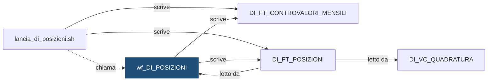

# Workflow: `wf_DI_POSIZIONI`

> ⚙️ **Scheda generata automaticamente, non modificare a mano.** Commit analizzato `c276f3f` del 2026-09-30. Le spiegazioni scritte a mano vanno nella nota accanto al sorgente.

## Descrizione

DEMO_INVESTIMENTI - posizioni giornaliere e controvalori di fine mese, lanciato da lancia_di_posizioni.sh. Dall'intestazione dell'export: Export PowerCenter SEMPLIFICATO e INVENTATO a scopo dimostrativo. Contiene solo i campi principali; non e' importabile in un repository reale.

## Struttura

**Sessioni**

| Sessione | Mapping | Descrizione |
|---|---|---|
| `s_m_DI_POSIZIONI` | `m_DI_POSIZIONI` | Posizioni di fine giornata per istituto |
| `s_m_DI_CONTROVALORI` | `m_DI_CONTROVALORI` | Controvalori dei dossier, solo a fine mese |

**Source**

| Nome | Tipo | Campi |
|---|---|---|
| [`DI_STG_ORDINI`](DI_STG_ORDINI.md) | Oracle | 6 |
| [`DI_FT_POSIZIONI`](DI_FT_POSIZIONI.md) | Oracle | 7 |

**Target**

| Nome | Tipo | Campi |
|---|---|---|
| [`DI_FT_POSIZIONI`](DI_FT_POSIZIONI.md) | Oracle | 11 |
| [`DI_FT_CONTROVALORI_MENSILI`](DI_FT_CONTROVALORI_MENSILI.md) | Oracle | 7 |

**Lookup**

| Trasformazione | Tabella |
|---|---|
| `LKP_DI_DIM_TITOLO` | [`DI_DIM_TITOLO`](DI_DIM_TITOLO.md) |

**Parametri:** `$$COD_ISTITUTO`, `$$DAT_RIFERIMENTO`, `$$FLG_FINE_MESE`, `$$ID_ELABORAZIONE`

## Chi lo chiama

| Chiamante | Contesto | Campi | Dove |
|---|---|---|---|
| [`lancia_di_posizioni.sh`](lancia_di_posizioni.md) | STATEMENT | — | [`script/demo_investimenti/lancia_di_posizioni.sh:20`](../../script/demo_investimenti/lancia_di_posizioni.sh) |

## Cosa scrive

| Oggetto scritto | Contesto | Campi | Dove |
|---|---|---|---|
| [`DI_FT_CONTROVALORI_MENSILI`](DI_FT_CONTROVALORI_MENSILI.md) | TARGET | COD_DOSSIER, COD_ISTITUTO, DAT_RIFERIMENTO, ID_ELABORAZIONE, IMP_CONTROVALORE, NUM_TITOLI, NUM_TITOLI_PREZZO_RIPORTATO | [`powercenter/DEMO_INVESTIMENTI/wf_DI_POSIZIONI.xml:47`](../../powercenter/DEMO_INVESTIMENTI/wf_DI_POSIZIONI.xml) |
| [`DI_FT_POSIZIONI`](DI_FT_POSIZIONI.md) | TARGET | COD_DOSSIER, COD_ISTITUTO, COD_TITOLO, DAT_RIFERIMENTO, FLG_PREZZO_RIPORTATO, ID_ELABORAZIONE, IMP_PREZZO, QTA_ACQUISTI, QTA_FINALE, QTA_INIZIALE, QTA_VENDITE | [`powercenter/DEMO_INVESTIMENTI/wf_DI_POSIZIONI.xml:34`](../../powercenter/DEMO_INVESTIMENTI/wf_DI_POSIZIONI.xml) |

## Cosa legge

| Oggetto letto | Contesto | Campi | Dove |
|---|---|---|---|
| [`DI_DIM_TITOLO`](DI_DIM_TITOLO.md) | LOOKUP | COD_TIPO, COD_TITOLO | [`powercenter/DEMO_INVESTIMENTI/wf_DI_POSIZIONI.xml:121`](../../powercenter/DEMO_INVESTIMENTI/wf_DI_POSIZIONI.xml) |
| [`DI_FT_POSIZIONI`](DI_FT_POSIZIONI.md) | SOURCE | COD_DOSSIER, COD_ISTITUTO, COD_TITOLO, DAT_RIFERIMENTO, FLG_PREZZO_RIPORTATO, IMP_PREZZO, QTA_FINALE | [`powercenter/DEMO_INVESTIMENTI/wf_DI_POSIZIONI.xml:23`](../../powercenter/DEMO_INVESTIMENTI/wf_DI_POSIZIONI.xml) |
| [`DI_FT_POSIZIONI`](DI_FT_POSIZIONI.md) | SQL_OVERRIDE | COD_DOSSIER, COD_ISTITUTO, COD_TITOLO, DAT_RIFERIMENTO, FLG_PREZZO_RIPORTATO, IMP_PREZZO, QTA_ACQUISTI, QTA_FINALE, QTA_INIZIALE, QTA_VENDITE | [`powercenter/DEMO_INVESTIMENTI/wf_DI_POSIZIONI.xml:64`](../../powercenter/DEMO_INVESTIMENTI/wf_DI_POSIZIONI.xml) |
| [`DI_STG_ORDINI`](DI_STG_ORDINI.md) | SOURCE | COD_DOSSIER, COD_ISTITUTO, COD_OPERAZIONE, COD_TITOLO, DAT_RIFERIMENTO, QTA_ORDINE | [`powercenter/DEMO_INVESTIMENTI/wf_DI_POSIZIONI.xml:15`](../../powercenter/DEMO_INVESTIMENTI/wf_DI_POSIZIONI.xml) |
| [`DI_STG_ORDINI`](DI_STG_ORDINI.md) | SQL_OVERRIDE | COD_DOSSIER, COD_ISTITUTO, COD_OPERAZIONE, COD_TITOLO, DAT_RIFERIMENTO, IMP_PREZZO, QTA_ORDINE | [`powercenter/DEMO_INVESTIMENTI/wf_DI_POSIZIONI.xml:64`](../../powercenter/DEMO_INVESTIMENTI/wf_DI_POSIZIONI.xml) |
| [`DI_STG_PREZZI`](DI_STG_PREZZI.md) | SQL_OVERRIDE | COD_ISTITUTO, COD_TITOLO, DAT_RIFERIMENTO, IMP_PREZZO | [`powercenter/DEMO_INVESTIMENTI/wf_DI_POSIZIONI.xml:64`](../../powercenter/DEMO_INVESTIMENTI/wf_DI_POSIZIONI.xml) |

## Impatti indiretti

Oggetti raggiunti a catena, a valle dei riferimenti diretti:

| Livello | Oggetto | Ruolo | Raggiunto da |
|---|---|---|---|
| 2 | [`DI_VC_QUADRATURA`](DI_VC_QUADRATURA.md) | legge | [`DI_FT_POSIZIONI`](DI_FT_POSIZIONI.md) |
| 3 | `APP_REPORTING` | consuma | [`DI_VC_QUADRATURA`](DI_VC_QUADRATURA.md) |
| 3 | `UTENTI_INVESTIMENTI` | consuma | [`DI_VC_QUADRATURA`](DI_VC_QUADRATURA.md) |

Diagramma dei primi due livelli:

## Note

Nota scritta a mano, da modificare nel repository: `powercenter/DEMO_INVESTIMENTI/wf_DI_POSIZIONI.md`

### Perché

**Prezzo mancante.** Se nel file dei prezzi del giorno manca un titolo, il flusso
usa l'ultimo prezzo disponibile, cioè quello della posizione del giorno
precedente, e marca la riga con `FLG_PREZZO_RIPORTATO = 'S'`. La scelta è nella
query di override della source, che unisce ordini, posizione precedente e prezzo
del giorno. Preferiamo un numero marcato a un buco: i controvalori di fine mese
non restano senza valore, e chi li legge vede quanti titoli sono valorizzati con
un prezzo vecchio.

**Obbligazioni: si divide per 100.** Nel calcolo del controvalore, il tipo del
titolo (letto con la lookup su `DI_DIM_TITOLO`) decide la formula: quantità per
prezzo per azioni e fondi; quantità per prezzo diviso 100 per le obbligazioni,
perché il loro prezzo è una percentuale del valore nominale. Un titolo mai
quotato ha controvalore zero.

**Un workflow, due calcoli.** Le posizioni si calcolano ogni giorno, i
controvalori solo nell'ultimo giorno del mese: la seconda sessione parte solo se
il parametro `FLG_FINE_MESE` è `S` (lo imposta la shell).

### Attenzione

- Si rilancia sempre tramite la shell `lancia_di_posizioni.sh`, che cancella
  prima le posizioni del giorno (e, a fine mese, i controvalori del mese). Lanciato
  a mano dal client PowerCenter, il workflow duplicherebbe i dati, perché le
  sessioni non troncano il target.
- La posizione di un giorno parte da quella del giorno prima: dopo un rilancio
  di un giorno passato vanno rilanciati in ordine anche i giorni successivi.
- Legge e scrive `DI_FT_POSIZIONI` (la posizione precedente è in ingresso, la
  nuova in uscita): è normale, e la scheda lo elenca sia tra gli oggetti letti sia
  tra quelli scritti.
- L'export XML è **semplificato**: non è importabile in un repository reale.

## Sorgente

[`powercenter/DEMO_INVESTIMENTI/wf_DI_POSIZIONI.xml`](../../powercenter/DEMO_INVESTIMENTI/wf_DI_POSIZIONI.xml)

## Limiti

L'analisi legge solo i file del repository. Non vede:

- **sinonimi** e **db link**: un oggetto letto tramite sinonimo o da un altro database non
  risulta collegato;
- **SQL dinamico**: le istruzioni costruite a runtime (`EXECUTE IMMEDIATE`, stringhe concatenate)
  sono segnalate come "da verificare", ma gli oggetti che toccano non sono noti;
- **oggetti non versionati**: tabelle, job o report che non stanno in questo repository
  (per esempio un cruscotto o un job di manutenzione dello schedulatore).

I risultati vanno sempre confermati con chi conosce il flusso.
